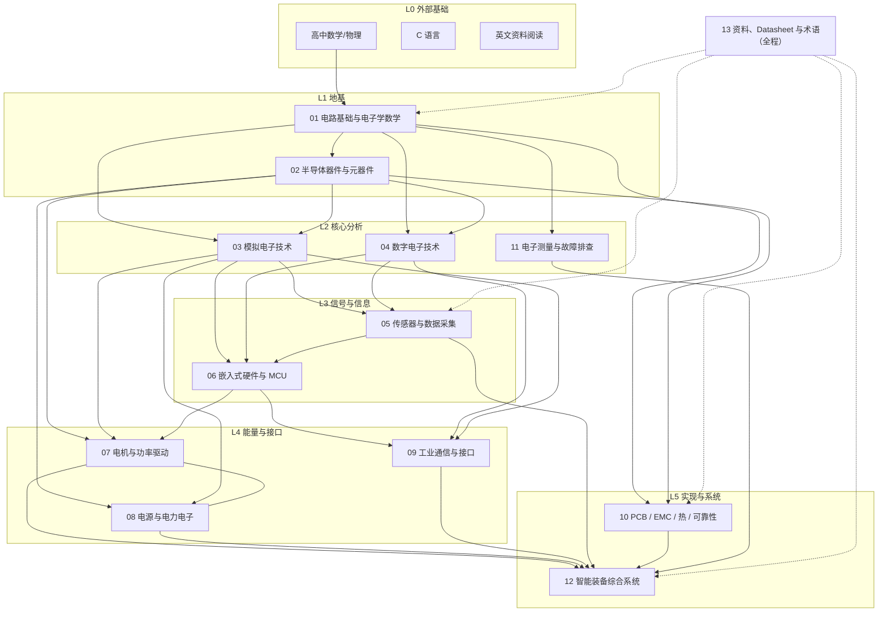
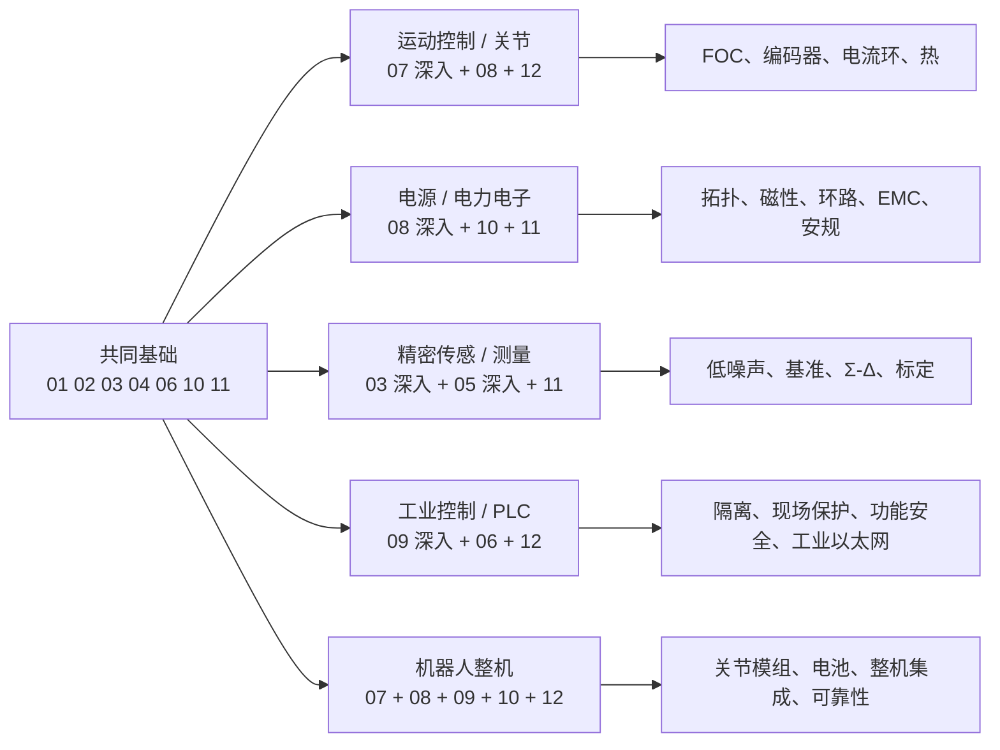

# 知识依赖关系

> 文档编号：EHB-00-03  
> 版本：v0.1.0  
> 日期：2026-11-13  
> 状态：第一轮完成（依赖框架版）  
> 配套文档：《电子硬件完整知识体系》《学习路线与能力地图》

---

## 1. 为什么需要依赖关系

知识体系回答“有哪些内容”，依赖关系回答“先学什么、可以并行什么、什么时候可以停”。没有依赖关系，学习者最容易犯两种错误：

- **线性排队**：把 14 章排成一条线，学完第 3 章才敢碰第 4 章，遇到瓶颈就停摆。
- **跳级堆叠**：直接照着开源项目抄原理图，不知道每个器件为什么在那里，出错后无法定位。

本文件用四种依赖类型把“必须”和“可以”分开，并给出可检查的门禁条件。

---

## 2. 四种依赖类型

| 类型 | 代号 | 含义 | 处理方式 |
|---|---|---|---|
| 硬前置 | H | 不掌握前置，后续内容无法真正理解 | 必须通过门禁检查才能开始 |
| 软前置 | S | 不掌握也能开始，但会在某处卡住 | 先补最小必要知识，边学边补 |
| 并行 | P | 可以同时推进，互相印证 | 同一阶段内交替安排 |
| 应用牵引 | A | 理论可以后补，先在做项目中建立需求感 | 项目后立即回补理论 |

判断标准：

- 如果后续章节的公式/电路**直接使用**前置章节的概念，且没有替代解释，就是 H。
- 如果只是“知道更好”，不影响当前计算与调试，就是 S。
- 如果两章共享同一组物理直觉（如模拟与测量），就是 P。
- 如果先做后学能显著提高理解效率（如 PCB 布局），就是 A。

---

## 3. 知识体系总览图

说明：

- 实线为硬/软前置，无向连线表示 07 与 08 互为应用背景（先学哪个都能开始，但必须尽快补齐另一个）。
- 虚线表示工具性支撑：第 13 章不是前置，而是全程使用的“检索与阅读层”。
- 第 10 章没有画成末端，它从 L2 就应开始（先学叠层/布局，再随项目深入 EMC/热）。

---

## 4. 分层依赖明细

### L0：外部基础（不属本手册，但必须补齐）

| 能力 | 最低要求 | 不满足时的补救 |
|---|---|---|
| 代数与函数 | 解一元二次方程、指数/对数、三角函数 | 第 01 章前两周补 |
| 微积分直觉 | 导数=变化率、积分=累积；不要求复杂积分 | 第 01 章用“斜率/面积”讲电容电感 |
| 物理 | 电场、磁场、功率、能量守恒的定性理解 | 第 02 章补 |
| C 语言 | 变量、函数、指针、位操作 | 与第 06 章并行 |
| 英文 | 能读技术句子，查词后理解 Datasheet | 第 13 章给读法，边读边练 |

### L1：地基

| 节点 | 前置 | 解锁 | 强度 |
|---|---|---|---|
| 01 电路基础 | 代数、物理 | 02、03、04、11 | H |
| 02 器件 | 01（电压/电流/功率） | 03、04、07、08 | H |

### L2：核心分析

| 节点 | 前置 | 解锁 | 强度 |
|---|---|---|---|
| 03 模拟 | 01（戴维南、频率响应）、02（二极管/BJT/MOSFET） | 05、06（模拟外设）、07（采样）、08（环路） | H |
| 04 数字 | 01（RC、阻抗）、02（MOSFET 开关） | 05（ADC）、06、09 | H |
| 11 测量 | 01（分压/阻抗）、02（器件） | 所有实验与项目 | H（可边做边学） |

### L3：信号与信息

| 节点 | 前置 | 解锁 | 强度 |
|---|---|---|---|
| 05 传感与采集 | 03（运放/滤波/噪声）、04（采样/ADC） | 06（接口）、12 | H |
| 06 嵌入式硬件 | 04（电平/时序/总线）、03（模拟外设基础） | 07、09、12 | H |

### L4：能量与接口

| 节点 | 前置 | 解锁 | 强度 |
|---|---|---|---|
| 07 电机与驱动 | 02（MOSFET）、03（运放/比较器）、06（PWM/定时器）、08（母线/电容，可并行） | 12 | H |
| 08 电源与电力电子 | 02（器件/磁性）、03（环路/基准）、07（开关波形，可并行） | 07、12 | H |
| 09 工业通信 | 04（电平/差分）、06（UART/SPI/CAN）、03（4–20 mA 前端） | 12 | H |

### L5：实现与系统

| 节点 | 前置 | 解锁 | 强度 |
|---|---|---|---|
| 10 PCB/EMC/热 | 01、02；03/04 并行；07/08 应用 | 12 | H（但应尽早开始） |
| 12 综合系统 | 05、06、07、08、09、10、11 | 无（终点） | H |
| 13 资料与术语 | 无 | 全程 | S |

---

## 5. 可以并行的学习簇

把所有内容排成一条线是低效的。以下四簇可以同时推进，只要保证每簇内部的前置：

### 簇 A：模拟信号链

`01 → 02 → 03 → 05 →（部分 06 的模拟外设）`

适合喜欢“从物理量到数字”的学习者；与簇 B 共享 01/02，之后分叉。

### 簇 B：数字与嵌入式

`01 → 02 → 04 → 06 → 09 →（部分 12）`

适合喜欢编程与系统集成的学习者；第 04 章之后即可开始 STM32 最小系统。

### 簇 C：能量链

`01 → 02 →（03 的运放/比较器）→ 08 → 07 →（10 的功率布局）`

适合对电机、电源感兴趣的学习者；但必须先完成 02 的 MOSFET 与 03 的运放基础。

### 簇 D：实现与保障

`01 → 02 → 10（叠层/布局）→ 随项目深入 EMC/热 → 11（测量贯穿）`

第 10 章不要留到最后。建议在第 04 章之后就开始画第一块 2 层板，在第 06 章做最小系统，在第 07/08 章做功率板，逐步加深。

### 并行建议

| 阶段 | 主簇 | 并行簇 | 理由 |
|---|---|---|---|
| S1 | A（01/02） | D（测量入门） | 一边学一边测，建立“计算—实测”对照 |
| S2 | A（03） | B（04）、D（PCB 基础） | 模拟与数字互补，PCB 趁热练 |
| S3 | A（05） | B（06） | 传感器必须接到 MCU 才有完整链路 |
| S4 | C（08） | B（09）、D（EMC） | 电源与接口共享保护/布局知识 |
| S5 | C（07） | D（热/可靠性） | 电机驱动是功率与控制的交汇 |
| S6 | 全部 | — | 综合系统 |

---

## 6. 关键路径

**主关键路径**：

`01 电路基础 → 02 器件 → 03 模拟 → 05 传感与采集 → 06 嵌入式 → 07 电机驱动 → 12 综合系统`

**为什么是这条**：

1. 01/02 是所有后续章节的共同前提，无法跳过。
2. 03 是信号链与功率链的共同语言（运放、比较器、基准、噪声）。
3. 05 把“模拟”变成“可采集的数据”，是智能装备感知能力的核心。
4. 06 把“数据”变成“控制”，没有 MCU 就无法闭环。
5. 07 是智能装备区别于普通电子产品的关键执行能力。
6. 12 需要前面所有章节的实物经验，不能提前。

**次关键路径**：

`04 数字 → 06 嵌入式 → 09 工业通信 → 12`

**并行关键路径**：

`10 PCB/EMC → 12`（如果 PCB 拖到最后，综合系统一定延期）

**最短可行路径（只求做出第一台设备）**：

`01 → 02 → 03（只学运放/比较器）→ 04（只学电平/总线）→ 06 → 07（半桥）→ 08（BUCK 模块）→ 10（2 层板）→ 12（简化版）`

这条路径约 300 学时，能做出“能动的设备”，但遇到噪声、EMC、精度问题会缺乏分析能力；只适合作为阶段性目标，不是完整路线。

---

## 7. 方向分支图

分支规则：

- 所有方向都必须完成 BASE，不允许“只学电源不学模电”。
- 分支只在 S4–S6 加权重，不改变共同基础的完整性。
- 一个方向的核心章（如运动控制的 07）要达到 B；相邻章（如 08）达到 B 的基础部分即可。

---

## 8. 常见错误路径（反模式）

| 反模式 | 表现 | 后果 | 纠正 |
|---|---|---|---|
| 先学 EDA，后学电路 | 能画板，但不知道去耦、终端、地平面为什么 | 板子能亮但不稳定 | 先完成 01/02，再学 10 |
| 跳过器件直接模电 | 会算增益，不会选运放/电容 | 设计“纸面正确”，实测失败 | 02 至少完成二极管/MOSFET/电容降额 |
| 先学 FOC 再学半桥 | 满口 d/q 轴，但没看过开关波形 | 无法定位直通、振铃、采样错误 | 先做 07 的半桥与电流采样 |
| 只仿真不测量 | 仿真完美，实物振荡 | 不知道为什么 | 每个模拟电路“算—仿—测”三对照 |
| PCB 留到最后 | 前期全在面包板，最后才画板 | EMC/热问题集中爆发，无法迭代 | 第 04 章后开始第一块 2 层板 |
| 线性排队 | “学完模电再学数电” | 半年无完整作品，失去反馈 | 按并行簇安排 |
| 资料囤积 | 收藏 100G 视频，不动手 | 虚假掌握 | 每节一个最小可验证任务 |
| 直接抄开源项目 | 原理图能跑，换个需求就废 | 无法迁移 | 先读懂每个模块的输入/输出/保护 |

---

## 9. 依赖门禁（可检查的条件）

在开始下一章前，用下面的问题自检。答不出，就回到前置章节补，而不是硬着头皮往下走。

### 9.1 进入第 03 章前

- [ ] 能不用公式，解释“为什么分压电路带负载后输出会下降”。
- [ ] 能画出二极管的伏安特性，并说明正向导通/反向击穿。
- [ ] 能说出 MOSFET 的 Rds(on) 随温度如何变化。
- [ ] 能用 LTspice 跑通 RC 低通，并读出 -3 dB 频率。

### 9.2 进入第 05 章前

- [ ] 能设计同相/反相放大器，算出增益与输入阻抗。
- [ ] 能解释运放的 GBW 对闭环带宽的限制。
- [ ] 能说出采样定理，并解释混叠。
- [ ] 能用示波器测量一个 1 kHz 正弦的幅值与相位差。

### 9.3 进入第 06 章前

- [ ] 能解释推挽/开漏输出的区别。
- [ ] 能读懂 SPI 的 CPOL/CPHA 时序图。
- [ ] 能说出 MCU 复位电路的作用与典型结构。
- [ ] 能用手算 RC 时间常数解释复位延时。

### 9.4 进入第 07 章前

- [ ] 能解释半桥直通的成因与死区的作用。
- [ ] 能说出栅极电荷与驱动电流的关系。
- [ ] 能用示波器安全测量低边 MOSFET 的 Vds（差分/隔离方法）。
- [ ] 能解释续流二极管/同步整流的作用。

### 9.5 进入第 08 章前

- [ ] 能画出 BUCK 的两种开关状态，并推导占空比。
- [ ] 能计算电感电流纹波。
- [ ] 能解释为什么陶瓷电容的容值随直流偏压下降。
- [ ] 能用地线弹簧/差分探头测量输出纹波。

### 9.6 进入第 12 章前

- [ ] 至少完成 5 个前面的项目，且有测试报告。
- [ ] 能独立画一块 4 层板并完成 bring-up。
- [ ] 能写接口控制文档（ICD）与测试大纲。
- [ ] 能对一处故障完成“现象→假设→测量→根因→预防”的闭环。

---

## 10. 依赖关系的变更管理

- 任何章节顺序调整，必须说明是否破坏 H 依赖；破坏则不允许。
- 新增知识点，先判断它属于哪个簇、依赖谁、解锁谁，再决定放在哪一章。
- 删除知识点，检查是否有下游章节引用；有则改为“选读”或保留索引。
- 每次版本更新，在《项目执行与版本记录》中记录变更原因与影响范围。

---

## 11. 一页纸总结

1. **地基只有两块**：01 电路、02 器件。它们不牢，后面全是背结论。
2. **三条主路径**：模拟链（03→05）、数字链（04→06→09）、能量链（08→07）。
3. **一条保障线**：10 PCB/EMC 与 11 测量，从第 1 周开始，不要留到最后。
4. **一个终点**：12 综合系统，必须等前面有实物经验再启动。
5. **一条工具线**：13 资料与 Datasheet，全程使用。
6. **不要线性排队**：按簇并行，按门禁推进。
