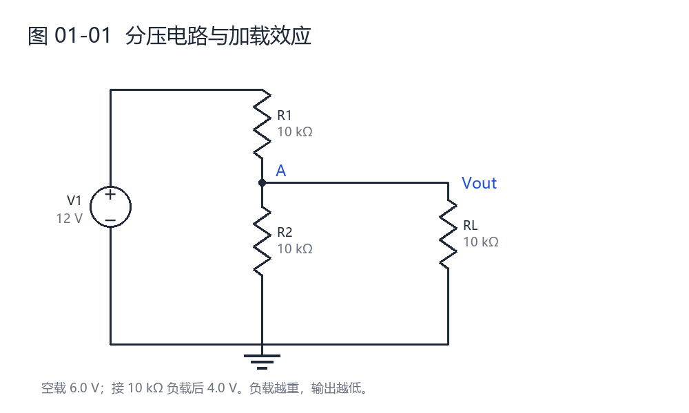
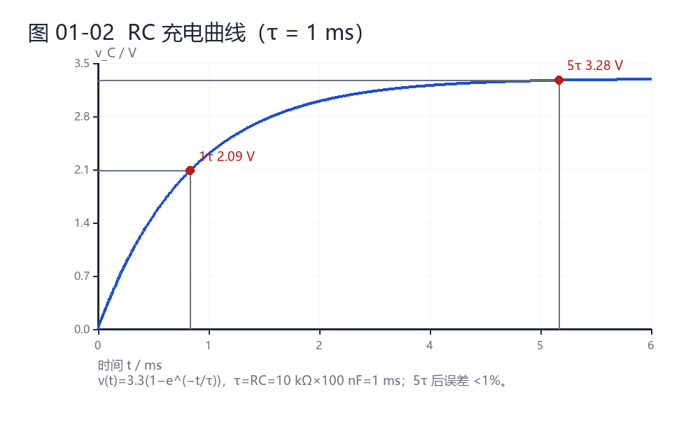
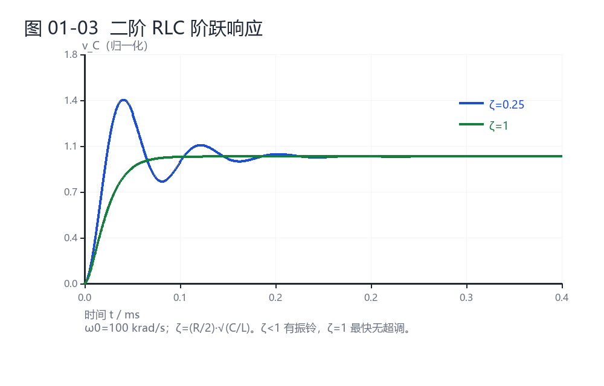

# 第 01 章 电路基础与电子学数学（上）

> 文档编号：EHB-01-01  
> 版本：v0.2.0  
> 日期：2026-11-13  
> 状态：草稿（待技术复核）  
> 深度：A  
> 前置：高中代数、物理  
> 对应项目：P1

---

## 1.0 本章要解决的工程问题

一台 24 V 供电的智能装备，要把一个 0–10 V 的传感器输出接到 STM32 的 3.3 V ADC。最容易想到的做法是“两个电阻分压”。但你会立刻遇到四个问题：

1. 分压比算出来是 0.33，为什么接上 ADC 后读数偏低？
2. 传感器输出阻抗 10 kΩ，分压电阻取 1 kΩ 还是 100 kΩ？
3. 传感器信号里有 50 Hz 工频干扰，加一个 RC 低通，截止频率取多少？
4. 电机启动时电源跌到 20 V，分压后的读数会怎样变化？

这四个问题分别对应：**加载效应、阻抗匹配、频率响应、电源抑制**。本章的目标不是背公式，而是让你能对这样的电路做出可验证的预测：先手算，再用 LTspice 仿真，最后用万用表和示波器测量，并解释三者差异。

本章分上下两篇：上篇（1.1–1.7）讲直流、动态与二阶电路；下篇（1.8–1.13）讲交流、频域、噪声、公差与仿真。

---

## 本章学习目标与先修检查

学完本章，你应当能够：

- 给定一个由电阻、电容、电感、独立源组成的电路，写出 KCL/KVL 方程并求解直流工作点。
- 用戴维南等效把一个复杂网络化简为“一个电压源 + 一个电阻”，并判断负载效应。
- 计算一阶 RC/RL 电路的时间常数、任意时刻的电压/电流，以及 5τ 建立的误差。
- 根据 R、L、C 判断二阶系统的阻尼状态，解释振铃与谐振。
- 用相量法计算正弦稳态的电流、相位与功率。
- 画出/读懂一阶低通的 Bode 图，解释截止频率、斜率与相位。
- 用分贝、噪声密度、均方根合成做简单的噪声估算。

**先修自检**（答不出就先补，不丢人）：

- [ ] 会解一元一次方程与二元一次方程组。
- [ ] 知道指数函数 $e^{-t/\tau}$ 随 $t$ 增大而衰减。
- [ ] 知道复数 $a+jb$ 的模与幅角。
- [ ] 知道功率的单位是 W，能量是 J。
- [ ] 能区分“电压源”和“电流源”的符号。

**符号与单位约定**

| 符号 | 含义 | 单位 |
|---|---|---|
| $u,i$ | 电压、电流（瞬时值） | V、A |
| $U,I$ | 直流或有效值 | V、A |
| $R,G$ | 电阻、电导 | Ω、S |
| $p,P$ | 瞬时功率、平均功率 | W |
| $q,C$ | 电荷、电容 | C、F |
| $\lambda,L$ | 磁链、电感 | Wb、H |
| $\tau$ | 时间常数 | s |
| $\omega,f,T$ | 角频率、频率、周期 | rad/s、Hz、s |
| $Z,X$ | 阻抗、电抗 | Ω |
| $\zeta,Q$ | 阻尼比、品质因数 | 无量纲 |

---

## 1.1 电路变量、参考方向与功率

### 1.1.1 电荷、电流、电压、电阻、电导

电荷 $q$ 的单位是库仑（C）。电流是电荷的定向移动率：

$$
i(t)=\frac{dq(t)}{dt}
\tag{1-1}
$$

1 A 表示每秒通过 1 C 电荷。实际电路中，电子从低电位流向高电位，但工程上统一规定**电流的正方向为正电荷流动方向**，即从高电位流向低电位。这个规定不影响结果，只要全电路一致。

电压（电位差）$u_{ab}=V_a-V_b$，单位伏特（V）。1 V 表示移动 1 C 电荷做功 1 J。电压必须说明“两点之间”，单独说“某点电压”默认以地为参考点（0 V）。

电阻 $R$ 的单位欧姆（Ω），电导 $G=1/R$，单位西门子（S）。一段均匀导体的电阻：

$$
R=\rho\frac{l}{A}
\tag{1-2}
$$

其中 $\rho$ 是电阻率（Ω·m），$l$ 是长度（m），$A$ 是截面积（m²）。这解释了为什么 PCB 走线越长、越细，电阻越大；为什么大电流路径要铺铜。

### 1.1.2 参考方向与关联参考方向

电路图上的箭头不是“电流真的往这流”，而是**参考方向**。计算结果为正，说明实际方向与参考方向一致；为负，说明相反。

功率的符号最容易错。采用**关联参考方向**（电流从电压的“+”端流入）：

$$
p(t)=u(t)\,i(t)
\tag{1-3}
$$

- $p>0$：元件吸收功率（电阻、电容充电、电机做功）。
- $p<0$：元件发出功率（电源、放电的电容）。

如果电流从“+”端流出，则 $p=-ui$。**先定参考方向，再谈正负**，这是电路分析的第一条纪律。

### 1.1.3 电功率、电能与能量守恒

直流情况下：

$$
P=UI=I^2R=\frac{U^2}{R}
\tag{1-4}
$$

电能 $W=Pt$，单位 J；工程上常用 kWh（1 kWh = 3.6×10⁶ J）。

**例 1-1** 12 V 电源给 3 Ω 负载供电，求电流、负载功率、电源发出功率。

解：

$$
I=\frac{U}{R}=\frac{12}{3}=4\ \text{A}
$$

$$
P_R=I^2R=4^2\times3=48\ \text{W}
$$

理想电源发出 48 W，负载吸收 48 W，能量守恒。若电源内阻 0.5 Ω，则总电阻 3.5 Ω，$I=3.43$ A，负载功率 $I^2\times3=35.3$ W，内阻消耗 $I^2\times0.5=5.9$ W，电源总发出 $12\times3.43=41.1$ W。**内阻不是小事**：电机启动、电池供电、长线供电都要算。

### 1.1.4 常见错误

- 把“电压”当成某一点的绝对量，不说明参考点。
- 电流方向改了，却忘记把功率符号一起改。
- 用 $P=U^2/R$ 时，$U$ 取的是电源电压而不是元件两端电压。

---

## 1.2 基尔霍夫定律与电阻网络

### 1.2.1 KCL 与 KVL

**KCL（节点电流定律）**：流入任一节点的电流代数和为零。

$$
\sum_{k=1}^{n} i_k=0
\tag{1-5}
$$

本质是电荷守恒：节点不能积累电荷（除非有电容，见 1.6）。

**KVL（回路电压定律）**：沿任一闭合回路，电压降代数和为零。

$$
\sum_{k=1}^{m} u_k=0
\tag{1-6}
$$

本质是能量守恒：绕一圈回到原点，电位差为零。

### 1.2.2 串联、并联与分压、分流

两个电阻串联：

$$
R_{eq}=R_1+R_2,\qquad
u_1=U\frac{R_1}{R_1+R_2},\qquad
u_2=U\frac{R_2}{R_1+R_2}
\tag{1-7}
$$

两个电阻并联：

$$
R_{eq}=\frac{R_1R_2}{R_1+R_2},\qquad
i_1=I\frac{R_2}{R_1+R_2},\qquad
i_2=I\frac{R_1}{R_1+R_2}
\tag{1-8}
$$

注意分流公式的分子是“另一个电阻”——电流走电阻小的路。

### 1.2.3 加载效应：分压器不是理想的

设 $R_1$ 接电源 $U$，$R_2$ 接地，输出取自 $R_2$。空载时：

$$
U_{out}=U\frac{R_2}{R_1+R_2}
\tag{1-9}
$$

接上负载 $R_L$ 后，$R_2$ 与 $R_L$ 并联：

$$
U_{out}'=U\frac{R_2\parallel R_L}{R_1+(R_2\parallel R_L)}
\tag{1-10}
$$

**例 1-2** $U=12$ V，$R_1=R_2=10$ kΩ，$R_L=10$ kΩ。空载输出 6 V；接负载后 $R_2\parallel R_L=5$ kΩ，输出：

$$
U_{out}'=12\times\frac{5}{10+5}=4\ \text{V}
$$

误差 33%。如果这是 ADC 采样，读数会从 6 V 变成 4 V，而且负载变化时读数跟着变。

*图 01-01 分压电路与加载效应。空载 6.0 V，接 10 kΩ 负载后 4.0 V。*

**工程判据**：若要求加载误差小于 1%，一般取 $R_L\ge 100(R_1\parallel R_2)$；或者用运放缓冲（第 03 章）。对 ADC 输入，还要考虑采样保持电容的电荷注入，见 04 章。

### 1.2.4 常见错误

- 分压公式直接套用，不看负载。
- 把“并联”算成“串联”。
- 用万用表测高阻节点，万用表内阻（10 MΩ）也会加载。

---

## 1.3 受控源与二端口初步

### 1.3.1 四种受控源

| 类型 | 符号 | 控制量 | 输出量 | 典型器件 |
|---|---|---|---|---|
| VCVS | 菱形 + | 电压 | 电压 | 理想运放（近似） |
| VCCS | 菱形 → | 电压 | 电流 | MOSFET 饱和区、跨导放大器 |
| CCVS | 菱形 + | 电流 | 电压 | 电流检测放大器（近似） |
| CCCS | 菱形 → | 电流 | 电流 | BJT 电流镜 |

受控源是“有源”元件，可以提供能量（由电源供给），不能单独用电阻等效。

### 1.3.2 输入/输出阻抗与加载

任何放大电路都可以近似为：

- 输入电阻 $R_{in}$：从输入端看进去的等效电阻。
- 输出电阻 $R_{out}$：从输出端看进去，独立源置零后的等效电阻。
- 开路增益 $A_{vo}$。

接上信号源内阻 $R_s$ 和负载 $R_L$ 后，实际增益：

$$
A_v=A_{vo}\cdot\frac{R_{in}}{R_s+R_{in}}\cdot\frac{R_L}{R_{out}+R_L}
\tag{1-11}
$$

**例 1-3** $A_{vo}=10$，$R_{in}=10$ kΩ，$R_{out}=100$ Ω，$R_s=1$ kΩ，$R_L=1$ kΩ：

$$
A_v=10\times\frac{10}{11}\times\frac{1000}{1100}=8.26
$$

比 10 少了 17%。这就是为什么传感器前端要“高输入阻抗、低输出阻抗”：前者减少对信号源的加载，后者增强带负载能力。

### 1.3.3 二端口网络

用 $Z$ 参数描述：

$$
\begin{cases}
u_1=Z_{11}i_1+Z_{12}i_2\\
u_2=Z_{21}i_1+Z_{22}i_2
\end{cases}
\tag{1-12}
$$

入门阶段不需要记矩阵，只要知道：**输入端看进去的阻抗会受输出端负载影响，反之亦然**。这正是“加载效应”的一般化。

---

## 1.4 节点法、网孔法与叠加定理

### 1.4.1 节点法

步骤：

1. 选一个节点为参考地（0 V）。
2. 对其余节点列 KCL，用节点电压表示支路电流。
3. 解线性方程组。

**例 1-4** 节点 A 通过 $R_1=1$ kΩ 接 5 V 源，通过 $R_2=2$ kΩ 接地，通过 $R_3=1$ kΩ 接 3.3 V 源。求 $V_A$。

KCL（流出为正）：

$$
\frac{V_A-5}{1k}+\frac{V_A}{2k}+\frac{V_A-3.3}{1k}=0
$$

两边乘 2k：

$$
2(V_A-5)+V_A+2(V_A-3.3)=0
$$

$$
5V_A=10+6.6=16.6 \Rightarrow V_A=3.32\ \text{V}
$$

### 1.4.2 网孔法

对每个独立回路设网孔电流，列 KVL。网孔法适合平面电路、回路少的情况；节点法适合节点少、电流源多的情况。两种方法结果必须一致，可作为验算。

### 1.4.3 叠加定理

线性电路中，多个独立源共同作用时，任一支路的响应等于各独立源单独作用（其余电压源短路、电流源开路）时响应之和。

**适用条件**：线性电路；功率不能叠加（功率与电压/电流平方成正比）。

**例 1-5** 用叠加求例 1-4 的 $V_A$。

- 5 V 单独作用（3.3 V 源短路）：$R_2\parallel R_3=2k\parallel1k=0.667k$，$V_A'=5\times0.667/(1+0.667)=2.0$ V。
- 3.3 V 单独作用（5 V 源短路）：$R_1\parallel R_2=0.667k$，$V_A''=3.3\times0.667/(1+0.667)=1.32$ V。
- 合计 $V_A=3.32$ V，与节点法一致。

### 1.4.4 常见错误

- 叠加时把电压源“开路”、电流源“短路”（正好相反）。
- 用叠加算功率。
- 节点方程符号混乱：建议统一“流出节点为正”。

---

## 1.5 戴维南与诺顿等效

### 1.5.1 定理内容

任何线性含源二端网络，对外都可以等效为：

- 戴维南：电压源 $U_{oc}$ 串联电阻 $R_{th}$。
- 诺顿：电流源 $I_{sc}$ 并联电阻 $R_{th}$。

其中 $U_{oc}$ 是开路电压，$I_{sc}$ 是短路电流，$R_{th}=U_{oc}/I_{sc}$。

### 1.5.2 求法

1. 开路：算 $U_{oc}$。
2. 短路：算 $I_{sc}$（注意电流方向）。
3. 独立源置零：电压源短路、电流源开路，算等效电阻 $R_{th}$。

**例 1-6** 12 V 源经 $R_1=10$ kΩ、$R_2=10$ kΩ 分压，输出端开路。求戴维南等效。

$$
U_{oc}=12\times\frac{10}{20}=6\ \text{V},\qquad
R_{th}=R_1\parallel R_2=5\ \text{k}\Omega
$$

接 $R_L=10$ kΩ：

$$
U_L=6\times\frac{10}{5+10}=4\ \text{V}
$$

与例 1-2 一致。戴维南把“分压 + 加载”变成了一个简单回路。

### 1.5.3 最大功率传输

负载获得最大功率的条件是 $R_L=R_{th}$，最大功率：

$$
P_{max}=\frac{U_{oc}^2}{4R_{th}}
\tag{1-13}
$$

注意：这是“负载获得最大功率”，不是“效率最高”。电力系统追求效率，信号系统才追求功率匹配。

### 1.5.4 工程意义

- 传感器输出可以等效为“电压源 + 内阻”，后级输入阻抗必须远大于内阻。
- MCU 的 ADC 输入可以等效为“采样电容 + 开关电阻”，外部源阻抗会影响建立时间。
- 电源可以等效为“理想电压源 + 输出阻抗”，负载跳变时电压跌落由输出阻抗和环路带宽决定。

---

## 1.6 电容、电感与一阶电路

### 1.6.1 物理原理

电容存储电荷：

$$
q=Cv,\qquad i=C\frac{dv}{dt},\qquad
W_C=\frac{1}{2}Cv^2
\tag{1-14}
$$

电感存储磁链：

$$
\lambda=Li,\qquad v=L\frac{di}{dt},\qquad
W_L=\frac{1}{2}Li^2
\tag{1-15}
$$

两个直接推论：

- 电容电压不能突变（否则 $i=C\,dv/dt$ 无穷大）。
- 电感电流不能突变（否则 $v=L\,di/dt$ 无穷大）。

这就是“上电瞬间电容相当于短路、电感相当于开路”的原因，也是浪涌电流与续流二极管的由来。

### 1.6.2 一阶 RC 电路

设 $U$ 经 $R$ 给 $C$ 充电，初始 $v_C(0)=0$。KVL：

$$
U=Ri+v_C=RC\frac{dv_C}{dt}+v_C
\tag{1-16}
$$

解：

$$
v_C(t)=U\left(1-e^{-t/\tau}\right),\qquad \tau=RC
\tag{1-17}
$$

放电（初始 $U_0$）：

$$
v_C(t)=U_0e^{-t/\tau}
\tag{1-18}
$$

**5τ 规则**：$t=5\tau$ 时达到终值的 99.3%，工程上认为“基本稳定”。

**例 1-7** 3.3 V 经 10 kΩ 给 100 nF 充电：

$$
\tau=10^4\times10^{-7}=1\ \text{ms}
$$

$t=1$ ms 达到 63.2%（2.09 V）；$t=5$ ms 达到 99.3%（3.28 V）。如果 ADC 采样开关在 1 µs 内闭合，电容只充到约 0.1%，读数严重偏低——这就是“采样时间不足”的物理根源。

*图 01-02 RC 充电曲线。τ=1 ms，5τ 后误差小于 1%。*

### 1.6.3 一阶 RL 电路

设 $U$ 经 $R$ 给 $L$ 通电，初始 $i_L(0)=0$：

$$
i_L(t)=\frac{U}{R}\left(1-e^{-t/\tau}\right),\qquad \tau=\frac{L}{R}
\tag{1-19}
$$

断电时，电感电流不能突变，会通过续流二极管/寄生电容形成回路，产生高压尖峰。这是继电器、电机、电磁阀必须加续流二极管的原因。

### 1.6.4 三要素法

对一阶电路，任何变量都可以写成：

$$
x(t)=x(\infty)+\left[x(0^+)-x(\infty)\right]e^{-t/\tau}
\tag{1-20}
$$

三要素：初始值 $x(0^+)$、终值 $x(\infty)$、时间常数 $\tau$。求 $\tau$ 时，把独立源置零，从储能元件两端看进去求等效电阻 $R_{eq}$，$\tau=R_{eq}C$ 或 $L/R_{eq}$。

### 1.6.5 常见错误

- 认为电容电压可以瞬间跳变（把电容当导线）。
- 认为电感电流可以瞬间切断（不做续流）。
- 求 $\tau$ 时用错电阻：不是“看到的第一个电阻”，而是储能元件两端的等效电阻。
- 忽略电容的 ESR/ESL，导致高频滤波失效。

---

## 1.7 二阶 RLC 与谐振

### 1.7.1 串联 RLC 的微分方程

$R$、$L$、$C$ 串联，输入 $u_s$，取电容电压 $v_C$：

$$
LC\frac{d^2v_C}{dt^2}+RC\frac{dv_C}{dt}+v_C=u_s
\tag{1-21}
$$

标准形式：

$$
\frac{d^2v_C}{dt^2}+2\alpha\frac{dv_C}{dt}+\omega_0^2v_C=\omega_0^2u_s
\tag{1-22}
$$

$$
\alpha=\frac{R}{2L},\qquad \omega_0=\frac{1}{\sqrt{LC}},\qquad \zeta=\frac{\alpha}{\omega_0}=\frac{R}{2}\sqrt{\frac{C}{L}}
\tag{1-23}
$$

### 1.7.2 三种阻尼

| 条件 | 名称 | 阶跃响应 | 工程含义 |
|---|---|---|---|
| $\zeta>1$ | 过阻尼 | 无超调，缓慢 | 大电阻/小电感，响应慢 |
| $\zeta=1$ | 临界阻尼 | 最快无超调 | 常作为设计目标 |
| $\zeta<1$ | 欠阻尼 | 振荡衰减 | 振铃、EMI、过冲 |

欠阻尼时的阻尼振荡频率：

$$
\omega_d=\omega_0\sqrt{1-\zeta^2}
\tag{1-24}
$$

品质因数：

$$
Q=\frac{1}{2\zeta}
\tag{1-25}
$$

**例 1-8** $L=10$ µH，$C=10$ µF，$R=2$ Ω：

$$
\omega_0=\frac{1}{\sqrt{10^{-5}\times10^{-5}}}=10^5\ \text{rad/s}
$$

$$
\alpha=\frac{2}{2\times10^{-5}}=10^5,\qquad \zeta=1
$$

临界阻尼。若 $R=0.5$ Ω，$\alpha=2.5\times10^4$，$\zeta=0.25$，$Q=2$，阶跃响应会有明显振铃，频率约 15.4 kHz（$\omega_d\approx96.8$ krad/s）。

### 1.7.3 谐振

串联谐振角频率：

$$
\omega_0=\frac{1}{\sqrt{LC}},\qquad f_0=\frac{1}{2\pi\sqrt{LC}}
\tag{1-26}
$$

谐振时 $X_L=X_C$，阻抗最小（$Z=R$），电流最大；电感与电容电压可能远高于源电压，$Q$ 倍：

$$
U_L=U_C=QU_s
\tag{1-27}
$$

这就是“谐振升压”现象，也是为什么开关电源、电机电缆、长线在特定频率会过压。

*图 01-03 二阶 RLC 阶跃响应。ζ=0.25 时振铃，ζ=1 时最快无超调。*

### 1.7.4 工程意义

- 去耦电容与 PCB 寄生电感形成谐振，可能在某个频点阻抗反而升高。
- 电机电缆的分布电容与电感形成谐振，导致开关振铃。
- 机械系统的惯量与弹簧也会形成二阶振荡，控制环需要阻尼。

### 1.7.5 常见错误

- 只看 $\omega_0$ 不看 $\zeta$，以为“谐振频率对就行”。
- 忽略电阻对阻尼的影响。
- 把 $Q$ 当成“品质好”的同义词；在高频谐振里，高 $Q$ 往往意味着更难驯服。

---

## 上篇小结与检查清单

### 小结

1. 电路分析的第一步是定参考方向；功率符号由关联参考方向决定。
2. KCL/KVL 是全部方法的起点；节点法适合少节点，网孔法适合少回路。
3. 分压器一带负载就变；工程上用“负载阻抗 ≥ 100 倍源阻抗”或加缓冲。
4. 戴维南把复杂网络变成“电压源 + 电阻”，是判断加载、噪声、驱动能力的基本工具。
5. 电容电压、电感电流不能突变；一阶电路用三要素法。
6. 二阶电路由 $\omega_0$ 与 $\zeta$ 共同决定；谐振可能带来过压与振铃。

### 检查清单

- [ ] 能画出并标注参考方向。
- [ ] 能用节点法解两节点电路，并用叠加验算。
- [ ] 能求戴维南等效并计算加载后的输出。
- [ ] 能写出 RC 充电的 $v(t)$ 并算出 5τ。
- [ ] 能根据 R、L、C 判断欠阻尼/临界/过阻尼。
- [ ] 能解释为什么继电器线圈要加续流二极管。
- [ ] 能说出谐振时为什么电压会升高。

### 实验与仿真

本章对应 P1 实验 1（分压/戴维南）与实验 2（RC 充放电），步骤见[《基础实验手册》](../12_智能装备综合硬件系统/实验/00_基础实验手册.md)。仿真文件：

- [rc_step.cir](../99_资源/仿真/01/rc_step.cir)
- [rlc_series.cir](../99_资源/仿真/01/rlc_series.cir)

### 参考资料

- [REF-I01] 邱关源《电路》第 5 版，第 1–7 章。
- [REF-A01] ADI *Linear Circuit Design Handbook*，第 1、10 章。
- [REF-A04] LTspice 官方教程。
