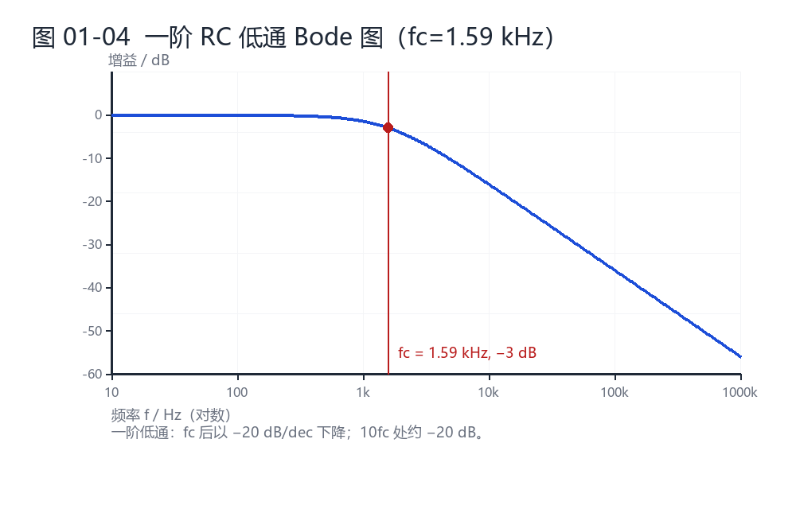

# 第 01 章 电路基础与电子学数学（下）

> 文档编号：EHB-01-02  
> 版本：v0.2.0  
> 日期：2026-11-13  
> 状态：草稿（待技术复核）  
> 深度：A/B  
> 前置：第 01 章上篇（1.1–1.7）  
> 对应项目：P1

---

## 1.8 正弦稳态与相量

### 1.8.1 正弦量的三要素

$$
u(t)=U_m\cos(\omega t+\varphi)
\tag{1-28}
$$

- $U_m$：峰值（V）。
- $\omega=2\pi f$：角频率（rad/s）。
- $\varphi$：初相位（rad 或 °）。

周期 $T=1/f$，频率 $f$（Hz）。市电 220 V/50 Hz 指有效值；峰值为 $220\sqrt{2}\approx311$ V。

有效值（RMS）定义为与直流产生相同热效应的值：

$$
U_{rms}=\sqrt{\frac{1}{T}\int_0^T u^2(t)\,dt}=\frac{U_m}{\sqrt{2}}
\tag{1-29}
$$

**例 1-9** $u(t)=10\sin(2\pi\cdot1000t)$ V，则 $U_m=10$ V，$U_{rms}=7.07$ V，$f=1$ kHz，$T=1$ ms。

### 1.8.2 相量与阻抗

把正弦量写成相量 $\dot{U}=U_{rms}\angle\varphi$（也可用峰值，全文统一即可）。微分变成乘 $j\omega$：

$$
\frac{d}{dt}\;\longleftrightarrow\;j\omega
\tag{1-30}
$$

于是：

$$
Z_R=R,\qquad Z_L=j\omega L,\qquad Z_C=\frac{1}{j\omega C}=-j\frac{1}{\omega C}
\tag{1-31}
$$

感抗 $X_L=\omega L$，容抗 $X_C=1/(\omega C)$。阻抗的模与幅角：

$$
|Z|=\sqrt{R^2+(X_L-X_C)^2},\qquad
\varphi_Z=\arctan\frac{X_L-X_C}{R}
\tag{1-32}
$$

### 1.8.3 串联 RLC 的交流分析

**例 1-10** $R=1$ kΩ，$L=10$ mH，$C=100$ nF，$u(t)=10\sin(2\pi\cdot1000t)$ V。求电流有效值与相位。

$\omega=6283$ rad/s：

$$
X_L=62.8\ \Omega,\qquad X_C=\frac{1}{6283\times10^{-7}}=1591.5\ \Omega
$$

$$
Z=1000+j(62.8-1591.5)=1000-j1528.7\ \Omega
$$

$$
|Z|=\sqrt{1000^2+1528.7^2}=1827\ \Omega,\qquad
\varphi_Z=-56.8^\circ
$$

电压峰值 10 V，电流峰值 $10/1827=5.47$ mA，有效值 3.87 mA。电流**超前**电压 56.8°（容性）。

### 1.8.4 交流功率

瞬时功率在一个周期内的平均值为有功功率：

$$
P=U_{rms}I_{rms}\cos\varphi
\tag{1-33}
$$

无功功率：

$$
Q=U_{rms}I_{rms}\sin\varphi
\tag{1-34}
$$

视在功率：

$$
S=U_{rms}I_{rms}=\sqrt{P^2+Q^2}
\tag{1-35}
$$

功率因数 $\cos\varphi$。例 1-10 中：

$$
P=7.07\times3.87\times10^{-3}\times\cos(-56.8^\circ)=15.0\ \text{mW}
$$

$$
Q=7.07\times3.87\times10^{-3}\times\sin(-56.8^\circ)=-22.9\ \text{mvar}
$$

负号表示容性无功（电流超前）。电阻消耗有功，电感/电容只交换无功。

### 1.8.5 常见错误

- 峰值与有效值混用：示波器读峰值，功率公式用有效值。
- 相量相加时直接加模，忘记矢量合成。
- 认为电容“消耗”无功功率（它只是交换）。

---

## 1.9 频率响应与 Bode 图

### 1.9.1 传递函数

线性时不变电路的正弦稳态响应与输入之比：

$$
H(j\omega)=\frac{\dot{Y}(j\omega)}{\dot{X}(j\omega)}
=|H|\angle\varphi
\tag{1-36}
$$

一阶 RC 低通（输出取电容电压）：

$$
H(j\omega)=\frac{1}{1+j\omega RC},\qquad
|H|=\frac{1}{\sqrt{1+(\omega RC)^2}},\qquad
\varphi=-\arctan(\omega RC)
\tag{1-37}
$$

截止频率（$-3$ dB，即 $|H|=1/\sqrt{2}$）：

$$
f_c=\frac{1}{2\pi RC}
\tag{1-38}
$$

**例 1-11** $R=10$ kΩ，$C=10$ nF：

$$
f_c=\frac{1}{2\pi\times10^4\times10^{-8}}=1591.5\ \text{Hz}
$$

在 $f=f_c$ 时 $|H|=0.707$（-3 dB），相位 -45°；在 $10f_c$ 时 $|H|\approx0.0995$（-20 dB），相位 -84.3°；在 $0.1f_c$ 时 $|H|\approx0.995$（-0.04 dB），相位 -5.7°。

### 1.9.2 Bode 图的读法

- 幅频：横轴对数频率，纵轴 $20\log_{10}|H|$（dB）。
- 一阶低通：低频 0 dB，高频以 -20 dB/dec 下降，转折点在 $f_c$。
- 一阶高通：低频 +20 dB/dec，高频 0 dB。
- 二阶低通：高频 -40 dB/dec；$Q>0.707$ 时在 $f_0$ 附近有峰值。

Bode 图的价值在于“看趋势”：不用逐点算，就能判断滤波是否足够、相位裕度是否危险。



*图 01-04 一阶 RC 低通 Bode 图。fc=1.59 kHz，之后以 −20 dB/dec 下降。*

### 1.9.3 谐振与带宽

串联 RLC 的谐振频率与品质因数：

$$
f_0=\frac{1}{2\pi\sqrt{LC}},\qquad
Q=\frac{1}{R}\sqrt{\frac{L}{C}},\qquad
BW=\frac{f_0}{Q}
\tag{1-39}
$$

$Q$ 越高，谐振峰越尖，带宽越窄。例：$L=10$ mH，$C=100$ nF，$R=10$ Ω：

$$
f_0=5033\ \text{Hz},\qquad Q=31.6,\qquad BW=159\ \text{Hz}
$$

谐振时电感/电容电压为源电压的 $Q$ 倍（本例 31.6 倍！），实际电路会受寄生电阻限制，但足以损坏器件。

### 1.9.4 工程意义

- 传感器信号带宽必须小于 ADC 采样率的一半，否则混叠。
- 抗混叠滤波器通常用二阶或更高阶；一阶在 $10f_c$ 只有 -20 dB，不够。
- 电源环路带宽与相位裕度决定负载跳变时的过冲。
- 电机电缆的谐振频率可能在数百 kHz 到数 MHz，与 PWM 边沿谐波重合时产生振铃。

### 1.9.5 常见错误

- 只看幅频不看相频：相位裕度不足会振荡。
- 把 $f_c$ 当成“完全截止”：它只是 -3 dB。
- 忽略探头/电缆电容对高频测量的影响。

---

## 1.10 傅里叶、拉普拉斯与传递函数 [C]

> **可跳过**：本节只要求“会用、会看图”，不要求完整推导。首次阅读可记住：傅里叶看“由哪些频率组成”，拉普拉斯看“系统对阶跃/正弦的响应”。

### 1.10.1 傅里叶：信号由频率组成

周期信号可以分解为直流 + 基波 + 各次谐波：

$$
x(t)=a_0+\sum_{n=1}^{\infty}\left(a_n\cos n\omega_0t+b_n\sin n\omega_0t\right)
\tag{1-40}
$$

方波（幅度 $A$，周期 $T$）的傅里叶级数：

$$
x(t)=\frac{4A}{\pi}\left(\sin\omega_0t+\frac{1}{3}\sin3\omega_0t+\frac{1}{5}\sin5\omega_0t+\cdots\right)
\tag{1-41}
$$

这解释了：

- PWM 边沿越陡，谐波越丰富，EMI 越难做。
- 开关电源的开关频率及其谐波是传导/辐射发射的主要来源。
- 方波通过低通滤波器后，边沿变缓、过冲/振铃。

### 1.10.2 拉普拉斯：把微分方程变成代数

定义（单边）：

$$
X(s)=\int_0^{\infty}x(t)e^{-st}\,dt,\qquad s=\sigma+j\omega
\tag{1-42}
$$

常用变换：

| $x(t)$ | $X(s)$ |
|---|---|
| 阶跃 $1(t)$ | $1/s$ |
| 指数 $e^{-at}$ | $1/(s+a)$ |
| 正弦 $\sin\omega t$ | $\omega/(s^2+\omega^2)$ |
| 微分 $dx/dt$ | $sX(s)-x(0^-)$ |
| 积分 $\int x\,dt$ | $X(s)/s$ |

电容阻抗在 s 域为 $1/(sC)$，电感为 $sL$。一阶 RC 低通：

$$
H(s)=\frac{1}{1+sRC}
\tag{1-43}
$$

极点 $s=-1/(RC)$，在左半平面，稳定。阶跃响应：

$$
v_C(t)=U\left(1-e^{-t/RC}\right)
\tag{1-44}
$$

### 1.10.3 极点、零点与稳定性

- 极点：分母为零的 $s$，决定系统的自然响应。
- 零点：分子为零的 $s$，影响响应形状。
- 所有极点实部为负 → 稳定；有右半平面极点 → 发散；虚轴上 → 临界振荡。

入门阶段只需记住：**看波特图的高频斜率与相位，就能大致判断极点数；看极点位置，就能判断稳定性。**

---

## 1.11 分贝、噪声与信噪比

### 1.11.1 分贝

功率比：

$$
L_P=10\log_{10}\frac{P_2}{P_1}\ \text{dB}
\tag{1-45}
$$

电压比（同一阻抗）：

$$
L_V=20\log_{10}\frac{U_2}{U_1}\ \text{dB}
\tag{1-46}
$$

常用值：×2 ≈ +6 dB，×10 = +20 dB，×0.1 = -20 dB，$1/\sqrt{2}$ ≈ -3 dB。

dBm 是以 1 mW 为参考的绝对功率：$0$ dBm = 1 mW，$+30$ dBm = 1 W。

### 1.11.2 热噪声

电阻的热噪声功率谱密度：

$$
e_n^2=4kTR\quad(\text{V}^2/\text{Hz})
\tag{1-47}
$$

其中 $k=1.38\times10^{-23}$ J/K，$T$ 为绝对温度（K），$R$ 为电阻（Ω）。在带宽 $B$ 内的均方根噪声：

$$
E_n=\sqrt{4kTRB}
\tag{1-48}
$$

**例 1-12** $R=10$ kΩ，$T=300$ K，$B=10$ kHz：

$$
E_n=\sqrt{4\times1.38\times10^{-23}\times300\times10^4\times10^4}
=\sqrt{1.656\times10^{-12}}=1.29\ \mu\text{V}_{rms}
$$

若带宽 1 MHz，则 $12.9\ \mu\text{V}_{rms}$。这就是为什么高阻传感器+宽带宽=噪声灾难。

### 1.11.3 信噪比与噪声底

$$
SNR=20\log_{10}\frac{U_{signal,rms}}{U_{noise,rms}}\ \text{dB}
\tag{1-49}
$$

例：1 V RMS 信号，10 µV RMS 噪声：

$$
SNR=20\log_{10}\frac{1}{10^{-5}}=100\ \text{dB}
$$

噪声源按功率（RMS 平方）相加，不按电压直接相加：

$$
E_{total}=\sqrt{E_1^2+E_2^2+\cdots}
\tag{1-50}
$$

### 1.11.4 常见错误

- 把噪声电压直接相加。
- 用示波器看到的“毛刺”当噪声 RMS（带宽与探头影响很大）。
- 忽略带宽：同一电路，100 MHz 带宽测到的噪声远大于 1 MHz。

---

## 1.12 公差、最坏情况与蒙特卡洛

### 1.12.1 误差来源

- 初始精度（±1%、±0.1%）。
- 温度系数（ppm/°C）。
- 长期漂移。
- 负载/电压系数。
- 焊接/PCB 漏电。

### 1.12.2 最坏情况

分压器 $U_{out}=U\cdot R_2/(R_1+R_2)$。设 $R_1,R_2$ 各 ±1%，则比值误差最坏约 ±1%（因为分子分母同向变化会抵消一部分）。计算：

- $R_1$ +1%，$R_2$ -1%：$0.99/2.00=0.495$，相对 0.5 偏差 -1%。
- $R_1$ -1%，$R_2$ +1%：$1.01/2.00=0.505$，偏差 +1%。

### 1.12.3 RSS 与蒙特卡洛

独立随机误差常用均方根合成：

$$
\sigma_{total}=\sqrt{\sigma_1^2+\sigma_2^2+\cdots}
\tag{1-51}
$$

两个 ±1% 的独立误差，RSS 为 $\sqrt{1^2+1^2}=1.41\%$，但分压比中两者各贡献一半，实际约 0.71%。

蒙特卡洛：给每个参数按其分布随机取值，跑 1000–10000 次，统计输出的分布与良率。LTspice 可用 `.step` + `.meas` 近似，Python 更适合。

### 1.12.4 工程判据

- 不能只看典型值；Datasheet 的 min/max 才是设计边界。
- 关键指标（ADC 基准、电流采样、保护阈值）要算最坏情况。
- 非关键指标可用 RSS，但要说明假设（独立、正态）。

---

## 1.13 仿真与实验

### 1.13.1 为什么先仿真

仿真是“低成本的犯错环境”：你可以把电阻改成 0、把电源改成 100 V、把电容去掉，看看会发生什么。但仿真只能验证你写进去的模型；模型错了，仿真越“准”越危险。

### 1.13.2 三种基本分析

| 分析 | 指令（ngspice） | 用途 |
|---|---|---|
| 直流工作点 | `.op` | 偏置、静态电流 |
| 瞬态 | `.tran 0 10m 0 10u` | 充电、开关、振荡 |
| 交流扫频 | `.ac dec 100 1 1Meg` | 滤波、Bode、稳定性 |
| 直流扫描 | `.dc V1 0 5 0.1` | 二极管伏安、传输特性 |

### 1.13.3 一个可运行的 RC 例子

```spice
* rc_step.cir - RC 充电
V1 in 0 PULSE(0 3.3 0 1u 1u 10m 20m)
R1 in out 10k
C1 out 0 100n
.tran 0 10m 0 10u
.probe
.end
```

运行：

```bash
ngspice -b rc_step.cir
```

预期：$v_{out}$ 以 $\tau=1$ ms 指数上升，5 ms 时约 3.28 V。若把 $R$ 改成 100 kΩ，$\tau=10$ ms，5 ms 只到 1.3 V 左右——与手算一致。

### 1.13.4 实测对照

1. 先手算：写出 $\tau$、5τ、终值。
2. 再仿真：记录波形与关键点。
3. 再实测：万用表/示波器，注意探头电容与量程。
4. 差异分析：电阻公差、电容实际值、探头负载、电源内阻。

**差异不是失败，差异是信息。** 如果实测与仿真差 20%，先查元件值，再查测量方法，最后才怀疑理论。

---

## 本章习题与解析

### 习题

1. 4–20 mA 电流环通过 250 Ω 采样电阻，求输出电压范围。
2. 12 V 经 $R_1=10$ kΩ、$R_2=4.7$ kΩ 分压，接 $R_L=100$ kΩ，求输出；若不接负载，输出多少？
3. 求例 1-6 的诺顿等效。
4. 3.3 V 经 4.7 kΩ 给 1 µF 充电，求 τ、5τ、$t=2$ ms 时的电压。
5. 串联 RLC：$R=10$ Ω，$L=1$ mH，$C=1$ µF，求 $f_0$、$Q$、带宽。
6. $R=100$ Ω 与 $C=1$ µF 串联，接 5 V/1 kHz 正弦，求阻抗、电流有效值、相位。
7. 一阶 RC 低通 $f_c=1$ kHz，在 10 kHz 处衰减多少 dB？相位多少？
8. 100 kΩ 电阻在 1 MHz 带宽、300 K 下的热噪声 RMS 是多少？
9. 分压器 $R_1=10$ kΩ±1%，$R_2=10$ kΩ±1%，求输出比的最坏情况误差与 RSS 误差。
10. 一个 100 µF 电容充电到 24 V，储存多少能量？若 1 s 内放完，平均功率多少？

### 解析

**1.** $U=4\text{ mA}\times250\ \Omega=1$ V 到 $20\text{ mA}\times250\ \Omega=5$ V，范围 1–5 V。

**2.** 空载：$12\times4.7/14.7=3.84$ V。带 100 kΩ：$4.7k\parallel100k=4.49k$，$12\times4.49/(10+4.49)=3.72$ V。加载误差约 3.1%。

**3.** $I_{sc}=U_{oc}/R_{th}=6/5k=1.2$ mA，诺顿为 1.2 mA 并联 5 kΩ。

**4.** $\tau=4.7k\times1\mu=4.7$ ms；5τ=23.5 ms；$t=2$ ms 时 $3.3(1-e^{-2/4.7})=1.13$ V。

**5.** $f_0=1/(2\pi\sqrt{10^{-3}\times10^{-6}})=5033$ Hz；$Q=(1/10)\sqrt{10^{-3}/10^{-6}}=3.16$；$BW=1592$ Hz。

**6.** $\omega=6283$；$X_C=159.2$ Ω；$Z=100-j159.2$，$|Z|=188$ Ω，相位 -57.9°；$I=5/188=26.6$ mA（有效值，若 5 V 为有效值）。

**7.** $|H|=1/\sqrt{1+10^2}=0.0995$，-20.04 dB；相位 $-\arctan10=-84.3^\circ$。

**8.** $E_n=\sqrt{4\times1.38\times10^{-23}\times300\times10^5\times10^6}=\sqrt{1.656\times10^{-9}}=40.7\ \mu$V。

**9.** 最坏 ±1%；RSS：两个半贡献，$\sqrt{0.5^2+0.5^2}=0.707\%$。

**10.** $W=\frac12CU^2=0.5\times100\mu\times24^2=28.8$ mJ；$P=28.8$ mW。

---

## 下篇小结

1. 正弦稳态用相量把微分方程变成代数；阻抗是复数，既有大小又有相位。
2. 一阶低通的截止频率是 -3 dB 点，高频以 -20 dB/dec 下降；二阶以 -40 dB/dec。
3. 谐振时电压可能升高 $Q$ 倍；高 $Q$ 系统难控制。
4. 傅里叶看频谱，拉普拉斯看极点；入门阶段“会用”即可。
5. 噪声按功率相加，带宽越宽噪声越大；高阻+宽带要特别小心。
6. 公差要用 min/max 或 RSS，不能只看典型值。
7. 仿真必须与手算、实测三方对照，差异要解释。

### 检查清单

- [ ] 能把正弦量写成相量并计算阻抗。
- [ ] 能算 RC 低通的 $f_c$ 与指定频率的衰减。
- [ ] 能根据 $Q$ 判断谐振峰与带宽。
- [ ] 能算电阻热噪声并判断是否影响 ADC 分辨率。
- [ ] 能写一个 `.tran` 或 `.ac` 网表并运行。
- [ ] 能解释仿真与实测差异的三个常见来源。

### 参考资料

- [REF-I01] 邱关源《电路》第 5 版，第 8–11 章。
- [REF-I07] Horowitz & Hill, *The Art of Electronics*, 3rd ed., Ch. 1.
- [REF-A01] ADI *Linear Circuit Design Handbook*, Ch. 1.
- [REF-A04] LTspice 官方教程与演示电路。
