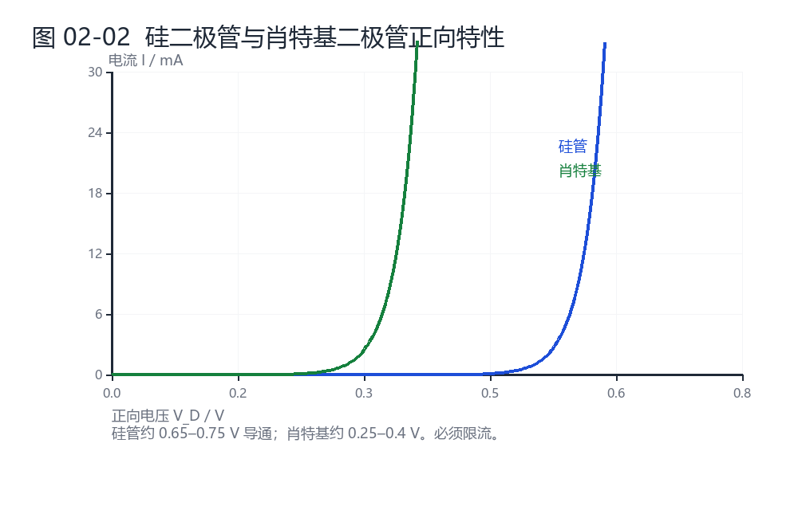
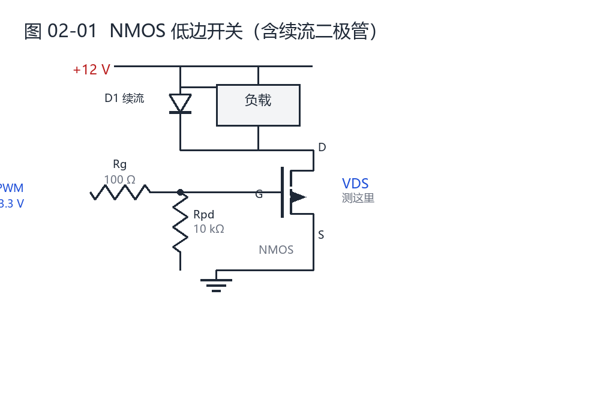

# 第 02 章 半导体器件与电子元器件（上）

> 文档编号：EHB-02-01  
> 版本：v0.2.0  
> 日期：2026-11-13  
> 状态：草稿（待技术复核）  
> 深度：A/B  
> 前置：第 01 章  
> 对应项目：P1

---

## 2.0 本章要解决的工程问题

你拿到一颗“IRLZ44N”NMOS，Datasheet 第一页写着 $R_{ds(on)}=0.022\ \Omega$，看起来很小。但你的 MCU 只有 3.3 V GPIO，这颗管子真的能完全导通吗？导通后要加散热片吗？栅极要不要串电阻？电机断电时，电感产生的反电动势会不会把它击穿？

同样，你看到一个 5 V 继电器，线圈电流 50 mA，想用 BJT 驱动。基极电阻取 1 kΩ 够不够？继电器断开时，线圈两端要不要加二极管？加了以后为什么动作变慢？

本章不追求半导体物理的完整体系，而是围绕三个问题：

1. **器件是怎么工作的**（物理直觉 + 简化模型）。
2. **Datasheet 的参数在什么条件下成立**（真实器件 vs 理想模型）。
3. **怎么判断它适不适合你的电路**（选型、降额、保护、散热）。

学完本章，你应当能独立完成一颗二极管的限流、一个 BJT 开关、一个 NMOS 低边开关的设计，并解释为什么。

---

## 本章学习目标与先修检查

**学习目标**

- 用能带/载流子/PN 结解释二极管、BJT、MOSFET 的单向导电与可控导电。
- 能从 Datasheet 提取绝对最大值、推荐工作条件、电气特性、热阻与降额曲线。
- 能设计二极管限流、稳压、钳位、续流电路。
- 能设计 BJT 与 MOSFET 的开关电路，计算基极/栅极电阻、损耗与温升。
- 能区分理想模型、恒压降模型、小信号模型，知道各自适用条件。
- 能识别常见失效模式（过压、过流、过热、ESD、浪涌）。

**先修检查**

- [ ] 知道电压、电流、功率、电阻。
- [ ] 知道电容/电感的 $du/dt$、$di/dt$ 特性。
- [ ] 会算分压与功率。
- [ ] 能读简单的英文 Datasheet 标题与参数表。

**符号与单位约定**

| 符号 | 含义 | 单位 |
|---|---|---|
| $I_S$ | 二极管反向饱和电流 | A |
| $V_T$ | 热电压 $kT/q$ | V（300 K 约 25.85 mV） |
| $V_F,V_Z$ | 正向压降、稳压值 | V |
| $\beta$ | BJT 电流增益 | 无量纲 |
| $V_{CE(sat)}$ | BJT 饱和压降 | V |
| $V_{GS(th)}$ | MOSFET 阈值电压 | V |
| $R_{ds(on)}$ | MOSFET 导通电阻 | Ω |
| $Q_g$ | 栅极总电荷 | C |
| $C_{iss},C_{oss},C_{rss}$ | 输入/输出/反向传输电容 | F |
| $\theta_{JA},\theta_{JC}$ | 结到环境/壳热阻 | °C/W |
| $T_J,T_A$ | 结温、环境温度 | °C |
| $C_L$ | 晶振负载电容 | F |

---

## 2.1 半导体物理基础

### 2.1.1 能带与载流子

导体、半导体、绝缘体的差别在能带间隙 $E_g$：

| 材料 | $E_g$（300 K） | 特性 |
|---|---|---|
| 导体（铜） | 0 | 电子自由移动 |
| 硅（Si） | 1.12 eV | 本征载流子少，可掺杂控制 |
| 锗（Ge） | 0.66 eV | 更易导电，温度稳定性差 |
| 砷化镓（GaAs） | 1.42 eV | 高频、光电器件 |
| 碳化硅（SiC） | 3.26 eV | 高温、高压、高导热 |
| 氮化镓（GaN） | 3.4 eV | 高电子迁移率、高频 |

本征硅在 300 K 的载流子浓度约 $n_i=1.5\times10^{10}\ \text{cm}^{-3}$，相比原子密度 $5\times10^{22}\ \text{cm}^{-3}$ 极小，所以纯硅几乎不导电。

### 2.1.2 掺杂：N 型与 P 型

- 掺入五价元素（磷、砷）→ 多出自由电子 → **N 型**，电子为多数载流子。
- 掺入三价元素（硼、铝）→ 多出空穴 → **P 型**，空穴为多数载流子。

掺杂浓度典型 $10^{15}$–$10^{20}\ \text{cm}^{-3}$。掺杂越高，电阻率越低，但击穿电压越低——这是功率器件设计的核心权衡。

### 2.1.3 漂移与扩散

- **漂移**：电场驱动载流子，$J=q n \mu E$。
- **扩散**：浓度梯度驱动载流子，$J=-qD\,dn/dx$。

PN 结的电流同时包含两种机制；平衡时扩散与漂移相互抵消，形成内建电场。

### 2.1.4 PN 结

P 型与 N 型接触后，交界处电子/空穴复合，形成**耗尽层**与内建电位 $V_{bi}$（硅约 0.6–0.9 V）。外加电压：

- **正偏**（P 接高、N 接低）：势垒降低，扩散电流指数上升。
- **反偏**（P 接低、N 接高）：势垒升高，只有微小漏电流；超过击穿电压后雪崩/齐纳击穿。

伏安特性（Shockley 方程）：

$$
I=I_S\left(e^{V/(nV_T)}-1\right),\qquad V_T=\frac{kT}{q}\approx25.85\ \text{mV}\ (300\ \text{K})
\tag{2-1}
$$

其中 $I_S$ 为反向饱和电流（A），$n$ 为理想因子（1–2），$V_T$ 为热电压。**例 2-1** $I_S=10^{-12}$ A，$n=1$，$V=0.6$ V：

$$
I=10^{-12}\left(e^{0.6/0.02585}-1\right)
=10^{-12}\left(e^{23.2}-1\right)\approx12\ \text{mA}
$$

电压从 0.6 V 增到 0.66 V，电流约增大 10 倍。这就是二极管“导通后电压几乎不变、电流急剧变化”的原因，也是为什么必须限流。

温度影响：$V_T$ 随温度升高，同一电流下正向压降约 **-2 mV/°C**。所以二极管不适合做精密基准。

---

## 2.2 二极管家族

### 2.2.1 普通整流二极管

- 典型：1N4007（1000 V/1 A）、1N4148（100 V/200 mA，小信号）。
- 正向压降 $V_F$：硅 0.6–1.0 V（随电流上升）。
- 反向恢复时间 $t_{rr}$：普通整流管几百 ns 到 µs，高频开关会发热。
- 额定：$I_F$、$V_{RRM}$、$I_{FSM}$（浪涌）、$P_D$。

**恒压降模型**：导通时 $V_D\approx0.7$ V（硅），截止时开路。适用于“电源电压远大于 0.7 V”的工程估算。

**例 2-2** 5 V 经 220 Ω 接 LED（$V_F=2.0$ V），求电流：

$$
I=\frac{5-2.0}{220}=13.6\ \text{mA}
$$

电阻功率 $I^2R=0.041$ W，选 0.125 W 即可，但建议留 2 倍裕量。

### 2.2.2 稳压二极管（Zener）

工作在反向击穿区，击穿电压 $V_Z$ 基本稳定。必须串限流电阻，且 $I_Z$ 在 $I_{Z(min)}$ 与 $I_{Z(max)}$ 之间。

**例 2-3** 12 V 输入，5.1 V 稳压，负载电流 10 mA，最小稳压电流 5 mA。求限流电阻。

总电流 $I=10+5=15$ mA：

$$
R_S=\frac{12-5.1}{15\ \text{mA}}=460\ \Omega
$$

取 470 Ω（标准值）。校验：$I=(12-5.1)/470=14.7$ mA，负载 10 mA 时 $I_Z=4.7$ mA，略低于 5 mA；取 430 Ω 更稳。电阻功率 $(6.9)^2/430=0.11$ W，选 0.25 W。

**注意**：负载电流变化大时，Zener 稳压效率低、发热大；超过 100 mA 通常改用 LDO/开关电源。

### 2.2.3 肖特基二极管

金属-半导体结，正向压降 0.2–0.5 V，反向恢复极快（多数载流子器件），适合高频整流、续流、ORing。

缺点：反向漏电流大（随温度指数上升），耐压一般 ≤200 V，抗浪涌能力较弱。

*图 02-02 硅二极管与肖特基二极管的正向特性。必须串限流电阻。*

### 2.2.4 TVS 与 ESD 保护

TVS（瞬态电压抑制器）在过压时钳位，响应时间 ns 级。选型要点：

- 工作电压 $V_{RWM}$ 大于被保护线路最高电压。
- 钳位电压 $V_C$ 小于被保护器件绝对最大值。
- 峰值脉冲电流 $I_{PP}$ 与波形（8/20 µs）满足要求。
- 结电容 $C_j$ 不能影响信号（高速线选低电容型）。

**常见错误**：把 TVS 当稳压管长期工作；TVS 放在保险丝前面（应先保险丝后 TVS，或按标准协调）；忽略 TVS 的漏电与电容。

### 2.2.5 LED 与光电器件

LED 是正偏发光的二极管，$V_F$ 取决于颜色：红 1.8–2.2 V，蓝/白 2.8–3.4 V。必须限流。

光耦：LED + 光电晶体管/光电二极管，实现电气隔离；关键参数 CTR（电流传输比）、速度、隔离电压。CTR 随温度和时间衰减，设计要留裕量。

光电二极管：反偏工作，输出光电流；跨阻放大器（TIA）是常见前端，见第 03 章。

### 2.2.6 二极管选型表

| 类型 | 典型 $V_F$ | 速度 | 耐压 | 主要用途 |
|---|---|---|---|---|
| 整流硅管 | 0.7–1.0 V | 慢 | 50–1000 V | 整流、防反接 |
| 肖特基 | 0.2–0.5 V | 快 | 20–200 V | 续流、ORing、高频整流 |
| 快恢复 | 0.8–1.2 V | 中 | 200–1200 V | 开关电源 |
| 稳压管 | 反向 $V_Z$ | 中 | 2.4–200 V | 钳位、简易稳压 |
| TVS | 钳位 | 极快 | 5–数百 V | ESD/浪涌保护 |
| LED | 1.8–3.4 V | — | — | 指示、照明、光耦 |

---

## 2.3 BJT 三极管

### 2.3.1 结构与工作模式

NPN：发射极（E）重掺杂、基极（B）薄、集电极（C）面积大。PNP 相反。

| 模式 | BE 结 | BC 结 | 用途 |
|---|---|---|---|
| 截止 | 反偏 | 反偏 | 开关断开 |
| 放大 | 正偏 | 反偏 | 模拟放大 |
| 饱和 | 正偏 | 正偏 | 开关导通 |

放大区：

$$
I_C=\beta I_B,\qquad I_E=(\beta+1)I_B,\qquad V_{BE}\approx0.7\ \text{V}
\tag{2-2}
$$

$\beta$ 典型 50–300，随 $I_C$、温度、器件分散而变化，**不能用于精确设计**。

### 2.3.2 输出特性与负载线

以 $I_B$ 为参数，$I_C$ 随 $V_{CE}$ 变化。放大区曲线较平（Early 效应），饱和区 $V_{CE(sat)}$ 约 0.1–0.3 V。

负载线：$V_{CE}=V_{CC}-I_C R_C$。与特性曲线交点即工作点。

### 2.3.3 BJT 开关设计

目标：让 BJT 进入饱和，$V_{CE}$ 尽量低。

**例 2-4** 3.3 V GPIO 驱动 5 V 继电器，线圈 50 mA，BJT β 最小 100。取强制 β=20（饱和裕量）：

$$
I_B=\frac{I_C}{\beta_{forced}}=\frac{50}{20}=2.5\ \text{mA}
$$

$$
R_B=\frac{3.3-0.7}{2.5\ \text{mA}}=1.04\ \text{k}\Omega
$$

取 1 kΩ，实际 $I_B=2.6$ mA。基极-发射极结消耗 $0.7\times2.6=1.8$ mW；BJT 饱和压降 0.2 V，$P=0.2\times50=10$ mW。继电器线圈必须并联续流二极管（如 1N4148），否则关断瞬间 $V=L\,di/dt$ 可能击穿 BJT。

### 2.3.4 常见错误

- 用 $\beta=100$ 算基极电阻，结果批量生产时部分管子不饱和。
- 基极悬空，导致误触发。
- 继电器线圈不加续流二极管。
- 把 BJT 当理想开关，忽略 $V_{CE(sat)}$ 与功耗。

---

## 2.4 MOSFET

### 2.4.1 结构与工作原理

N 沟道增强型 MOSFET：栅极（G）通过氧化层绝缘，源极（S）与漏极（D）之间形成沟道。$V_{GS}>V_{TH}$ 时沟道形成，$V_{DS}$ 驱动电流。

- **截止区**：$V_{GS}<V_{TH}$，$I_D\approx0$。
- **线性/三极管区**：$V_{GS}>V_{TH}$，$V_{DS}<V_{GS}-V_{TH}$，沟道未夹断，等效电阻。
- **饱和区**：$V_{DS}>V_{GS}-V_{TH}$，沟道夹断，电流基本由 $V_{GS}$ 决定。

简化模型：

$$
I_D=k_n\left[(V_{GS}-V_{TH})V_{DS}-\frac{1}{2}V_{DS}^2\right]\quad\text{（线性区）}
\tag{2-3}
$$

$$
I_D=\frac{1}{2}k_n(V_{GS}-V_{TH})^2\quad\text{（饱和区）}
\tag{2-4}
$$

$$
k_n=\mu_n C_{ox}\frac{W}{L}
\tag{2-5}
$$

其中 $\mu_n$ 为电子迁移率，$C_{ox}$ 为单位面积栅电容，$W/L$ 为宽长比。

### 2.4.2 关键参数

| 参数 | 含义 | 设计影响 |
|---|---|---|
| $V_{TH}$ | 阈值电压 | 驱动电压必须显著大于它 |
| $R_{ds(on)}$ | 导通电阻 | 导通损耗 $I^2R$，随温度上升 |
| $Q_g$ | 栅极总电荷 | 驱动电流、开关速度 |
| $C_{iss}/C_{oss}/C_{rss}$ | 输入/输出/反向传输电容 | 驱动、振铃、米勒平台 |
| $V_{DS(max)}$ | 漏源耐压 | 必须大于母线+尖峰，留 20–30% |
| $I_D$ | 连续漏电流 | 受封装/热限制，不是芯片极限 |
| $P_D$ | 最大耗散 | 由 $T_J(max)$ 与热阻决定 |
| SOA | 安全工作区 | 避免同时高压大电流 |

**$R_{ds(on)}$ 的温度效应**：硅 MOSFET 约 +0.6%/°C 到 +1%/°C，150 °C 时可能是 25 °C 的 1.8–2 倍。选型时必须用高温值算损耗。

### 2.4.3 栅极驱动

栅极是电容负载，驱动电流用于充放电：

$$
I_G\approx\frac{Q_g}{t_r}
\tag{2-6}
$$

**例 2-5** $Q_g=48$ nC，目标开通时间 100 ns：

$$
I_G=\frac{48\ \text{nC}}{100\ \text{ns}}=0.48\ \text{A}
$$

普通 MCU GPIO 只能提供几十 mA，直接驱动会慢、发热。应使用专用栅极驱动器（如 IR2104、DRV8323）或至少加三极管推挽。

栅极串联电阻 $R_g$ 控制开关速度：太小→振铃/EMI；太大→开关损耗增加。典型 2.2–22 Ω，需用示波器验证。

### 2.4.4 低边开关设计

**例 2-6** 24 V/2 A 直流电机，NMOS 低边开关，选 IRLZ44N（逻辑电平，$R_{ds(on)}=0.025\ \Omega$ @ $V_{GS}=4.5$ V）。3.3 V 驱动时 $R_{ds(on)}$ 会更大，需查曲线；若不足，改用 $V_{GS(th)}=1$ V 级别的逻辑管或加 5 V 驱动。

导通损耗（按 4.5 V 驱动、2 A）：

$$
P_{cond}=I^2R_{ds(on)}=4\times0.025=0.1\ \text{W}
$$

开关损耗（20 kHz，$t_r=t_f=100$ ns）：

$$
P_{sw}=\frac12 V_{DS}I_D f_s(t_r+t_f)
=\frac12\times24\times2\times20k\times200n=0.096\ \text{W}
$$

总损耗约 0.2 W，SOT-223/TO-220 无需散热片即可，但仍要测壳温。电机断电时，续流二极管（或 MOSFET 体二极管）提供电感电流回路；若做半桥，必须考虑死区与直通。

*图 02-01 NMOS 低边开关。栅极串 Rg、下拉 Rpd，负载并联续流二极管。*

### 2.4.5 体二极管与寄生

NMOS 内部有一个从源极（阳极）到漏极（阴极）的体二极管。它在半桥中充当续流二极管，但反向恢复较慢，高频时可能发热。同步整流用低 $V_F$ MOSFET 替代二极管，可提高效率。

寄生电容导致：

- 栅极振铃（$L_{gate}$ 与 $C_{iss}$）。
- 米勒导通（$C_{gd}$ 把漏极 dv/dt 耦合到栅极）。
- 半桥直通（上下管同时导通）。

### 2.4.6 常见错误

- 用 $V_{GS(th)}$ 当“完全导通电压”；它只是开始导通的阈值。
- 用 25 °C 的 $R_{ds(on)}$ 算损耗，忽略高温翻倍。
- 认为 $I_D$ 标称 50 A 就能长期跑 50 A（受封装/热限制）。
- 栅极悬空（必须下拉电阻）。
- 半桥不加死区。

---

## 2.5 IGBT、SiC 与 GaN

### 2.5.1 IGBT

IGBT = MOSFET 栅极 + BJT 输出。特点是：

- 输入阻抗高，电压驱动。
- 导通压降 $V_{CE(sat)}$ 较低，适合高压大电流。
- 开关速度比 MOSFET 慢，关断有“拖尾电流”，开关损耗大。
- 典型应用：变频器、伺服驱动、光伏逆变、电动汽车。

### 2.5.2 SiC MOSFET

- 禁带宽、击穿场强高，同耐压下漂移区更薄，$R_{ds(on)}$ 更低。
- 高温工作能力强（>150 °C）。
- 开关速度快，但 dv/dt 高，对驱动、布局、EMC 要求更高。
- 栅极驱动电压通常 15–18 V 开通、负压关断，不能用普通 3.3 V。

### 2.5.3 GaN HEMT

- 电子迁移率高，开关极快，适合高频、高功率密度。
- 阈值电压低（约 1–2 V），对噪声敏感；栅极耐压窄。
- 需要专用驱动与精细布局。

### 2.5.4 选型对比

| 器件 | 电压范围 | 频率 | 驱动 | 典型场景 |
|---|---|---|---|---|
| 硅 MOSFET | 20–200 V | 100 kHz–2 MHz | 4–10 V | 低压电机、电源 |
| IGBT | 600–6500 V | 1–20 kHz | 15 V | 变频器、牵引 |
| SiC MOSFET | 600–1700 V | 20–200 kHz | 15–18 V | 高效电源、电驱 |
| GaN HEMT | 100–650 V | 200 kHz–数 MHz | 5–6 V | 高频电源、快充 |

> 入门阶段只需理解“为什么高压用 IGBT/SiC、低压用 MOSFET”，不要急着设计高压桥。

---

## 上篇小结

1. 半导体器件的核心是“用电压/电流控制导电性”；PN 结是所有器件的起点。
2. 二极管必须限流；稳压管、TVS、肖特基的用途不同，不能混用。
3. BJT 是电流控制器件，开关设计要保证饱和；$\beta$ 不能作为精确设计依据。
4. MOSFET 是电压控制器件，$V_{GS}$ 必须足够大；$R_{ds(on)}$ 随温度上升；栅极电荷决定驱动电流。
5. 功率器件的选型是“耐压、电流、损耗、热、驱动、成本”的折中。

### 检查清单

- [ ] 能解释 PN 结正偏/反偏的物理过程。
- [ ] 能算二极管限流电阻与功耗。
- [ ] 能设计 Zener 稳压电路并校验电流范围。
- [ ] 能设计 BJT 饱和开关并加续流二极管。
- [ ] 能根据 $V_{GS}$、$R_{ds(on)}$、$Q_g$ 判断 MOSFET 是否适合 3.3 V 驱动。
- [ ] 能算 MOSFET 导通/开关损耗并判断是否需要散热。

### 参考资料

- [REF-I05] Sedra & Smith, *Microelectronic Circuits*, 8th ed., Ch. 3–5.
- [REF-I06] Razavi, *Fundamentals of Microelectronics*, 3rd ed., Ch. 2–4.
- [REF-A01] ADI *Linear Circuit Design Handbook*, Ch. 1.
- 各器件 Datasheet（1N4148、1N4007、IRLZ44N、IRF540N）。
