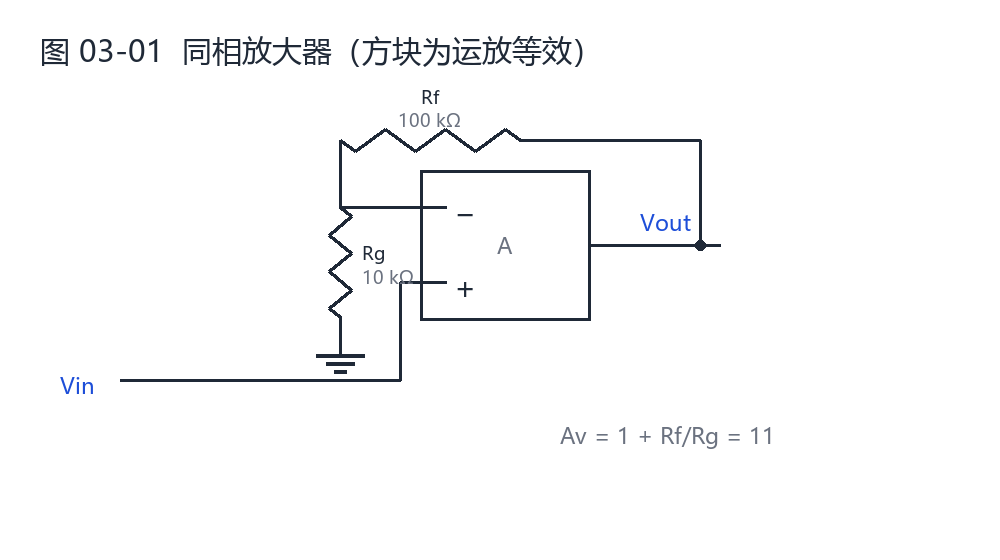

# 第 03 章 模拟电子技术（上）

> 文档编号：EHB-03-01  
> 版本：v0.2.0  
> 日期：2026-11-13  
> 状态：草稿（待技术复核）  
> 深度：A/B  
> 前置：第 01、02 章  
> 对应项目：P2

---

## 3.0 本章要解决的工程问题

一只应变片电桥的输出只有几毫伏，源阻抗 350 Ω；你要把它接到 3.3 V、12 位 ADC 上，要求分辨 0.1% 的满量程。直接接 ADC 会怎样？用一级运放放大 100 倍够不够？放大器的输入失调 50 µV 会被放大成 5 mV，相当于多少个 ADC 码？滤波器截止频率取多少？电源噪声会不会串进来？

本章围绕“**把微小信号干净地送到 ADC**”这条主线，讲清四件事：

1. 放大的本质与限制（增益、带宽、阻抗、噪声）。
2. 晶体管级放大电路（BJT/MOSFET、共射/共集/共基、差分、电流源）。
3. 运放级电路（同相/反相/差分/仪表/滤波/比较）。
4. 真实运放的非理想性与误差预算。

本章分上下两篇：上篇（3.1–3.7）讲放大器件与基本组态；下篇（3.8–3.14）讲比较器、滤波器、反馈、基准、噪声与实验。

## 本章学习目标与先修检查

学完本章，你应当能够：

- 计算 BJT/MOSFET 的工作点、$g_m$ 与单级增益。
- 区分共射/共集/共基、共源/共漏/共栅的增益、相位与阻抗。
- 解释差分对、电流源、有源负载为什么能提高增益与 CMRR。
- 推导同相/反相/差分/仪表放大增益，并根据 GBW/压摆率判断是否够用。
- 设计一阶/二阶滤波器、迟滞比较器，并做噪声与误差预算。

**先修检查**

- [ ] 知道 BJT 的放大/饱和/截止三种模式。
- [ ] 知道 MOSFET 的 $V_{GS}>V_{TH}$ 才导通。
- [ ] 会算分压与戴维南等效。
- [ ] 知道 RC 低通的截止频率。
- [ ] 会用示波器测幅值与相位。

**符号与单位约定**

| 符号 | 含义 | 单位 |
|---|---|---|
| $g_m$ | 跨导 | S（或 mS） |
| $r_\pi,r_e,r_o$ | 小信号输入/发射极/输出电阻 | Ω |
| $A_v,A_{vo}$ | 电压增益、开路电压增益 | 无量纲（或 dB） |
| $R_{in},R_{out}$ | 输入/输出电阻 | Ω |
| $GBW$ | 增益带宽积 | Hz |
| $SR$ | 压摆率 | V/µs |
| $V_{OS},I_B$ | 输入失调电压、偏置电流 | V、A |
| $CMRR,PSRR$ | 共模/电源抑制比 | dB |
| $NG$ | 噪声增益 | 无量纲 |
| $f_0,Q$ | 滤波器中心/截止频率、品质因数 | Hz、无量纲 |

---

## 3.1 模拟信号与放大概念

### 3.1.1 什么是“放大”

放大不是“把电压变大”这么简单，而是**用电源的能量，按输入信号的形状，控制输出**。因此：

- 放大器必须有电源。
- 输出功率可以大于输入功率（功率增益），但能量来自电源。
- 放大器的核心是“控制”，不是“变压”。

一个电压放大器可以用戴维南等效描述：

$$
v_o=A_{vo}v_i,\qquad R_{in},\qquad R_{out}
\tag{3-1}
$$

接源和负载后：

$$
A_v=A_{vo}\frac{R_{in}}{R_s+R_{in}}\cdot\frac{R_L}{R_{out}+R_L}
\tag{3-2}
$$

### 3.1.2 小信号与偏置

模拟放大器通常工作在某个直流工作点（Q 点），交流信号叠加在其上：

$$
v_{BE}(t)=V_{BEQ}+v_{be}(t),\qquad
i_C(t)=I_{CQ}+i_c(t)
\tag{3-3}
$$

“小信号”指交流幅度足够小，可以用线性近似（泰勒展开一阶）。如果信号太大，会出现截止/饱和失真。

### 3.1.3 增益、分贝与失真

电压增益 $A_v=v_o/v_i$，功率增益 $G=10\log_{10}(P_o/P_i)$，电压增益用 $20\log_{10}|A_v|$。

总谐波失真（THD）：

$$
THD=\frac{\sqrt{V_2^2+V_3^2+\cdots}}{V_1}\times100\%
\tag{3-4}
$$

其中 $V_1$ 为基波，$V_n$ 为各次谐波。THD 越小，波形越接近正弦。

### 3.1.4 输入/输出阻抗为什么重要

- 高输入阻抗：少从信号源取电流，减少加载。
- 低输出阻抗：带负载能力强，信号不易跌落。
- 传感器（高阻）→ 缓冲/仪表放大（高输入、低输出）→ ADC（较低输入阻抗，采样电容）。

**例 3-1** 传感器内阻 10 kΩ，放大器输入阻抗 100 kΩ，则只有 91% 的信号到达输入端；若输入阻抗 1 MΩ，则 99%。这就是为什么“高输入阻抗”是传感器前端的第一要求。

---

## 3.2 BJT 放大电路与偏置

### 3.2.1 跨导与小信号模型

BJT 在放大区：

$$
I_C=I_S e^{V_{BE}/V_T},\qquad
g_m=\frac{\partial I_C}{\partial V_{BE}}=\frac{I_C}{V_T}
\tag{3-5}
$$

$$
r_\pi=\frac{\beta}{g_m},\qquad
r_e=\frac{V_T}{I_E}\approx\frac{1}{g_m}
\tag{3-6}
$$

其中 $V_T\approx25.85$ mV（300 K）。$I_C=1$ mA 时，$g_m=38.6$ mS，$r_\pi=2.6$ kΩ（β=100）。

小信号模型（hybrid-π）：基极-发射极之间 $r_\pi$，集电极电流源 $g_m v_{be}$，输出电阻 $r_o$（Early 效应，通常几十 kΩ 到几百 kΩ）。

### 3.2.2 为什么要偏置

BJT 的 $V_{BE}$ 必须约 0.7 V 才导通；交流信号有正有负，如果不加直流偏置，负半周会截止。偏置电路的任务是：

- 设定稳定的 $I_C$（不受 β、温度大幅影响）。
- 让输出有足够的摆幅。
- 不引入过多噪声/功耗。

### 3.2.3 分压偏置 + 发射极电阻

电路：$V_{CC}$ 经 $R_{B1}$、$R_{B2}$ 分压到基极，发射极经 $R_E$ 接地，集电极经 $R_C$ 接 $V_{CC}$。

近似（$I_B$ 远小于分压电流）：

$$
V_B\approx V_{CC}\frac{R_{B2}}{R_{B1}+R_{B2}},\qquad
V_E=V_B-V_{BE},\qquad
I_E=\frac{V_E}{R_E}
\tag{3-7}
$$

$$
I_C\approx I_E,\qquad
V_{CE}=V_{CC}-I_C(R_C+R_E)
\tag{3-8}
$$

**例 3-2** $V_{CC}=12$ V，$R_{B1}=100$ kΩ，$R_{B2}=20$ kΩ，$R_C=4.7$ kΩ，$R_E=1$ kΩ，$V_{BE}=0.7$ V。

$$
V_B=12\times\frac{20}{120}=2.0\ \text{V}
$$

$$
V_E=1.3\ \text{V},\quad I_E=1.3\ \text{mA},\quad I_C\approx1.3\ \text{mA}
$$

$$
V_{CE}=12-1.3\times(4.7+1)=12-7.41=4.59\ \text{V}
$$

工作点合理（$V_{CE}$ 约为电源的 38%）。

### 3.2.4 偏置稳定性

$\beta$ 随温度/批次变化，$V_{BE}$ 随温度约 -2 mV/°C。$R_E$ 引入直流负反馈：

- 若 $I_C$ 增大 → $V_E$ 增大 → $V_{BE}=V_B-V_E$ 减小 → $I_C$ 回落。
- $R_E$ 越大，稳定性越好，但会消耗电压裕量、降低增益（交流可用旁路电容）。

**工程判据**：分压电流取 $I_B$ 的 10 倍以上；$V_E$ 取 $V_{CC}$ 的 10%–20%；$V_{CE}$ 取 $V_{CC}$ 的 30%–50%。

### 3.2.5 常见错误

- 分压电阻太大，$I_B$ 不可忽略，$V_B$ 低于计算值。
- 没有 $R_E$，工作点随 β 漂移。
- 忽略 $V_{CE}$ 太小导致饱和。
- 把 $g_m$ 当成常数（它随 $I_C$ 变）。

---

## 3.3 共射、共集、共基

### 3.3.1 共射（CE）

输入：基极；输出：集电极；发射极交流接地（由旁路电容旁路）。若发射极不旁路，增益会下降、输入阻抗升高，需用发射极退化公式重新计算。

$$
A_v=-g_m(R_C\parallel R_L),\qquad
R_{in}=R_{B1}\parallel R_{B2}\parallel r_\pi,\qquad
R_{out}\approx R_C
\tag{3-9}
$$

特点：电压增益大、反相、输入/输出阻抗中等。用途：电压放大。

**例 3-3** 例 3-2 的工作点，$g_m=1.3m/25.85m=50.3$ mS，$r_\pi=100/50.3m=1.99$ kΩ。

空载增益：

$$
A_v=-50.3m\times4.7k=-236
$$

接 $R_L=10$ kΩ：

$$
A_v=-50.3m\times(4.7k\parallel10k)=-50.3m\times3.20k=-161
$$

输入阻抗 $R_{in}=100k\parallel20k\parallel1.99k\approx1.77$ kΩ——偏低，会加载前级。

### 3.3.2 共集（CC，射极跟随器）

输入：基极；输出：发射极；集电极交流接地。

$$
A_v\approx1,\qquad
R_{in}\approx\beta(R_E\parallel R_L),\qquad
R_{out}\approx\frac{R_s\parallel R_B}{\beta}+r_e
\tag{3-10}
$$

特点：电压增益略小于 1、同相、输入阻抗高、输出阻抗低。用途：缓冲、驱动负载。

### 3.3.3 共基（CB）

输入：发射极；输出：集电极；基极交流接地。

$$
A_v\approx+g_mR_C,\qquad
R_{in}\approx r_e=\frac{1}{g_m},\qquad
R_{out}\approx R_C
\tag{3-11}
$$

特点：同相、输入阻抗极低、高频特性好。用途：高频/电流缓冲、 cascode。

### 3.3.4 三种组态对比

| 组态 | 增益 | 相位 | 输入阻抗 | 输出阻抗 | 典型用途 |
|---|---|---|---|---|---|
| CE | 大（-gmRc） | 反相 | 中 | 中 | 电压放大 |
| CC | ≈1 | 同相 | 高 | 低 | 缓冲/驱动 |
| CB | 大（+gmRc） | 同相 | 低 | 中 | 高频/电流 |

**工程组合**：CE + CC（共射-共集）得到高增益+低输出阻抗；CE + CB（cascode）得到高增益+好高频特性。

---

## 3.4 MOSFET 放大电路

### 3.4.1 跨导

MOSFET 饱和区：

$$
I_D=\frac12 k_n(V_{GS}-V_{TH})^2,\qquad
g_m=\frac{\partial I_D}{\partial V_{GS}}=k_n(V_{GS}-V_{TH})=\sqrt{2k_nI_D}
\tag{3-12}
$$

$I_D=1$ mA、$k_n=2$ mA/V² 时，$g_m=\sqrt{2\times2m\times1m}=2$ mS。比 BJT 低（BJT 在 1 mA 时 38.6 mS），所以 MOSFET 单级增益通常较低。

### 3.4.2 共源（CS）

$$
A_v=-g_m(R_D\parallel R_L\parallel r_o),\qquad
R_{in}\approx\infty,\qquad
R_{out}\approx R_D\parallel r_o
\tag{3-13}
$$

特点：高输入阻抗、反相、增益中等。用途：电压放大、传感器前端（但噪声/失调不如专用运放）。

### 3.4.3 源极跟随（CD）与共栅（CG）

- CD：增益 ≈1，输入阻抗高，输出阻抗低，缓冲。
- CG：输入阻抗低，高频好，电流缓冲。

### 3.4.4 偏置

MOSFET 需要 $V_{GS}>V_{TH}$，且 $V_{DS}>V_{GS}-V_{TH}$（饱和区）。常用分压偏置 + 源极电阻，或电流源偏置。

**例 3-4** $k_n=2$ mA/V²，$V_{TH}=1$ V，目标 $I_D=1$ mA。由 $I_D=\frac12k_n(V_{GS}-V_{TH})^2$：

$$
1m=1m(V_{GS}-1)^2 \Rightarrow V_{GS}=2\ \text{V}
$$

若源极电阻 $R_S=1$ kΩ，则 $V_S=1$ V，栅极需 3 V。$V_D$ 需大于 $V_G-V_{TH}=2$ V，取 $V_D=6$ V（12 V 供电，$R_D=6$ kΩ）。

### 3.4.5 常见错误

- 用 $V_{TH}$ 当偏置点（应显著大于）。
- 忽略沟道长度调制（$r_o$）。
- 栅极悬空（必须偏置/下拉）。
- 用 MOSFET 做精密放大而不用专用运放（失调/噪声/匹配差）。

---

## 3.5 差分放大、电流源与有源负载

### 3.5.1 为什么需要差分

传感器信号常是“两根线之间的电压差”，而干扰（工频、地电位）同时叠加在两根线上（共模）。差分放大器放大差模、抑制共模：

$$
v_{id}=v_1-v_2,\qquad
v_{ic}=\frac{v_1+v_2}{2}
\tag{3-14}
$$

共模抑制比：

$$
CMRR=\left|\frac{A_d}{A_{cm}}\right|
\tag{3-15}
$$

### 3.5.2 差分对

两个匹配的 BJT/MOSFET，发射极/源极共接电流源 $I_{tail}$。尾电流恒定，所以：

- 差模输入时，电流在两侧分配变化，输出差模电压。
- 共模输入时，两侧电流同向变化，尾电流源阻抗高，共模增益小。

半电路分析：差模增益

$$
A_d=g_m R_C
\tag{3-16}
$$

共模增益（尾电阻 $R_{EE}$）：

$$
A_{cm}\approx-\frac{R_C}{2R_{EE}}
\tag{3-17}
$$

$$
CMRR\approx 2g_mR_{EE}
\tag{3-18}
$$

**例 3-5** $I_{tail}=2$ mA，每管 1 mA，$g_m=38.6$ mS，$R_C=5$ kΩ，$R_{EE}=100$ kΩ：

$$
A_d=38.6m\times5k=193
$$

$$
A_{cm}\approx-\frac{5k}{200k}=-0.025
$$

$$
CMRR=193/0.025=7720\approx77.8\ \text{dB}
$$

### 3.5.3 电流源与电流镜

简单电流源：晶体管 + 发射极电阻，基准电流 $I_{ref}$ 镜像到输出。理想电流源交流阻抗无穷大，提高 CMRR 与增益。

电流镜误差来源：$V_{BE}$ 失配、β 有限、Early 效应、电阻失配。精密应用用运放+MOSFET 或专用电流源 IC。

### 3.5.4 有源负载

用电流源代替 $R_C$，交流阻抗高、直流压降小，可在低电源电压下获得高增益：

$$
A_v=-g_m(r_{o,n}\parallel r_{o,p})
\tag{3-19}
$$

这就是运放内部高增益的来源。

### 3.5.5 常见错误

- 差分对不匹配（版图/器件），CMRR 变差。
- 尾电流源阻抗不够，共模抑制差。
- 忽略输入共模范围（超过会饱和）。
- 用电阻做负载却希望高增益（增益受 $R_C$ 与电压裕量限制）。

---

## 3.6 运算放大器基础与负反馈

### 3.6.1 理想运放模型

- 开环增益 $A_{OL}\to\infty$。
- 输入阻抗 $\to\infty$。
- 输出阻抗 $\to0$。
- 带宽 $\to\infty$。
- 输入失调/噪声/偏置电流为 0。

理想运放只有两个规则（**负反馈**下）：

1. 输入端电压相等（虚短）：$v_+=v_-$。
2. 输入端不取电流（虚断）：$i_+=i_-=0$。

**关键前提**：负反馈。开环比较器不满足虚短。

### 3.6.2 负反馈与闭环增益

一般反馈结构：

$$
A_{CL}=\frac{A_{OL}}{1+A_{OL}\beta}
\tag{3-20}
$$

当 $A_{OL}\beta\gg1$：

$$
A_{CL}\approx\frac{1}{\beta}
\tag{3-21}
$$

闭环增益由反馈网络决定，而不是运放本身。这就是“运放电路可预测”的原因。

### 3.6.3 反相放大器

输入经 $R_1$ 到反相端，反馈 $R_2$ 从输出到反相端，同相端接地。

虚短：$v_-=0$；虚断：流过 $R_1$ 的电流等于流过 $R_2$ 的电流。

$$
\frac{v_i}{R_1}=-\frac{v_o}{R_2}
\Rightarrow
A_v=-\frac{R_2}{R_1}
\tag{3-22}
$$

输入阻抗 $R_{in}=R_1$（较低）；输出阻抗接近 0。

### 3.6.4 同相放大器

输入接同相端，反相端经 $R_1$ 接地、$R_2$ 接输出。

$$
v_-=v_i,\qquad
v_-=v_o\frac{R_1}{R_1+R_2}
\Rightarrow
A_v=1+\frac{R_2}{R_1}
\tag{3-23}
$$

输入阻抗极高（运放输入阻抗），输出阻抗低。

*图 03-01 同相放大器。Av=1+Rf/Rg；方块为运放等效，实际用运放符号。*

### 3.6.5 增益带宽积

运放的开环增益随频率下降，增益带宽积（GBW）近似常数：

$$
GBW=|A_{OL}(f)|\cdot f
\tag{3-24}
$$

闭环带宽：

$$
f_{-3dB}\approx\frac{GBW}{1+R_2/R_1}
\tag{3-25}
$$

**例 3-6** GBW=10 MHz，同相增益 11：

$$
f_{-3dB}\approx\frac{10\ \text{MHz}}{11}=909\ \text{kHz}
$$

增益越高，带宽越窄。这是运放最常用的取舍。

### 3.6.6 常见错误

- 把虚短用于比较器/正反馈。
- 忽略 GBW，设计 100 倍增益却想要 1 MHz 带宽。
- 反相放大器输入阻抗低，直接接高阻传感器。
- 同相端没有直流通路（浮空）。

---

## 3.7 基本运放组态

### 3.7.1 电压跟随器

输出直接接反相端，$R_2=0$，$R_1=\infty$：

$$
A_v=1
\tag{3-26}
$$

用途：缓冲、阻抗变换。输入高阻、输出低阻，但要注意容性负载稳定性（见 3.12）。

### 3.7.2 加法器

反相加法：

$$
v_o=-R_f\left(\frac{v_1}{R_1}+\frac{v_2}{R_2}+\cdots\right)
\tag{3-27}
$$

若 $R_1=R_2=R_f=R$，则 $v_o=-(v_1+v_2)$。

### 3.7.3 减法器/差分放大器

四个电阻：

$$
v_o=\frac{R_f}{R_1}(v_2-v_1)
\quad(\text{当 }R_3=R_1,\ R_4=R_f)
\tag{3-28}
$$

电阻失配会降低 CMRR。分立电阻 1% 时，CMRR 通常只有 60–80 dB；精密应用用集成差分放大器/仪表放大器。

### 3.7.4 积分器

反相输入经 $R$，反馈电容 $C$：

$$
v_o(t)=-\frac{1}{RC}\int_0^t v_i(\tau)\,d\tau+v_o(0)
\tag{3-29}
$$

频域：

$$
\frac{V_o}{V_i}=-\frac{1}{sRC}
\tag{3-30}
$$

用途：电荷放大、低通、PID 的 I 项。缺点：直流增益无穷大，会饱和；需并联大电阻或复位开关。

### 3.7.5 微分器

输入经 $C$，反馈 $R$：

$$
v_o=-RC\frac{dv_i}{dt}
\tag{3-31}
$$

缺点：高频增益上升，噪声放大；实际电路串电阻限带宽。

### 3.7.6 仪表放大器

三运放结构：

$$
A_v=\left(1+\frac{2R}{R_G}\right)\frac{R_f}{R_1}
\tag{3-31a}
$$

常用单片 INA（如 INA333）增益：

$$
G=1+\frac{100\ \text{k}\Omega}{R_G}
\tag{3-32}
$$

特点：高输入阻抗、高 CMRR、低噪声。用途：电桥、热电偶、应变片。

**例 3-7** INA333 要增益 100：

$$
R_G=\frac{100k}{G-1}=\frac{100k}{99}=1.01\ \text{k}\Omega
$$

取 1 kΩ，实际增益 101。

### 3.7.7 常见错误

- 积分器没有复位/直流路径，输出饱和。
- 微分器没有输入电阻，噪声/振荡。
- 仪表放大器输入共模范围超限。
- 单端接法破坏 CMRR。

---

## 上篇小结

1. 放大是用电源能量控制输出；输入/输出阻抗决定加载。
2. BJT 的 $g_m=I_C/V_T$，1 mA 时约 38.6 mS；CE 增益大但输入阻抗低，CC 缓冲，CB 高频。
3. MOSFET 的 $g_m$ 较低，适合高输入阻抗/开关，不适合高精度放大。
4. 差分放大抑制共模；CMRR 取决于匹配与尾电流源阻抗。
5. 运放负反馈下“虚短虚断”，闭环增益由反馈网络决定；GBW 决定带宽。
6. 反相/同相/跟随/加减/积分/微分/仪表放大是最常用的七种组态。

### 检查清单

- [ ] 能算 BJT 工作点与 $g_m$。
- [ ] 能区分 CE/CC/CB 的增益、相位、阻抗。
- [ ] 能解释差分对为什么抑制共模。
- [ ] 能推导反相/同相增益。
- [ ] 能根据 GBW 算闭环带宽。
- [ ] 能选仪表放大器并算 $R_G$。

### 参考资料

- [REF-I05] Sedra & Smith, *Microelectronic Circuits*, 8th ed., Ch. 5–9.
- [REF-I06] Razavi, *Fundamentals of Microelectronics*, 3rd ed., Ch. 4–5.
- [REF-A02] ADI *Op Amp Applications Handbook*, Ch. 1–2.
- [REF-A08] TI Precision Labs（运放章节）。
- TI OPA2188 / INA333 Datasheet（厂商官网，按型号检索；注意 Vos、噪声、GBW 的测试条件）。
