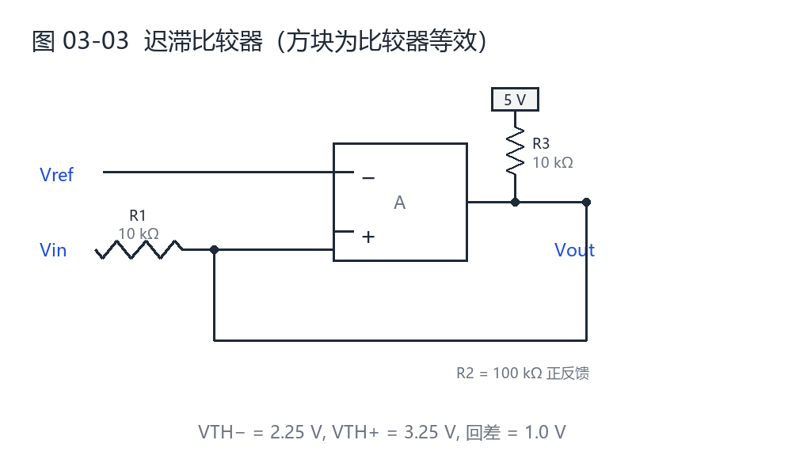
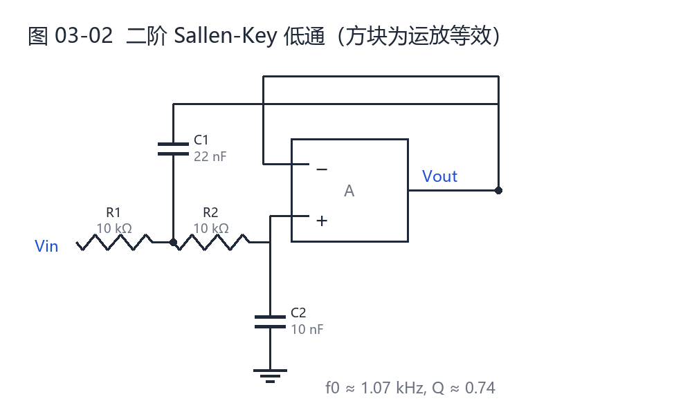

# 第 03 章 模拟电子技术（下）

> 文档编号：EHB-03-02  
> 版本：v0.2.0  
> 日期：2026-11-13  
> 状态：草稿（待技术复核）  
> 深度：A/B/C  
> 前置：第 03 章上篇（3.1–3.7）  
> 对应项目：P2

---

## 3.8 比较器与滞回

### 3.8.1 比较器不是运放

比较器工作在开环/正反馈，输出只有高/低两态；运放设计用于负反馈线性放大。二者区别：

| 项 | 运放 | 比较器 |
|---|---|---|
| 反馈 | 负反馈 | 开环/正反馈 |
| 输出 | 线性 | 饱和（推挽/开漏） |
| 速度 | 带宽受限 | 传播延迟 ns–µs |
| 失调 | 低 | 较大 |
| 用途 | 放大 | 阈值判断 |

用运放做比较器通常可以“应急”，但速度、输出电平、相位反转可能出问题。

### 3.8.2 迟滞比较器

单阈值比较器在输入接近阈值时会因噪声反复翻转。正反馈引入两个阈值，形成“施密特触发器”。

电路：$V_{in}$ 经 $R_1$ 接同相端，输出经 $R_2$ 接同相端，$V_{ref}$ 接反相端。

同相端电压：

$$
V_+=\frac{V_{in}/R_1+V_{out}/R_2}{1/R_1+1/R_2}
\tag{3-33}
$$

令 $V_+=V_{ref}$，得两个阈值：

$$
V_{TH-}=V_{ref}\left(1+\frac{R_1}{R_2}\right)-V_{sat}\frac{R_1}{R_2}
\tag{3-34}
$$

$$
V_{TH+}=V_{ref}\left(1+\frac{R_1}{R_2}\right)+V_{sat}\frac{R_1}{R_2}
\tag{3-35}
$$

回差：

$$
\Delta V=2V_{sat}\frac{R_1}{R_2}
\tag{3-36}
$$

**例 3-8** $V_{ref}=1.65$ V，$V_{sat}=3.3$ V，$R_1=10$ kΩ，$R_2=100$ kΩ：

$$
V_{TH-}=1.65\times1.1-3.3\times0.1=1.485\ \text{V}
$$

$$
V_{TH+}=1.65\times1.1+3.3\times0.1=2.145\ \text{V}
$$

回差 0.66 V。若输入是缓慢变化的温度信号，回差要大于噪声峰峰值；若回差太大，会降低精度。

*图 03-03 迟滞比较器。正反馈 R2 产生两个阈值，回差约 1.0 V。*

### 3.8.3 开漏输出与上拉

许多比较器（如 LM393）是开漏输出，只能拉低，需要上拉电阻。上拉电阻与负载电容形成上升沿：

$$
t_r\approx2.2R_{pull}C_L
\tag{3-37}
$$

**例 3-9** $R_{pull}=10$ kΩ，$C_L=100$ pF：$t_r=2.2\times10^4\times10^{-10}=2.2$ µs。要更快就减小上拉，但功耗增加。

### 3.8.4 常见错误

- 单阈值比较器直接接缓慢信号/长线，输出抖动。
- 回差过大，错过真实阈值。
- 开漏输出忘记上拉。
- 输入超出共模范围（比较器也有输入范围）。

---

## 3.9 滤波器

### 3.9.1 一阶 RC

低通：

$$
H(s)=\frac{1}{1+sRC},\qquad f_c=\frac{1}{2\pi RC}
\tag{3-38}
$$

高通：

$$
H(s)=\frac{sRC}{1+sRC}
\tag{3-39}
$$

一阶滤波器的衰减只有 -20 dB/dec，抗混叠通常不够。例如 12 位 ADC 采样 10 kSPS，信号带外 50 kHz 干扰，一阶 RC 在 50 kHz 只有约 -14 dB，仍会混叠。

### 3.9.2 二阶 Sallen-Key 低通

单位增益 Sallen-Key：

$$
H(s)=\frac{1}{1+sC_2(R_1+R_2)+s^2R_1R_2C_1C_2}
\tag{3-40}
$$

$$
\omega_0=\frac{1}{\sqrt{R_1R_2C_1C_2}},\qquad
Q=\frac{\sqrt{R_1R_2C_1C_2}}{C_2(R_1+R_2)}
\tag{3-41}
$$

设计步骤（给定 $f_0$、$Q$）：

1. 取 $C_1=2Q C_2$（$Q\le1$ 时常用）。
2. 取 $R_1=R_2=R$。
3. $R=1/(2\pi f_0\sqrt{C_1C_2})$。

**例 3-10** $f_0=1$ kHz，$Q=0.707$，取 $C_2=10$ nF，$C_1=2Q C_2=14.1$ nF（取 15 nF 或 22 nF）。

用 $C_1=22$ nF、$C_2=10$ nF：

$$
\sqrt{C_1C_2}=14.83\ \text{nF},\qquad
f_0=\frac{1}{2\pi\times10k\times14.83n}=1073\ \text{Hz}
$$

$$
Q=\frac{14.83n}{10n\times20k}=0.742
$$

接近目标。若用 15 nF，$f_0=1.3$ kHz，需重新算 $R$。

*图 03-02 二阶 Sallen-Key 低通。R1=R2=10 kΩ，C1=22 nF，C2=10 nF。*

### 3.9.3 高通、带通、带阻

- 高通 Sallen-Key：交换 R/C。
- 带通：低通 + 高通级联，或用 MFB 带通。
- 带阻：双 T 网络，常用于 50 Hz 工频抑制。
- 二阶高通/带通的 Q 与截止频率定义不同，设计时看传递函数，不要套错公式。

### 3.9.4 抗混叠滤波器设计

步骤：

1. 确定信号带宽 $f_s/2$ 与目标衰减（如 12 位要求 74 dB）。
2. 选阶数：一阶 -20 dB/dec，二阶 -40 dB/dec；计算在 $f_s/2$ 处的衰减。
3. 选拓扑（Sallen-Key 简单，MFB 性能好）。
4. 选器件：运放 GBW ≥ 100×$f_c$；电容用 C0G/薄膜，避免 X7R 的电压系数。
5. 仿真 + 实测。

**例 3-11** 采样率 10 kSPS，信号带宽 1 kHz，要求 1 kHz 以上至少 -60 dB。二阶低通在 5 kHz（$5f_c$）衰减约 -40 dB（按 -40 dB/dec，2 个十倍频程），不够；需三阶或更高，或提高采样率。

### 3.9.5 常见错误

- 只看 $f_c$ 不看阶数/衰减。
- 用 X7R 做精密滤波（容量随电压/温度变）。
- 运放 GBW 不够，滤波器高频特性偏离。
- 忽略电阻/电容公差对 Q 的影响（Q 对元件比敏感）。

---

## 3.10 反馈稳定性与振荡

### 3.10.1 环路增益与稳定性

负反馈系统：

$$
A_{CL}=\frac{A}{1+A\beta}
\tag{3-42}
$$

环路增益 $T=A\beta$。当 $T$ 的相位达到 -180° 时，若 $|T|\ge1$，系统振荡。

稳定判据：

- **相位裕度 PM**：$|T|=1$ 时，相位与 -180° 的差。一般要求 ≥45°，推荐 60°。
- **增益裕度 GM**：相位 -180° 时，$|T|$ 低于 1 的 dB 数。一般要求 ≥10 dB。

### 3.10.2 极点与补偿

每增加一个极点，高频相位最多再滞后 90°。运放内部通常有主极点（补偿），使单位增益稳定；但容性负载、反馈电容、PCB 寄生会引入额外极点。

容性负载导致输出阻抗与 $C_L$ 形成极点，可能使相位裕度不足。解决：

- 输出串小电阻（隔离）。
- 加反馈电容（超前补偿）。
- 选低输出阻抗/容性负载能力强的运放。

### 3.10.3 振荡器

巴克豪森判据：

$$
|T(j\omega_0)|=1,\qquad
\angle T(j\omega_0)=0^\circ\ (或\ 360^\circ)
\tag{3-43}
$$

Wien 桥振荡器：

$$
f_0=\frac{1}{2\pi RC},\qquad
A_v=3
\tag{3-44}
$$

实际要用非线性元件（热敏电阻/二极管）稳幅，否则会削波。

石英晶体振荡器：Q 极高、频率稳定，用于 MCU 时钟、通信。

**工程提醒**：振荡器是“有意为之”的正反馈；放大器里的正反馈是故障。遇到自激，先找反馈路径与相位。

---

## 3.11 电压基准与信号调理

### 3.11.1 基准的类型

| 类型 | 初始精度 | 温漂 | 噪声 | 用途 |
|---|---|---|---|---|
| Zener | 中 | 中 | 中 | 低成本钳位 |
| 带隙（bandgap） | 高 | 低 | 低 | ADC/DAC 基准 |
| 埋入齐纳 | 很高 | 很低 | 低 | 精密仪器 |
| 分流基准（TL431） | 中 | 中 | 中 | 电源反馈、低成本 |

关键参数：

- 初始精度（%）。
- 温度系数（ppm/°C）。
- 长期漂移（ppm/1000h）。
- 噪声（µVpp 或 nV/√Hz）。
- 负载调整率/线性调整率。

**例 3-12** REF3033：3.3 V，初始 ±0.05%，温漂 50 ppm/°C，工作温区 -40–85 °C（ΔT=125 °C）。

初始误差：$3.3\times0.05\%=1.65$ mV。温漂：$50\times125=6250$ ppm = 0.625%，即 20.6 mV。最坏合计约 22.3 mV（0.68%），对 12 位 ADC（LSB=0.8 mV）是 28 个码。**基准不是“随便接 3.3 V”**。

### 3.11.2 比例式与绝对式

- **比例式**：传感器激励与 ADC 基准同源，误差相互抵消（如称重传感器）。
- **绝对式**：基准独立，精度由基准决定。

比例式测量能显著降低对基准精度的要求，是电桥/RTD 常用技巧。

### 3.11.3 电桥信号调理

电桥输出：

$$
V_{out}=V_{exc}\cdot\frac{\Delta R}{4R}
\tag{3-45}
$$

（小失配近似）。$V_{exc}=5$ V，$\Delta R/R=0.1\%$，输出仅 1.25 mV。需要增益 1000 才能到 1.25 V。

调理链：电桥 → 仪表放大 → 低通 → ADC。激励稳定性直接影响增益误差；比例式可抵消。

### 3.11.4 4–20 mA 接口

4–20 mA 用电流传输，抗干扰强、可断线检测（0 mA 故障）。接收端用 250 Ω 采样电阻：

$$
V=4\text{ mA}\times250\ \Omega=1\ \text{V}
\ \text{到}\
20\text{ mA}\times250\ \Omega=5\ \text{V}
\tag{3-46}
$$

后续差分放大/ADC。注意共模范围、TVS/浪涌保护、隔离。

### 3.11.5 常见错误

- 用电源直接当基准，忽略负载/温度/噪声。
- 基准没有去耦电容。
- 电桥激励与 ADC 基准不同源，却想比例式抵消。
- 4–20 mA 采样电阻太大，导致环路电压不足。

---

## 3.12 运算放大器的实际限制

### 3.12.1 直流误差

输入失调电压 $V_{OS}$：输出误差 $V_{OS}(1+R_2/R_1)$。
输入偏置电流 $I_B$：流过反馈电阻产生误差 $I_B R_f$。
共模抑制比 CMRR：共模变化 $\Delta V_{cm}$ 引起输入误差 $\Delta V_{cm}/CMRR$。
电源抑制比 PSRR：电源变化引起输入误差 $\Delta V_{supply}/PSRR$。

**例 3-13** $V_{OS}=100\ \mu$V，增益 100 → 10 mV 输出；$I_B=1$ nA，$R_f=1$ MΩ → 1 mV；CMRR=80 dB（10⁴），共模变化 1 V → 100 µV 输入 → 10 mV 输出。三项都可能超过 ADC 的 LSB。

### 3.12.2 交流限制

- GBW：闭环带宽 = GBW/噪声增益。
- 压摆率 SR：大信号时，输出最大变化率。
- 建立时间：到指定误差（如 0.1%）的时间。
- 输出摆幅：接近电源轨时非线性。
- 输入共模范围：超过会失效。

**例 3-14** 输出 1 Vpp（峰值 0.5 V）、100 kHz 正弦，所需压摆率：

$$
SR=2\pi f V_p=2\pi\times10^5\times0.5=3.14\times10^5\ \text{V/s}=0.314\ \text{V/}\mu\text{s}
$$

若运放 SR=0.5 V/µs，勉强；SR=0.1 V/µs 会削顶成三角波。

### 3.12.3 容性负载与稳定性

输出直接接大电容（如电缆、ADC 采样电容）可能导致振荡。解决：串 10–100 Ω 隔离电阻，或选容性负载能力强的运放，或加反馈补偿。

### 3.12.4 常见错误

- 只看 GBW 不看压摆率。
- 输出轨到轨，但输入不是轨到轨。
- 反相端电容直接接输出（形成极点）。
- 忽略输入偏置电流在高阻电路中的影响。

---

## 3.13 模拟电路噪声与误差

### 3.13.1 噪声来源

- 电阻热噪声：$e_n=\sqrt{4kTR}$（V/√Hz）。
- 运放电压噪声 $e_n$（nV/√Hz）。
- 运放电流噪声 $i_n$（pA/√Hz），流过源阻抗产生电压噪声。
- 1/f 噪声：低频段上升，斩波/自稳零运放可降低。
- 电源/数字耦合：不是“器件噪声”，但常是系统噪声主因。

### 3.13.2 噪声增益

同相放大器的噪声增益：

$$
NG=1+\frac{R_f}{R_g}
\tag{3-47}
$$

反相放大器的信号增益为 $-R_f/R_g$，但噪声增益同样是 $1+R_f/R_g$。输出噪声 ≈ 输入噪声 × NG × √BW。

**例 3-15** INA333 输入噪声 50 nV/√Hz，带宽 1 kHz：

$$
E_{in}=50\ \text{nV}\times\sqrt{1000}=1.58\ \mu\text{V}_{rms}
$$

增益 100 → 输出 158 µV RMS。16 位、3.3 V ADC 的 LSB=50 µV，约 3.2 LSB。若要求 1 LSB，需要更窄带宽或更低噪声器件。

### 3.13.3 误差预算

把误差源列成表，分别算：

- 最坏情况：直接相加（保守）。
- RSS：平方和开根（独立随机）。
- 蒙特卡洛：分布仿真。

**例 3-16** 某信号链误差：Vos 100 µV、Ib 1 mV、CMRR 100 µV、噪声 158 µV。最坏 1.36 mV；RSS 1.02 mV。若 ADC LSB=0.8 mV，最坏 1.7 LSB，RSS 1.3 LSB。

### 3.13.4 降低噪声的工程手段

- 减小带宽（匹配信号实际需要）。
- 降低源阻抗（但传感器可能固定）。
- 用低噪声运放/仪表放大器。
- 合理布局：短输入走线、guard、屏蔽、单点接地。
- 电源去耦与 LDO 滤波。
- 数字信号远离模拟输入。

### 3.13.5 常见错误

- 只算信号增益，不算噪声增益。
- 忽略电流噪声在高阻电路中的贡献。
- 用示波器带宽测噪声，结果偏大/偏小。
- 把 50 Hz 干扰当“运放噪声”。

---

## 3.14 实验：运放、滤波与比较器

对应[《基础实验手册》](../12_智能装备综合硬件系统/实验/00_基础实验手册.md)实验 6、7、8：

- 同相/反相放大：测增益、带宽、失调。
- 二阶 Sallen-Key 低通：测 $f_c$、Q、阻带衰减。
- 迟滞比较器：测两个阈值与回差。

要求：先手算，再 LTspice，再实测；记录波形、探头设置、元件实际值。

---

## 本章习题与解析

### 习题

1. 同相放大器 $R_f=100$ kΩ，$R_g=10$ kΩ，输入 0.1 V，求输出。
2. 反相放大器 $R_1=2.2$ kΩ，$R_2=22$ kΩ，输入 0.2 V，求输出与输入阻抗。
3. 运放 GBW=2 MHz，同相增益 51，求闭环带宽。
4. 输出 2 Vpp、50 kHz 正弦，所需压摆率是多少？
5. 差分对 $I_{tail}=1$ mA，$R_C=10$ kΩ，$R_{EE}=50$ kΩ，求 $A_d$、$A_{cm}$、CMRR。
6. Sallen-Key $R_1=R_2=10$ kΩ，$C_1=22$ nF，$C_2=10$ nF，求 $f_0$ 与 Q。
7. 迟滞比较器 $V_{ref}=2.5$ V，$V_{sat}=5$ V，$R_1=10$ kΩ，$R_2=100$ kΩ，求两个阈值。
8. 电桥 $V_{exc}=5$ V，$\Delta R/R=0.2\%$，求输出；增益 500 后是多少？
9. INA333 增益 50，$R_G$ 取多少？
10. 运放 $V_{OS(max)}=50\ \mu$V，噪声增益 101，求输出失调；ADC LSB=0.8 mV，相当于几个码？

### 解析

**1.** $A=1+100/10=11$，$v_o=1.1$ V。

**2.** $A=-22/2.2=-10$，$v_o=-2$ V；$R_{in}=2.2$ kΩ。

**3.** $f=2\text{ MHz}/51=39.2$ kHz。

**4.** $V_p=1$ V，$SR=2\pi\times50k\times1=3.14\times10^5$ V/s = 0.314 V/µs。

**5.** 每管 0.5 mA，$g_m=19.3$ mS，$A_d=193$；$A_{cm}=-10k/(100k)=-0.1$；CMRR=1930（65.7 dB）。

**6.** $\sqrt{C_1C_2}=14.83$ nF，$f_0=1/(2\pi\times10k\times14.83n)=1073$ Hz；$Q=14.83n/(10n\times20k)=0.742$。

**7.** $V_{TH-}=2.5\times1.1-5\times0.1=2.25$ V；$V_{TH+}=2.75+0.5=3.25$ V。

**8.** $V=5\times0.002/4=2.5$ mV；×500=1.25 V。

**9.** $R_G=100k/(50-1)=2.04$ kΩ。

**10.** $50\mu\times101=5.05$ mV；$5.05/0.8=6.3$ 个码。

---

## 本章小结

1. 放大器的增益、带宽、阻抗、噪声、失调是互相牵制的，不能只看增益。
2. BJT/MOSFET 级适合理解原理与分立设计；精密信号链优先用集成运放/仪表放大器。
3. 差分与仪表放大解决共模、低电平、高源阻抗问题。
4. 负反馈下虚短虚断；闭环增益由反馈网络决定，GBW 决定带宽。
5. 比较器用正反馈做迟滞；滤波器要看阶数与阻带衰减，不只截止频率。
6. 稳定性看相位裕度；容性负载、反馈电容、PCB 寄生都可能破坏稳定。
7. 基准、噪声、失调、CMRR/PSRR 共同决定 ADC 前端的有效精度。

### 检查清单

- [ ] 能算同相/反相/差分/仪表放大增益。
- [ ] 能根据 GBW 与压摆率判断运放是否够用。
- [ ] 能设计二阶 Sallen-Key 并算 Q。
- [ ] 能算迟滞比较器的两个阈值。
- [ ] 能区分信号增益与噪声增益。
- [ ] 能做一张误差预算表并判断是否满足 ADC 分辨率。

### 参考资料

- [REF-A02] ADI *Op Amp Applications Handbook*，Ch. 1–4。
- [REF-A01] ADI *Linear Circuit Design Handbook*，Ch. 1–3。
- [REF-A08] TI Precision Labs，运放/ADC 章节。
- [REF-I05] Sedra & Smith, *Microelectronic Circuits*, 8th ed., Ch. 9–13。
