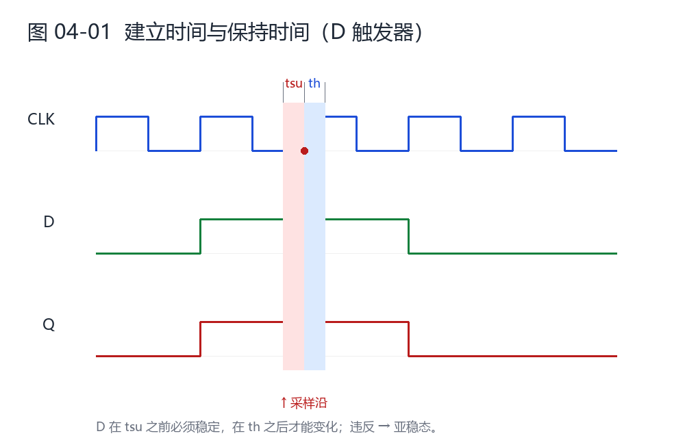
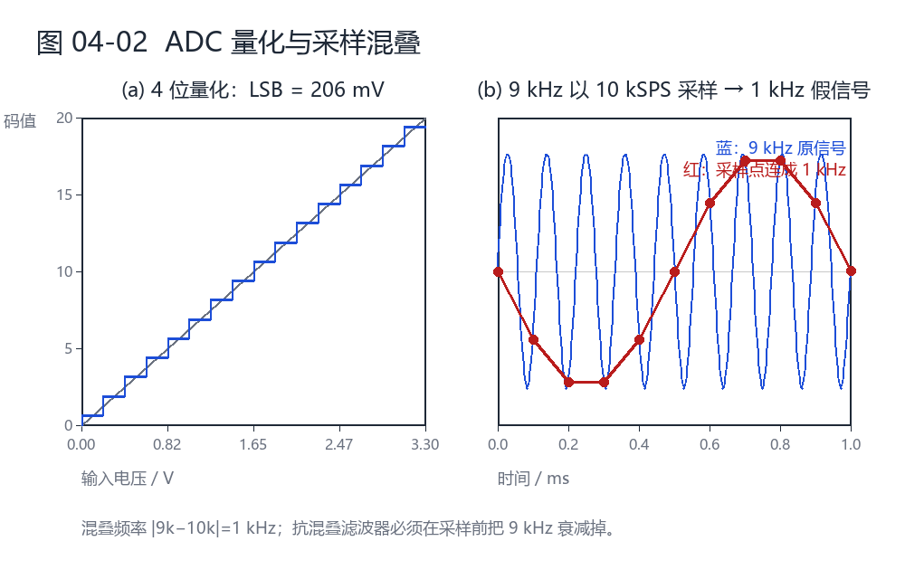

# 第 04 章 数字电子技术（下）

> 文档编号：EHB-04-02  
> 版本：v0.2.0  
> 日期：2026-11-13  
> 状态：草稿（待技术复核）  
> 深度：A/B  
> 前置：第 04 章上篇（4.1–4.6）  
> 对应项目：P4

---

## 4.7 时钟、建立保持与亚稳态

### 4.7.1 时钟来源

| 来源 | 精度 | 成本 | 用途 |
|---|---|---|---|
| 内部 RC | ±1%–±5% | 低 | 低速、低成本 |
| 外部晶振 | ±10–50 ppm | 中 | MCU 主时钟、通信 |
| 温补晶振（TCXO） | ±0.5–2 ppm | 高 | 精密计时、GNSS |
| PLL | 由参考决定 | 中 | 倍频、时钟树 |
| 恢复时钟 | 由数据流决定 | — | 高速串行 |

时钟抖动（jitter）与偏斜（skew）是时序预算的两个敌人。

### 4.7.2 时序方程

单周期路径（寄存器到寄存器）：

$$
T_{clk}\ge T_{co}+T_{comb}+T_{su}+T_{skew}
\tag{4-7}
$$

- $T_{co}$：时钟到输出延迟。
- $T_{comb}$：组合逻辑延迟。
- $T_{su}$：建立时间。
- $T_{skew}$：时钟偏斜（目的时钟比源时钟晚为正）。

保持时间：

$$
T_{co}+T_{comb}\ge T_h+T_{skew}
\tag{4-8}
$$

**例 4-6** $T_{clk}=10$ ns，$T_{co}=1$ ns，$T_{comb}=6$ ns，$T_{su}=2$ ns，$T_{skew}=0.5$ ns：

$$
1+6+2+0.5=9.5\ \text{ns}<10\ \text{ns}
$$

建立裕量 0.5 ns。若 $T_{comb}$ 增加到 7 ns，则 10.5 ns，违例，必须降频/改逻辑/加流水线。

*图 04-01 D 触发器建立/保持窗口。D 在窗口内变化会进入亚稳态。*

**例 4-7** 保持检查：$T_{co}=1$ ns，$T_{comb}=0.5$ ns，$T_h=1.5$ ns，$T_{skew}=0.2$ ns：

$$
1+0.5=1.5\ \text{ns}<1.5+0.2=1.7\ \text{ns}
$$

保持违例。保持违例不能靠降频解决，只能改逻辑/加延迟/调整时钟。

### 4.7.3 亚稳态

当 D 在建立/保持窗口内变化，触发器可能进入“既不是 0 也不是 1”的亚稳态，输出在某个中间电平停留一段时间，最终随机稳定。

亚稳态不能完全消除，只能降低概率。同步器（两级触发器）让第一级有足够时间稳定：

$$
MTBF=\frac{e^{t_r/\tau}}{T_0 f_{clk} f_{data}}
\tag{4-9}
$$

工程上不要求你手算 MTBF，但要知道：

- 跨时钟域必须同步（两级 FF 或异步 FIFO）。
- 单比特用两级 FF；多比特用格雷码/握手/FIFO，不能直接打两拍。
- 复位也要同步释放。

### 4.7.4 常见错误

- 跨时钟域直接连。
- 多比特信号分别打两拍（各位不同步，出现错误组合）。
- 用组合逻辑输出当时钟。
- 忽略时钟偏斜/抖动。

---

## 4.8 ADC 原理

### 4.8.1 常见架构

| 架构 | 速度 | 分辨率 | 特点 | 典型用途 |
|---|---|---|---|---|
| SAR | 中 | 8–18 位 | 逐次逼近，低功耗 | MCU 内置 ADC |
| ΔΣ | 低 | 16–24 位 | 过采样+噪声整形，高精度 | 传感器、音频 |
| Flash | 极快 | 4–8 位 | 并行比较，面积大 | 高速示波器 |
| Pipeline | 快 | 10–14 位 | 流水线，功耗较高 | 通信、视频 |
| 双积分 | 慢 | 高 | 抗工频干扰 | 万用表 |

### 4.8.2 分辨率、LSB 与量化误差

$N$ 位 ADC，满量程 $V_{FS}$：

$$
LSB=\frac{V_{FS}}{2^N}
\tag{4-10}
$$

量化误差在 $\pm0.5$ LSB 内，量化噪声 RMS 约 $LSB/\sqrt{12}$。

**例 4-8** 12 位、3.3 V：

$$
LSB=\frac{3.3}{4096}=0.806\ \text{mV}
$$

理想 SNR：

$$
SNR=6.02N+1.76\ \text{dB}
\tag{4-11}
$$

12 位 → 74.0 dB。实际用 SINAD 算 ENOB：

$$
ENOB=\frac{SINAD-1.76}{6.02}
\tag{4-12}
$$

若 SINAD=68 dB，则 ENOB≈11.0 位。

### 4.8.3 静态指标

- 失调误差：输入为 0 时输出不为 0。
- 增益误差：传输斜率偏差。
- INL（积分非线性）：实际传输曲线与理想直线的最大偏差。
- DNL（微分非线性）：相邻码宽度偏差；DNL 可能 >1 LSB，导致失码。

### 4.8.4 SAR ADC 的采样过程

SAR 通过“猜测-比较”逐位确定：

1. 采样保持电容记录输入。
2. 逐次比较：先试最高位，再试下一位。
3. $N$ 次比较得到 $N$ 位结果。

采样时间必须足够让采样电容充到输入电压（受源阻抗、开关电阻、电容影响）。见 4.9。

### 4.8.5 参考电压

ADC 输出码：

$$
D=\text{round}\left(\frac{V_{in}}{V_{REF}}\cdot2^N\right)
\tag{4-13}
$$

$V_{REF}$ 的误差直接变成增益误差。REF3033 的 0.68% 误差 ≈ 28 个 12 位码（见 3.11）。

---

## 4.9 采样、混叠与分辨率

### 4.9.1 采样定理

要无失真恢复带宽 $B$ 的信号，采样率必须：

$$
f_s>2B
\tag{4-14}
$$

实际工程取 $f_s\ge5B$–$10B$，给抗混叠滤波器留过渡带。

### 4.9.2 混叠

采样后，频率 $f$ 的信号会映射到：

$$
f_{alias}=|f-kf_s|,\qquad k=\text{整数}
\tag{4-15}
$$

**例 4-9** $f_s=10$ kSPS，输入 9 kHz 干扰：

$$
|9k-10k|=1\ \text{kHz}
$$

在频谱上看起来像 1 kHz 信号，无法与真实 1 kHz 区分。这就是“示波器上的假低频”。

*图 04-02 (a) 4 位量化；(b) 9 kHz 信号以 10 kSPS 采样后混叠成 1 kHz。*

### 4.9.3 抗混叠滤波器

必须在 ADC 前把 $f_s/2$ 以上的能量衰减到低于 ADC 噪声/分辨率。阶数估算：

- 一阶：-20 dB/dec。
- 二阶：-40 dB/dec。
- 四阶：-80 dB/dec。

**例 4-10** $f_s=10$ kSPS，$f_s/2=5$ kHz，信号带宽 1 kHz。若要求 5 kHz 处衰减 60 dB，二阶从 1 kHz 到 5 kHz 只有约 28 dB，不够；需四阶或更高，或提高 $f_s$。

### 4.9.4 采样保持与孔径抖动

采样保持（SHA）在采样瞬间“冻结”输入。孔径抖动 $t_j$ 引起电压误差：

$$
\Delta V=2\pi f V_{in} t_j
\tag{4-16}
$$

**例 4-11** $f=1$ MHz，$V_{in}=1$ V，$t_j=1$ ns：

$$
\Delta V=2\pi\times10^6\times1\times10^{-9}=6.28\ \text{mV}
$$

对 12 位、3.3 V（LSB=0.8 mV）是 7.8 个码。低频 1 kHz 时只有 6.3 µV，可忽略。**高速采样对时钟抖动极敏感。**

### 4.9.5 过采样与平均

过采样 4 倍可把量化噪声摊到更宽带宽，SNR 改善约 6 dB（1 位）：

$$
SNR_{improve}=10\log_{10}(OSR)\ \text{dB}
\tag{4-17}
$$

平均 $M$ 个样本，噪声降低 $\sqrt{M}$。但平均不能消除混叠，也不能消除 INL/失调。

### 4.9.6 常见错误

- 只看采样率，不加抗混叠滤波。
- 把“分辨率”当“精度”（ENOB 才是有效位数）。
- 采样时间不足，读数偏低。
- 多通道切换后不等待建立。

---

## 4.10 DAC 与 PWM

### 4.10.1 DAC 架构

- 电阻串：单调、易匹配，分辨率中等。
- R-2R 梯形：面积小、成本低，需激光修调/匹配。
- ΔΣ：高分辨率、低速，靠过采样与噪声整形。
- 电流舵：高速，用于通信。

DAC 关键指标：分辨率、INL/DNL、建立时间、毛刺（glitch）、输出噪声。

### 4.10.2 PWM 当 DAC

用 PWM + RC 低通产生模拟电压：

$$
V_{out}=D\cdot V_{DD}
\tag{4-18}
$$

纹波近似（$RC\gg T$）：

$$
V_{ripple}\approx\frac{V_{DD}D(1-D)}{f_{PWM}RC}
\tag{4-19}
$$

**例 4-12** $V_{DD}=3.3$ V，$D=0.5$，$f=20$ kHz，$R=1$ kΩ，$C=10$ µF：

$$
V_{ripple}\approx\frac{3.3\times0.25}{20k\times0.01}=4.1\ \text{mV}
$$

12 位 LSB=0.8 mV，4 mV 纹波约 5 个码。要更干净，提高 PWM 频率/增大 RC/加二阶滤波。

### 4.10.3 分辨率与时间

PWM 分辨率 $N$ 位，周期 $T$，最小脉宽 $T/2^N$。若时钟 72 MHz、PWM 20 kHz，计数范围 3600，约 11.8 位。

PWM DAC 的建立时间由 RC 决定，切换后要等 5RC 才稳定。

### 4.10.4 常见错误

- RC 太小，纹波大。
- RC 太大，响应慢。
- 用 PWM 直接驱动模拟负载（未滤波）。
- 忽略 PWM 边沿的 EMI。

---

## 4.11 存储器基础

### 4.11.1 类型对比

| 类型 | 掉电保持 | 速度 | 擦写寿命 | 用途 |
|---|---|---|---|---|
| SRAM | 否 | 快 | 无限 | 缓存、变量 |
| DRAM | 否（需刷新） | 中 | 无限 | 主存 |
| NOR Flash | 是 | 读快、写慢 | 1万–10万次 | 代码存储 |
| NAND Flash | 是 | 块读写 | 1千–10万次 | 数据存储 |
| EEPROM | 是 | 慢 | 100万次 | 参数、校准 |

### 4.11.2 MCU 存储器映射

- Flash：程序、常量。
- SRAM：栈、堆、全局变量。
- EEPROM/模拟 EEPROM：校准参数、故障记录。
- 外扩 Flash/SD：日志、图像。

### 4.11.3 写寿命与掉电

- Flash 按扇区擦除，写入前必须擦除。
- 频繁写参数要用磨损均衡或 FRAM。
- 掉电时正在写 Flash 可能损坏数据；需掉电检测 + 备份区。
- EEPROM 写入时间 ms 级，不能频繁写。

### 4.11.4 常见错误

- 在中断里写 Flash（阻塞、掉电风险）。
- 不做掉电保护。
- 忽略 Flash 等待周期对主频的限制。
- 把 SD 卡当可靠存储（无磨损均衡/掉电保护）。

---

## 4.12 数字输入输出的实际电气特性

### 4.12.1 推挽与开漏

- **推挽**：主动拉高/拉低，速度快、驱动强；不能两个输出直接并联（会短路）。
- **开漏**：只能拉低，高电平靠上拉；适合总线（I2C）、电平转换、线与。

上拉电阻选择：

$$
R_{pull}=\frac{V_{DD}-V_{OL}}{I_{OL}},\qquad
t_r\approx2.2R_{pull}C_L
\tag{4-20}
$$

**例 4-13** I2C 快速模式 400 kHz，$C_b=200$ pF，要求 $t_r\le300$ ns：

$$
R_{max}=\frac{t_r}{0.8473C_b}=\frac{300n}{0.8473\times200p}=1.77\ \text{k}\Omega
$$

4.7 kΩ 太大（$t_r\approx0.8$ µs），应选 1.5 kΩ 左右，同时校验 $I_{OL}$ 与功耗。

### 4.12.2 电平转换

| 场景 | 方法 |
|---|---|
| 3.3 V 推挽 → 5 V CMOS | 专用电平转换器/缓冲器 |
| 3.3 V 开漏 → 5 V | 上拉到 5 V（确认 3.3 V 器件耐 5 V） |
| 5 V → 3.3 V | 分压/电平转换器（注意速度） |
| 双向 I2C | 专用双向电平转换（如 PCA9306） |
| 高速 SPI | 专用转换器，注意传播延迟 |

**绝对最大值**：很多 3.3 V MCU 引脚不耐 5 V，即使开漏上拉到 5 V 也不行。查 Datasheet 的“5 V tolerant”标注。

### 4.12.3 驱动能力与振铃

- 输出电流有限（通常 4–20 mA），驱动 LED/继电器要用三极管/MOSFET。
- 长线/大电容导致上升沿变慢、振铃；串 22–100 Ω 电阻可抑制。
- 未使用输入不要悬空：接固定电平或配置为输出。

### 4.12.4 ESD 与保护

- 人体 ESD 可达 ±8 kV，接口必须加 TVS/ESD 保护。
- 串联电阻限流，TVS 钳位。
- 连接器插拔时先接地，避免带电插拔。

### 4.12.5 与 MCU 的连接清单

- [ ] 电平是否兼容（$V_{OH}/V_{IH}$，绝对最大值）。
- [ ] 电流是否足够（LED、继电器、长线）。
- [ ] 是否需要上拉/下拉（I2C、复位、BOOT）。
- [ ] 是否需要串阻/滤波（振铃、EMI）。
- [ ] 是否需要 ESD/浪涌保护（外部接口）。
- [ ] 引脚复用是否正确（SWD、晶振、BOOT）。
- [ ] 未用引脚如何处理（模拟输入接地/输出低）。

---

## 4.13 实验：逻辑门、触发器与 ADC 采样

对应[《基础实验手册》](../12_智能装备综合硬件系统/实验/00_基础实验手册.md)实验 9、10：

- 用 74HC00/74HC74 搭 SR 锁存器、D 触发器，测真值表与时序。
- 用 MCU 的 ADC 采 1 kHz 正弦/方波，改变采样率，观察混叠。
- 用 PWM + RC 产生直流，测纹波。

要求：记录真值表、时序图、FFT/频谱（可用示波器 FFT 或 Python 处理 CSV）。

---

## 本章习题与解析

### 习题

1. 3.3 V CMOS：$V_{OH}=3.1$ V，$V_{IH}=2.0$ V，$V_{OL}=0.3$ V，$V_{IL}=0.8$ V，求 $NM_H$、$NM_L$。
2. 将 -25 表示为 8 位补码。
3. 化简 $F=A'B+AB+AB'$。
4. 4 位二进制数 1011 与 0110 相加，结果是多少？是否溢出（无符号/补码）？
5. 12 位 ADC、$V_{REF}=3.3$ V，输入 1.0 V，输出码是多少？
6. 采样率 8 kSPS，输入 7.5 kHz，混叠频率是多少？
7. 16 位 ADC 的理想 SNR 是多少？若 SINAD=86 dB，ENOB 是多少？
8. I2C 上拉 2.2 kΩ，$C_b=150$ pF，求上升时间（0.8473RC）。
9. 8 位 PWM、20 kHz、3.3 V、RC=1 kΩ×10 µF，占空比 50%，求纹波。
10. 时钟 100 MHz，$T_{co}=1$ ns，$T_{comb}=6$ ns，$T_{su}=2$ ns，$T_{skew}=0.4$ ns，判断建立时间是否满足。

### 解析

**1.** $NM_H=1.1$ V，$NM_L=0.5$ V。

**2.** 25=`0001 1001`，取反 `1110 0110`，+1=`1110 0111`=0xE7。

**3.** $A'B+AB=B$；$AB+AB'=A$；$F=A+B$。

**4.** 1011(11)+0110(6)=10001(17)，4 位结果 0001，进位 1。无符号溢出；补码 1011=-5，0110=6，-5+6=1，不溢出。

**5.** $D=1.0/3.3\times4096=1241.2$，取 1241。

**6.** $|7.5k-8k|=0.5$ kHz。

**7.** $6.02\times16+1.76=98.1$ dB；$ENOB=(86-1.76)/6.02=14.0$。

**8.** $t_r=0.8473\times2.2k\times150p=0.28$ µs。

**9.** $V_{ripple}=3.3\times0.25/(20k\times0.01)=4.1$ mV。

**10.** $1+6+2+0.4=9.4$ ns < 10 ns，满足，裕量 0.6 ns。

---

## 本章小结

1. 数字接口的可靠性由电平、时序、噪声容限共同决定。
2. 补码是 MCU 内部的有符号表示；注意范围、溢出、符号扩展。
3. 组合逻辑有毛刺，同步设计在时钟沿采样。
4. 建立/保持时间是时序设计的基本约束；跨时钟域必须同步。
5. ADC 的分辨率不等于精度；ENOB、INL/DNL、参考、噪声共同决定有效位数。
6. 采样前必须抗混叠；采样保持与时钟抖动限制高速精度。
7. 数字 I/O 要查电平、电流、上拉、保护与引脚复用。

### 检查清单

- [ ] 能算噪声容限并判断互连。
- [ ] 能完成补码转换与溢出判断。
- [ ] 能画出 D 触发器时序并标 $t_{su}/t_h$。
- [ ] 能算 ADC 的 LSB、SNR、ENOB。
- [ ] 能解释混叠并设计抗混叠滤波。
- [ ] 能选 I2C 上拉并校验上升时间。
- [ ] 能列出 MCU 引脚连接的 7 项检查。

### 参考资料

- [REF-I03] 阎石《数字电子技术基础》第 6 版，第 6–10 章。
- [REF-A03] ADI *Data Conversion Handbook*，Ch. 2、5、6。
- [REF-A08] TI Precision Labs，ADC 章节。
- [REF-B08] ARM Cortex-M 技术参考手册。
