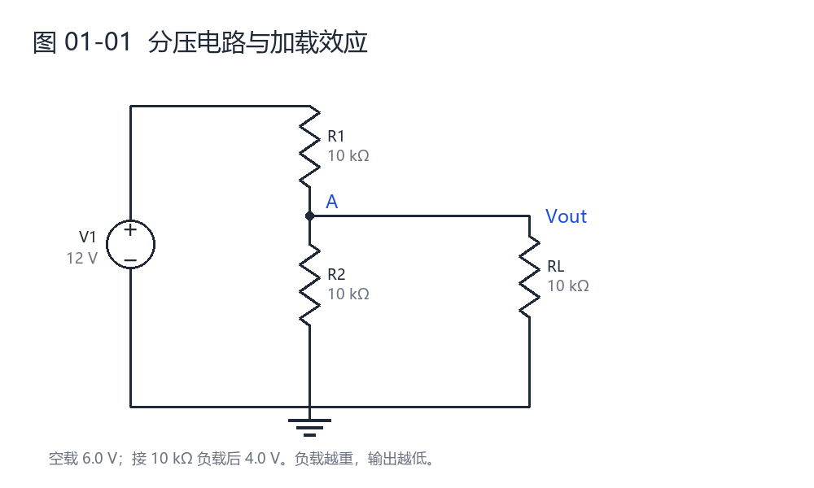
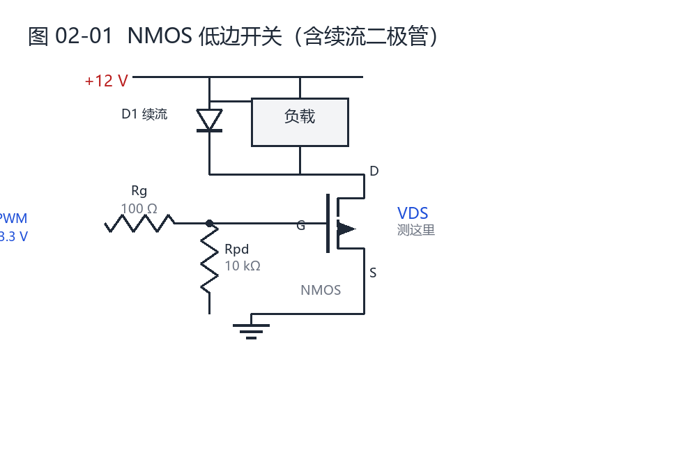
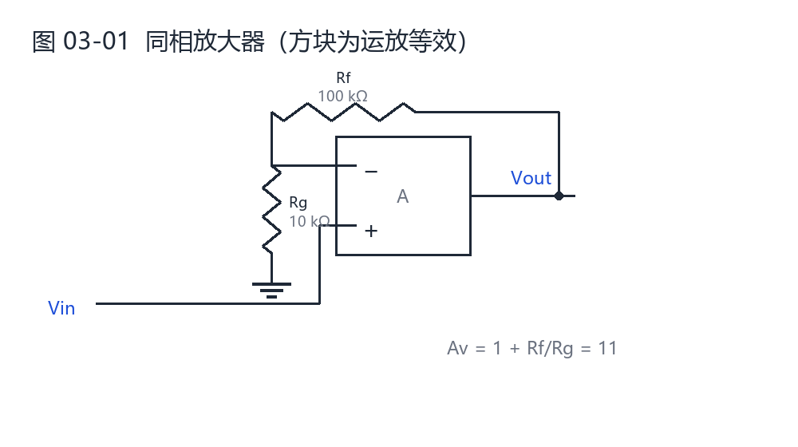
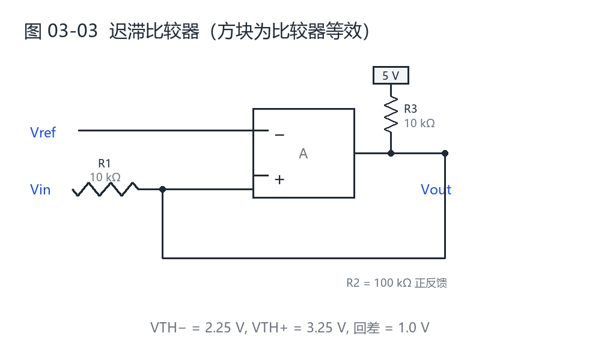

# 基础实验手册（第 01–04 章）

> 文档编号：EHB-LAB-01  
> 版本：v1.1.0  
> 日期：2026-11-14  
> 状态：初稿（**未实操复核**；按安全边界使用）  
> 适用：第 01–04 章，S0–S2 阶段  
> 安全边界：≤24 V DC，≤0.5 A（除电机实验 ≤2 A），禁止市电

---

## 0. 实验总则

### 0.1 安全

1. 上电前检查极性、短路、器件方向；首次上电必须限流。
2. 改线前断电，母线电容放电（等待 ≥10 s）。
3. 示波器探头地线只接电路地，不接开关节点/高边。
4. 电机固定、加防护；先低速。
5. 烙铁通风、归位；护目镜。
6. 冒烟/异味/发热立即断电，不要用手摸。

> 每个实验的限流值见 0.4 表；首次上电取表中值的一半，确认无短路/异常后再升到表中值。

### 0.2 记录

每个实验记录：

- 日期、实验号、版本。
- 元件实测值（万用表/LCR）。
- 电路图或接线表。
- 预测值（先写）。
- 测量值（表格/波形）。
- 差异与解释。
- 故障与修复。

### 0.3 仪器

| 仪器 | 用途 | 注意 |
|---|---|---|
| 万用表 | 电压/电流/通断/二极管 | 电流档串联，勿并联 |
| 直流电源 | 供电 | 先设限流，再接线 |
| 示波器 | 波形/时序 | ×10 探头，校准 |
| 信号发生器 | 正弦/方波 | 幅值/偏置 |
| 面包板 | 快速验证 | 接触电阻大，高频慎用 |

### 0.4 实验索引与安全参数

| # | 实验 | 电压 | 限流建议 | 主要风险 | 建议时间 | 前置 |
|---|---|---|---|---|---|---|
| 1 | 分压/戴维南 | 12 V | ≤100 mA | 低 | 1–2 h | 01.1–01.5 |
| 2 | RC 充放电 | 3.3 V | ≤50 mA | 低 | 1–2 h | 01.6 |
| 3 | 二极管伏安 | 5 V | ≤50 mA | 反接/过热 | 1–2 h | 02.2 |
| 4 | BJT 开关 | 5 V | ≤100 mA | 继电器反电动势 | 2 h | 02.3 |
| 5 | MOSFET 开关 | 12 V | ≤0.5 A | 感性尖峰/发热 | 2–3 h | 02.4 |
| 6 | 运放放大 | ±5 V | ≤50 mA | 短路/饱和 | 2–3 h | 03.1–03.7 |
| 7 | RC 滤波 | 5 V | ≤20 mA | 低 | 1–2 h | 03.9 |
| 8 | 比较器 | 5 V | ≤20 mA | 低 | 1–2 h | 03.8 |
| 9 | 逻辑/触发 | 5 V | ≤50 mA | 电源反接 | 2 h | 04.3–04.6 |
| 10 | ADC 采样 | 3.3 V | ≤20 mA | 过压 | 2 h | 04.8–04.9 |

> 表中限流是“建议上限”，不是器件极限；首次上电取更小值。电机实验另见第 07 章/项目 3 的安全说明。

### 0.5 数据记录表（通用，复制到实验报告）

| 项目 | 记录 |
|---|---|
| 日期/实验号/版本 |  |
| 仪器型号/量程/探头 |  |
| 元件实测值（R/C/L） |  |
| 预测值（先写） |  |
| 测量值 1 |  |
| 测量值 2 |  |
| 测量值 3 |  |
| 波形/截图编号 |  |
| 与预测的差异 |  |
| 差异解释 |  |
| 故障/修复 |  |
| 结论 |  |

---

## 实验 1 电阻串并联与分压

**目标**：验证欧姆定律、分压公式、加载效应与戴维南等效。

**器材**：12 V 电源、10 kΩ×3（±1%）、万用表、面包板。

**接线表**

| 从 | 到 | 说明 |
|---|---|---|
| 电源 + | R1 上端 | 12 V |
| R1 下端 | R2 上端 / 节点 A | 分压点 |
| R2 下端 | 电源 − / GND | — |
| 节点 A | 万用表 + | 测 $V_A$ |
| 电源 − | 万用表 − | 共地 |



*接线示意：R1、R2 串联，节点 A 为输出；RL 并在 R2 两端。*

**步骤**

1. 用万用表实测 R1、R2，记录。
2. 空载测 $V_A$，与 $12R_2/(R_1+R_2)$ 比较。
3. 在 A 与地之间接 R3=10 kΩ，再测 $V_A$。
4. 计算戴维南 $U_{oc}$、$R_{th}$，预测带载电压，与实测比较。
5. 改变 R3=1 kΩ，观察加载。

**预期**

- 空载：6.0 V（若电阻精确）。
- 带 10 kΩ：4.0 V。
- 带 1 kΩ：$R_2\parallel R_3=0.909$ kΩ，$V=12\times0.909/10.909=1.0$ V。

**故障排查**

| 现象 | 可能原因 |
|---|---|
| 一直 12 V | R2 开路/未接地 |
| 一直 0 V | R1 开路/电源未上 |
| 读数不稳 | 面包板接触不良 |
| 比预测低很多 | 万用表内阻/负载 |

**思考**：为什么万用表测高阻节点会“改变电路”？

---

## 实验 2 RC 充放电

**目标**：测时间常数、验证 5τ 规则、理解电容电压不能突变。

**器材**：3.3 V 电源、10 kΩ、100 nF、示波器、信号发生器（方波）或开关。

**接线**

```text
方波源 ──[R 10 kΩ]──┬── 示波器 CH1
                    │
                 [C 100 nF]
                    │
                   GND
```

- 方波经 R 接 C，C 另一端接地；示波器 CH1 测 C 电压。
- 方波 0–3.3 V，频率 100 Hz（周期 10 ms，足够 5τ=5 ms）。

**步骤**

1. 计算 $\tau=RC=1$ ms。
2. 观察充电曲线，测 0→63.2% 的时间。
3. 测 0→99.3% 的时间（5τ）。
4. 改变 R=100 kΩ，重复；解释为什么波形变“斜”。

**预期**

- τ≈1 ms，5τ≈5 ms。
- R=100 kΩ：τ=10 ms，5τ=50 ms，10 ms 周期内只充到 63%。

**故障排查**

| 现象 | 原因 |
|---|---|
| 波形是方波 | C 未接/虚焊 |
| 上升沿有尖峰 | 探头接地不良 |
| τ 明显偏小 | 电容实际值偏小/电阻错 |

---

## 实验 3 二极管伏安特性

**目标**：测正向导通电压、反向截止、LED 压降。

**器材**：0–5 V 可调电源、1 kΩ、1N4148、1N5819、LED、万用表。

**接线**

```text
+5 V ──[R 1 kΩ]──[D 阳极→阴极]── GND
                  │            │
                  +── 万用表 V ─+
```

- 电源 + → 1 kΩ → 二极管阳极 → 阴极 → 电源 −。
- 万用表测二极管两端电压；电流由 $(V_{supply}-V_D)/1k$ 计算。

**步骤**

1. 从 0 V 缓慢升到 5 V，每 0.1 V 记录 $V_D$ 与电流。
2. 画 $I$–$V$ 曲线，找“膝点”。
3. 换 1N5819，比较 $V_F$。
4. 换 LED（串 220 Ω），测 $V_F$ 与亮度。
5. 反接二极管，测反向电流（应为 µA 级）。

**预期**

- 1N4148：$V_F$ 0.6–0.75 V（10 mA）。
- 1N5819：$V_F$ 0.25–0.4 V。
- LED：红 1.8–2.2 V，蓝/白 2.8–3.4 V。

**故障排查**

| 现象 | 原因 |
|---|---|
| 电流为 0 | 二极管反接/开路 |
| 电压一直 5 V | 二极管未导通/极性错 |
| 发热 | 限流不足 |

---

## 实验 4 BJT 开关

**目标**：验证饱和开关、测 $V_{CE(sat)}$、理解基极电阻。

**器材**：3.3 V/5 V 电源、2N3904、1 kΩ/10 kΩ、LED+220 Ω 或 5 V 继电器+1N4148、万用表。

**接线（NPN 低边）**

| 从 | 到 |
|---|---|
| 3.3 V | R_B 1 kΩ → 基极 |
| 集电极 | LED 阴极（LED 阳极经 220 Ω 到 5 V） |
| 发射极 | GND |
| 继电器线圈 | 5 V 与集电极之间，线圈并联 1N4148（阴极接 5 V） |

```text
3.3 V ──[Rb 1 kΩ]── B
5 V ──[LED+220 Ω / 继电器]── C
E ── GND
```

**步骤**

1. 不接基极，测 LED 应不亮（截止）。
2. 基极经 1 kΩ 接 3.3 V，测 $V_{BE}$、$V_{CE}$、$I_B$、$I_C$。
3. 计算强制 β=$I_C/I_B$，判断是否饱和。
4. 换 10 kΩ 基极电阻，观察 $V_{CE}$ 上升（欠饱和）。
5. 继电器实验：听吸合声，断电时用示波器看集电极尖峰（加/不加续流二极管对比）。

**预期**

- $V_{BE}\approx0.7$ V，$V_{CE(sat)}\approx0.1$–0.3 V。
- 1 kΩ 时 $I_B\approx2.6$ mA，LED 电流约 10 mA，饱和。
- 10 kΩ 时 $I_B\approx0.26$ mA，可能放大区，$V_{CE}$ 升高。

**故障排查**

| 现象 | 原因 |
|---|---|
| 不亮 | 基极没驱动/管脚错 |
| 很暗 | 基极电阻太大/饱和不足 |
| 关断尖峰高 | 续流二极管缺失/反接 |

---

## 实验 5 MOSFET 开关

**目标**：测 $V_{DS(on)}$、栅极波形、开关振铃、温升。

**器材**：12 V/0.5 A 电源、IRLZ44N、3.3 V PWM（MCU 或信号源）、12 V 灯泡/电机、1N5819 续流、10 kΩ 栅极下拉、100 Ω 栅极电阻。

**接线**



- 12 V → 负载 → 漏极 D；源极 S → GND。
- 栅极 G 经 100 Ω 接 PWM，10 kΩ 下拉到 GND。
- 负载并联续流二极管（阴极接 12 V）。

**步骤**

1. 栅极 0 V，确认关断。
2. 栅极 3.3 V 直流，测 $V_{DS}$、负载电流、壳温。
3. 加 20 kHz PWM，占空比 50%，看 $V_{DS}$ 波形与振铃。
4. 改变栅极电阻 10 Ω/100 Ω，比较上升沿与振铃。
5. 运行 5 min，测温升。

**预期**

- 3.3 V 驱动时 $V_{DS(on)}$ 可能高于 Datasheet 的 4.5 V 值；若明显发热，说明驱动不足。
- 关断时 $V_{DS}$ 尖峰应 ≤44 V（约 80% 耐压）；接近 55 V 绝对最大值说明续流/布局不合格，必须停机检查。

**故障排查**

| 现象 | 原因 |
|---|---|
| 一直导通 | 栅极悬空/漏源反接 |
| 发热严重 | 驱动不足/开关损耗/散热 |
| 尖峰过高 | 续流不足/布线电感大 |

---

## 实验 6 运算放大器放大

**目标**：测同相/反相增益、带宽、失调。

**器材**：OPA2188（或 NE5532/OPA333）、±5 V 或 5 V 单电源、电阻 1 kΩ/10 kΩ/100 kΩ、信号发生器、示波器。

**接线（同相，单电源需偏置）**



- $V_{in}$ 经 10 kΩ 到同相端，同相端经 100 kΩ 到 2.5 V 偏置（或双电源接地）。
- 反相端经 1 kΩ 到地，经 10 kΩ 到输出。
- 增益 $1+10/1=11$。

**步骤**

1. 输入 0.1 Vpp/1 kHz，测输出，算增益。
2. 改变频率 10 Hz–100 kHz，找 -3 dB 点，与 GBW/11 比较。
3. 输入接地，测输出直流失调，算输入失调。
4. 观察输出削顶（电源轨限制）。

**预期**

- 增益≈11（电阻 1% 时误差 <2%）。
- OPA2188 GBW=2 MHz，闭环带宽约 180 kHz。
- 失调在 mV 级。

**故障排查**

| 现象 | 原因 |
|---|---|
| 输出饱和 | 偏置不对/增益太大 |
| 振荡 | 容性负载/布线长 |
| 增益不对 | 电阻接错/虚焊 |

---

## 实验 7 RC 滤波

**目标**：测一阶低通幅频、截止频率、相位。

**器材**：10 kΩ、10 nF、信号发生器、示波器（双通道）。

**接线**

```text
Vin ──[R 10 kΩ]──┬── 示波器 CH2（Vout）
                 │
              [C 10 nF]
                 │
                GND
CH1 接 Vin
```

**步骤**

1. 计算 $f_c=1/(2\pi RC)=1591.5$ Hz。
2. 在 100 Hz、1 kHz、1.59 kHz、10 kHz、100 kHz 测幅值与相位差。
3. 画 Bode 图（可用 Python/Excel）。
4. 与理论 $|H|=1/\sqrt{1+(f/f_c)^2}$ 比较。

**预期**

- $f_c$ 处幅值 -3 dB（0.707），相位 -45°。
- 10$f_c$ 处 -20 dB，相位 -84°。

**故障排查**

| 现象 | 原因 |
|---|---|
| 没有衰减 | C 未接 |
| 衰减过快 | 探头电容/负载 |
| 相位测不准 | 双通道未校准/触发 |

---

## 实验 8 比较器

**目标**：测阈值、回差、输出电平。

**器材**：LM393、10 kΩ×3、100 kΩ、电位器、5 V 电源、万用表。

**接线**



- $V_{ref}$ 用电位器分压到反相端。
- 输入经 10 kΩ 到同相端，输出经 100 kΩ 到同相端（正反馈）。
- 输出开漏，接 10 kΩ 上拉到 5 V。

**步骤**

1. 慢慢调输入，从低到高，记录输出翻转时的 $V_{in}$（$V_{TH+}$）。
2. 从高到低，记录 $V_{TH-}$。
3. 计算回差，与 $2V_{sat}R_1/R_2$ 比较。
4. 去掉正反馈，观察输出在阈值附近抖动。

**预期**

- $V_{ref}=2.5$ V，$R_1=10k$，$R_2=100k$：$V_{TH-}=2.25$ V，$V_{TH+}=3.25$ V（若 $V_{sat}=5$ V）。

**故障排查**

| 现象 | 原因 |
|---|---|
| 不翻转 | 输入超出范围/电源未接 |
| 输出一直高 | 上拉/接线错 |
| 回差不对 | 电阻值错/正反馈未接 |

---

## 实验 9 逻辑门与触发器

**目标**：验证真值表、SR 锁存器、D 触发器时序。

**器材**：74HC00（NAND）、74HC74（D FF）、LED+330 Ω、按键、5 V 电源。

**步骤**

1. 用 74HC00 搭 SR 锁存器（两个 NAND 交叉耦合），测 $S/R$ 四种组合。
2. 用 74HC74 搭 D 触发器：D 接开关，CLK 接按键/方波，Q 接 LED。
3. 测 CP 上升沿前后的 Q，验证“边沿采样”。
4. 用信号发生器给 CLK，示波器看 D、CLK、Q 的时序。

**预期**

- SR：$S=0,R=1$ 置位；$S=1,R=0$ 复位；$S=R=1$ 保持（NAND 实现）。
- D FF：上升沿时 $Q=D$；其余时间保持。

**故障排查**

| 现象 | 原因 |
|---|---|
| 输出不定 | 输入悬空/未接上拉 |
| 不翻转 | 时钟没到/按键抖动 |
| 发热 | 电源反接/输出短路 |

---

## 实验 10 ADC 采样基础

**目标**：观察采样、量化、混叠；测有效位数。

**器材**：STM32 开发板、1 kHz 正弦/方波信号源、电位器、示波器、串口。

**步骤**

```text
信号源 ──[R 10 kΩ]──┬── ADC 输入引脚
                    │
                 [C 10 nF]
                    │
                   GND
```

1. 用 ADC 采电位器直流，改变电压，记录码值，算 LSB 与线性度。
2. 采 1 kHz 正弦，采样率设为 10 kSPS、20 kSPS、100 kSPS，观察波形。
3. 输入 9 kHz 正弦，采样 10 kSPS，观察“假 1 kHz”。
4. 加 RC 抗混叠（10 kΩ+10 nF），重复步骤 3。
5. 用 FFT（Python/示波器）看频谱与 ENOB。

**预期**

- 12 位、3.3 V：LSB=0.806 mV。
- 9 kHz 采 10 kSPS：混叠到 1 kHz。
- 加抗混叠后 9 kHz 幅度明显下降。

**故障排查**

| 现象 | 原因 |
|---|---|
| 读数跳动大 | 参考噪声/接地/采样时间不足 |
| 一直是 0/满量程 | 通道/引脚配置错 |
| 混叠不明显 | 信号源幅度太小/滤波已存在 |

---

## 实验报告模板

```markdown
# 实验 N：标题
## 1. 目标
## 2. 器材与实测值
## 3. 电路/接线
## 4. 预测（先写）
## 5. 步骤
## 6. 数据与波形
## 7. 计算与误差分析
## 8. 故障与修复
## 9. 结论与思考
```

---

## 常见故障速查

| 现象 | 先查 |
|---|---|
| 全部无电 | 电源、限流、接线 |
| 电压不对 | 分压、极性、负载 |
| 波形振铃 | 探头地线、走线、端接 |
| 运放饱和 | 偏置、增益、电源轨 |
| 数字不翻转 | 时钟、使能、悬空输入 |
| 发热 | 短路、过流、驱动不足 |
| 噪声大 | 地环路、电源、屏蔽 |
