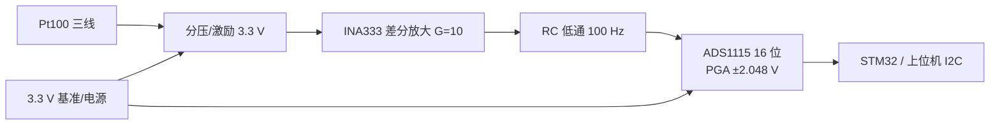

# 项目 1：传感器信号采集模块（Pt100 / 桥式）

> 文档编号：EHB-PROJ-01  
> 版本：v0.3.0  
> 状态：设计级（未打样、未实测）  
> 对应章节：第 03、05 章  
> 安全：≤5 V、≤10 mA

---

## 1. 需求分析

| 项 | 指标 |
|---|---|
| 输入 | 三线 Pt100，0–200 °C |
| 精度目标 | ±0.2 °C（设计目标，需标定） |
| 分辨率 | ≤0.05 °C |
| 输出 | I2C（ADS1115），3.3 V 逻辑 |
| 供电 | 3.3 V（±5%），≤10 mA |
| 环境 | 0–50 °C，电机/变频器附近 |
| 接口 | 4 针：3.3V/GND/SDA/SCL；传感器 3 线 |

**非目标**：不做隔离、不做 4–20 mA 输出、不做高精度计量级（0.01 °C）。

---

## 2. 系统框图



---

## 3. 方案比较

| 方案 | 优点 | 缺点 | 结论 |
|---|---|---|---|
| A：恒流 + RTD + INA | 线性好、线阻影响小 | 需电流源 | 备选 |
| B：3.3 V 分压 + INA（比例式） | 简单、便宜、比例式抵消电源漂移 | 非线性、激励随温度略变 | **采用** |
| C：专用 RTD 芯片（MAX31865） | 集成、精度高 | 成本高、学习点少 | 量产可选 |

选 B 作为教学方案，C 作为工程替代。

---

## 4. 原理与参数计算

### 4.1 分压与激励

$R_{ref}=3.3\ \text{k}\Omega$ 与 Pt100 串联，3.3 V 激励：

$$
V_{PT}=3.3\frac{R_{PT}}{3300+R_{PT}}
\tag{P1-1}
$$

0 °C：$R=100\ \Omega$，$V=97.1$ mV，$I=0.971$ mA。  
200 °C：$R=177.0\ \Omega$，$V=168.0$ mV，$I=0.948$ mA。

### 4.2 增益

INA333：

$$
G=1+\frac{100k}{R_G}
\tag{P1-2}
$$

取 $R_G=11\ \text{k}\Omega$ → $G=10.09$。输出 0.98–1.68 V，落在 ADS1115 ±2.048 V 范围内。

### 4.3 ADC 分辨率

ADS1115、PGA ±2.048 V、16 位：

$$
LSB=\frac{4.096}{65536}=62.5\ \mu\text{V}
\tag{P1-3}
$$

折算到 INA 输入：$62.5/10.09=6.2\ \mu\text{V}$。Pt100 在 0.1 °C 时约 38.5 µV（1 mA），约 6 LSB，满足 0.05 °C 分辨率目标。

### 4.4 噪声与带宽

INA333 噪声约 50 nV/√Hz，RC 截止 100 Hz（噪声带宽约 157 Hz）：

$$
E_n=50\text{ nV}\times\sqrt{157}\approx0.63\ \mu\text{V}_{rms}
\tag{P1-4}
$$

增益 10 → 6.3 µV RMS，约 0.1 LSB，可接受。

### 4.5 三线补偿

- 三条线同规格、同长度。
- 本设计的三线接法只把两根测量线接到 INA 输入，线阻主要靠软件零点/两点校准修正；**不是严格的三线硬件补偿**。
- 若线缆长、精度要求高，改四线（开尔文）或专用 RTD 芯片（MAX31865）。

---

## 5. 器件选型与 BOM

| 位号 | 器件 | 参数 | 封装 | 说明 |
|---|---|---|---|---|
| U1 | INA333 | 零漂移仪表放大 | MSOP-8 | 低噪声、低失调 |
| U2 | ADS1115 | 16 位 Σ-Δ、I2C | VSSOP-10 | PGA、内部基准 |
| R1 | 3.3 kΩ | ±0.1%、25 ppm/°C | 0805 | 激励电阻 |
| R2–R4 | 100 Ω | ±1% | 0603 | 输入限流/滤波 |
| C1 | 100 nF | C0G | 0603 | 差分滤波 |
| C2 | 1 µF | X7R | 0603 | 去耦 |
| J1 | 4 pin | 2.54 mm | — | I2C/电源 |
| J2 | 3 pin | 3.81 mm | — | Pt100 |

完整 BOM：[BOM/项目1_BOM.csv](BOM/项目1_BOM.csv)。

---

## 6. 原理图（设计级）

```text
3.3V ──[R1 3.3k 0.1%]──┬── Pt100 ── GND
                       │
                       ├── INA+ (经 100Ω)
                       └── INA- (经 100Ω，第三线)
INA333 G=10 ──[R 1k]──[C 100n]── ADS1115 AIN0/AIN1
ADS1115 SDA/SCL ── 4.7k 上拉 ── 3.3V
```

差分布线：R1/Pt100 走线等长、远离电机线；INA 输入加 RC（1 kΩ+100 nF）共模/差模滤波。

---

## 7. 仿真

文件：[仿真/项目1_sensor_frontend.cir](仿真/项目1_sensor_frontend.cir)。

用行为级 INA（E 源增益 10）+ RC + 负载，扫描 Pt100 从 100 Ω 到 177 Ω，检查输出范围与建立时间。**未运行验证**（本机无 ngspice）。

---

## 8. PCB 设计要点（未提供工程文件）

- 4 层：信号-地-电源-信号；模拟区独立铺地。
- INA 输入走线短、等长、包地；远离 I2C/电源。
- 3.3 V 经磁珠/LC 给模拟区；ADS1115 去耦靠近引脚。
- 传感器连接器加 TVS/RC；外壳地/信号地按现场处理。
- 测试点：3.3V、GND、INA OUT、SDA/SCL。

---

## 9. 上电检查

- [ ] 3.3 V 对地电阻 >100 Ω（无短路）。
- [ ] 限流 20 mA 上电，电流 <10 mA。
- [ ] 3.3 V 纹波 <20 mV。
- [ ] I2C 扫描到 ADS1115 地址（0x48）。
- [ ] 短接 INA 输入，读数接近 0（失调 <5 mV）。

---

## 10. 测试与验收

| 测试 | 方法 | 目标 |
|---|---|---|
| 零点 | 冰水 0 °C（或 100 Ω 精密电阻） | ±0.2 °C |
| 增益 | 100 Ω/138.5 Ω/177.0 Ω 电阻模拟 | 非线性 <0.5% |
| 噪声 | 短接输入，记录 100 个样本 | RMS <0.05 °C |
| 温漂 | 0–50 °C 环境 | <0.1 °C/10 °C |
| 干扰 | 旁边电机 PWM 运行 | 读数跳变 <0.1 °C |

**验收**：0–200 °C 内 ±0.2 °C（经两点校准）；分辨率 0.05 °C；I2C 100 kHz 稳定。

---

## 11. 故障排查

| 现象 | 原因 | 处理 |
|---|---|---|
| 读数满量程 | 输入开路/短路 | 查 Pt100/接线 |
| 读数跳动 | 地环路/电机干扰 | 屏蔽、RC、单点地 |
| 非线性大 | 分压非比例/增益饱和 | 查 R1、G、ADC 范围 |
| I2C 无响应 | 上拉/地址/电源 | 查 4.7k、0x48、3.3V |

---

## 12. 改进方向

- 改四线 RTD 或 MAX31865。
- 加隔离 I2C/隔离电源。
- 加 EEPROM 存校准系数。
- 改成 24 V 供电 + 隔离 4–20 mA 输出。
