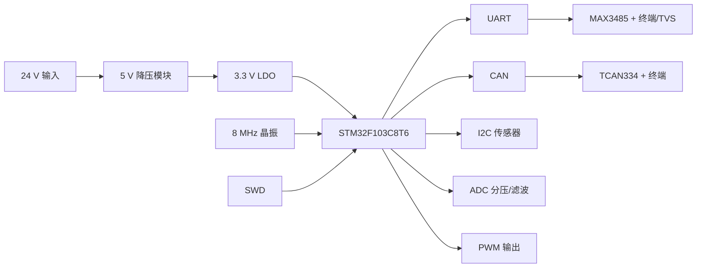

# 项目 2：STM32 最小系统与接口板

> 文档编号：EHB-PROJ-02  
> 版本：v0.3.0  
> 状态：设计级（未打样、未实测）  
> 对应章节：第 04、06、10 章  
> 安全：5 V/3.3 V，≤500 mA

---

## 1. 需求分析

| 项 | 指标 |
|---|---|
| MCU | STM32F103C8T6（LQFP48） |
| 供电 | 24 V 输入（可选）、5 V 外供、3.3 V/300 mA |
| 时钟 | 8 MHz HSE + 内部 HSI |
| 调试 | SWD 4 针 |
| 接口 | UART×1（RS-485）、CAN×1、I2C×1、ADC×2、PWM×2 |
| 保护 | 电源反接/过压、接口 ESD |
| 尺寸 | 60×80 mm，2 层或 4 层 |

---

## 2. 系统框图

---

## 3. 关键计算

### 3.1 3.3 V LDO

5 V→3.3 V、300 mA：

$$
P=(5-3.3)\times0.3=0.51\ \text{W}
\tag{P2-1}
$$

SOT-223（θJA≈60 °C/W）温升 31 °C，可接受；若 500 mA，需换 DC-DC 或加铜皮。

### 3.2 晶振负载电容

8 MHz、$C_L=12$ pF、$C_{stray}=3$ pF：

$$
C=2(12-3)=18\ \text{pF}
\tag{P2-2}
$$

### 3.3 RS-485 终端

总线两端 120 Ω；节点数少时加偏置 560 Ω 上/下拉；TVS 选低电容（<50 pF）。

### 3.4 ADC 输入

12 位、3.3 V：LSB=0.806 mV；输入分压 10 kΩ/10 kΩ，加 1 kΩ+100 nF 抗混叠；源阻抗 5 kΩ，采样时间 ≥10 µs。

---

## 4. 最小系统清单

- [ ] VDD 每组 100 nF，整体 10 µF。
- [ ] VDDA 磁珠 + 100 nF + 1 µF。
- [ ] NRST 100 nF + 10 kΩ 上拉 + 按键。
- [ ] BOOT0 10 kΩ 下拉 + 跳线。
- [ ] HSE 8 MHz + 18 pF×2 + 外壳接地。
- [ ] SWD：SWDIO/SWCLK/GND/3.3V + 串阻/TVS。
- [ ] 电源指示灯 + 用户 LED。
- [ ] 未用引脚：输出低/输入下拉。

---

## 5. 接口电路

| 接口 | 器件 | 关键 |
|---|---|---|
| RS-485 | MAX3485/THVD1450 | 120 Ω、偏置、TVS、DE/RE |
| CAN | TCAN334/SN65HVD230（3.3 V） | 120 Ω、共模电感、TVS；若用 5 V TJA1050，必须确认 RXD 电平/5 V 容忍 |
| I2C | 传感器 | 4.7 kΩ 上拉、总线电容 |
| ADC | 分压 | 10 kΩ/10 kΩ、1 kΩ+100 nF |
| PWM | 排针 | 串 100 Ω、可选缓冲 |

---

## 6. BOM

完整 BOM：[BOM/项目2_BOM.csv](BOM/项目2_BOM.csv)。

关键器件：STM32F103C8T6、AMS1117-3.3（或 TLV70233）、8 MHz 晶振、MAX3485、TCAN334（3.3 V）、TVS（USBLC6/ESD 阵列）、连接器。

---

## 7. PCB 设计要点（未提供工程文件）

- 4 层优先：信号-地-电源-信号；2 层时地平面尽量完整。
- 晶振靠近 MCU，包地，远离开关节点。
- RS-485/CAN 连接器靠板边，TVS 靠近入口。
- 3.3 V 电源入口 π 滤波；ADC 模拟区独立铺地。
- SWD/BOOT 测试点；电源/地测试点。

---

## 8. 上电检查

- [ ] 5 V/3.3 V 对地无短路；限流 100 mA 上电。
- [ ] 3.3 V 在 3.20–3.40 V；纹波 <20 mV。
- [ ] SWD 能识别；NRST 释放为高。
- [ ] 8 MHz 起振（示波器/时钟输出）。
- [ ] UART 回环、CAN 回环、I2C 扫描。

---

## 9. 测试与验收

| 测试 | 目标 |
|---|---|
| 电源 | 3.3 V±3%，纹波 ≤20 mV，300 mA 不跌 |
| 复位 | 上电/按键/看门狗均可靠 |
| 时钟 | 8 MHz±50 ppm（晶振） |
| RS-485 | 10 m/115.2 kbps 误码 0 |
| CAN | 500 kbps 回环/双节点正常 |
| ADC | 分压误差 ≤1% |
| EMC | 电机旁运行不复位（预测试） |

---

## 10. 故障排查

| 现象 | 原因 |
|---|---|
| 无法连接 SWD | BOOT0/复位/时钟/引脚复用 |
| 3.3 V 偏低 | LDO 过热/输入不足/负载过大 |
| 晶振不起振 | 负载电容/焊接/晶振损坏 |
| RS-485 误码 | 终端/偏置/地环路/线序 |
| ADC 跳动 | 源阻抗/采样时间/地噪声 |

---

## 11. 改进方向

- 换 STM32G431/F411，提升 ADC/定时器资源。
- 加隔离 RS-485/CAN。
- 加 EEPROM/FRAM 存参数。
- 4 层板 + 完整地平面，做 EMC 预测试。
