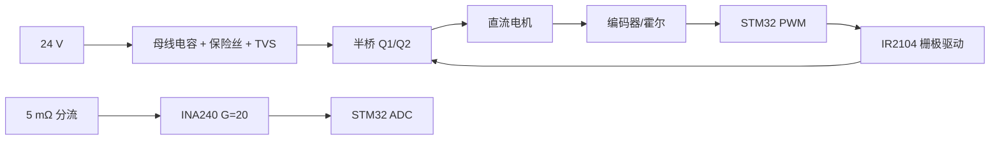

# 项目 3：MOSFET 驱动与直流电机控制板

> 文档编号：EHB-PROJ-03  
> 版本：v1.1.0  
> 状态：设计级（未打样、未实测）  
> 对应章节：第 07、10、11 章  
> 安全：完整版 24 V、峰值 15–20 A（B，需监护）；低功率版 12 V/2 A（A/B，可独立限流）

---

## 1. 需求分析

| 项 | 指标 |
|---|---|
| 母线 | 24 V（18–30 V） |
| 电机 | 有刷直流，24 V/100 W，额定 5 A，堵转 ≤15 A |
| 驱动 | 半桥，PWM 20 kHz，正反转/制动 |
| 电流采样 | 低边 5 mΩ，量程 0–15 A |
| 反馈 | 霍尔/编码器接口（ABZ 差分可选） |
| 保护 | 过流、欠压、过温、续流、反接 |
| 控制 | 3.3 V PWM + 使能/方向 |

> 电平提醒：IR2104 的 VIH 约 3.0 V，3.3 V 驱动余量较小；批量前必须确认，必要时加 5 V 缓冲/电平转换。

---

## 2. 系统框图



---

## 3. 方案比较

| 方案 | 优点 | 缺点 | 结论 |
|---|---|---|---|
| 集成 H 桥（DRV8871） | 简单、保护全 | 电流/电压受限 | 小功率备选 |
| 分立半桥 + IR2104 | 学习点全、可扩展 | 需自举/死区/保护 | **采用** |
| 三相驱动（DRV8323） | 适合 BLDC | 本项目有刷电机不需要 | 项目 6 使用 |

### 3.1 初学者低功率入门版（推荐先做）

| 项 | 完整版 | 低功率版 |
|---|---|---|
| 母线 | 24 V，峰值 15–20 A | **12 V，限流 2 A** |
| 电机 | 24 V/100 W | 12 V/10 W 级有刷 |
| 驱动 | 分立半桥 + IR2104 | **DRV8871/DRV8874 集成 H 桥** |
| 采样 | 5 mΩ + INA240 | 内置电流限制/低边采样（可选） |
| 保护 | 15 A 保险丝、TVS、泄放 | **2 A 保险丝、TVS、470 µF + 1 kΩ 泄放** |
| 目标 | 正反转/调速/限流/测速 | 正反转/调速/限流 |
| 等级 | B（监护） | **A/B（可独立，限流）** |

低功率版接线：12 V→2 A 保险丝→TVS→DRV8871 VM；电机接 OUT1/OUT2；PWM/IN1/IN2 接 3.3 V；GND 共地。不要接 24 V，不要堵转超过 2 s。

### 3.2 低功率版 BOM 与调试

| Ref | 器件 | 参数/说明 | 数量 |
|---|---|---|---|
| U1 | DRV8871 | 集成 H 桥，45 V/3.6 A 峰值 | 1 |
| M1 | 有刷电机 | 12 V/10 W 级 | 1 |
| F1 | 保险丝 | 2 A 慢断 | 1 |
| D1 | TVS | 18 V 单向（SMBJ18A 级） | 1 |
| C1 | 电解 | 470 µF/25 V | 1 |
| C2 | 陶瓷 | 100 nF/50 V | 1 |
| R1 | 泄放 | 1 kΩ/2 W | 1 |
| J1/J2 | 端子 | 电机 2P；逻辑 4P（PWM/IN1/IN2/GND） | 2 |

低功率 BOM：[项目3_低功率_BOM.csv](BOM/项目3_低功率_BOM.csv)。

- ILIM 电阻按 DRV8871 Datasheet 公式设 1.5 A 限流；不确定时先按手册典型值，实测后调整。
- 电源用 12 V/2 A 适配器，带限流；首次上电限流 0.5 A。
- 调试：IN1=1/IN2=0，50% PWM，测电机电压/电流；反转；堵转 ≤2 s 看限流；运行 5 min，壳温 ≤80 °C。
- 验收：正反转/调速正常；限流动作；无 24 V 误接；无过热/异味。

---

## 4. 关键计算

### 4.1 MOSFET

选 60 V/30 A、$R_{ds(on)}=10\ \text{m}\Omega$（25 °C）、$Q_g=30$ nC。耐压 60 V > 24 V×1.5=36 V，留尖峰裕量。

导通损耗（5 A、D=0.5、高温 1.8 倍）：

$$
P_{cond}=25\times0.018\times0.5=0.225\ \text{W}
\tag{P3-1}
$$

开关损耗（20 kHz、tr=tf=100 ns）：

$$
P_{sw}=0.5\times24\times5\times20k\times200n=0.24\ \text{W}
\tag{P3-2}
$$

单管约 0.47 W；加驱动/死区按 0.6 W。

### 4.2 栅极驱动

$I_G=Q_g/t_r=30n/100n=0.3$ A；IR2104 峰值 0.2–0.6 A 级，配 10–22 Ω 栅极电阻。

自举电容：

$$
C_{boot}\ge\frac{30n}{0.5}=60\ \text{nF}
\tag{P3-3}
$$

取 100 nF/25 V，串 10 Ω 限流。

### 4.3 死区

IR2104 固定死区约 500 ns（以 Datasheet 为准）；20 kHz 周期 50 µs，500 ns 占 1%，可接受。若换驱动器，死区按 MOS 开关时间 + 裕量设置。

### 4.4 电流采样

5 mΩ、15 A → 75 mV；INA240 增益 20 → 1.5 V；功耗 $15^2\times0.005=1.125$ W，选 3 W 四端分流器。

### 4.5 母线电容

按每安培 100–220 µF 估算，5 A → 470–1000 µF；并联 10 µF 陶瓷。

---

## 5. 原理图（设计级）

```text
24V ──[F1 15A 慢断]──[TVS]──┬── Q1(高边) ── M+ ── 电机 ── M- ── Q2(低边) ── GND
                       └── C_bulk 1000µF + 10µF
IR2104: VCC=12V, IN=PWM, SD=EN, HO→Q1, LO→Q2, VS→M+
Q2 源极 ── 5mΩ ── GND；INA240 跨接 5mΩ，输出→ADC
```

保护：Q1/Q2 栅极 10 kΩ 下拉、栅极串 10–22 Ω、续流用体二极管 + 可选肖特基、母线 TVS、保险丝、反接 MOSFET。

**安全**：1000 µF 母线电容并联 1 kΩ/2 W 泄放电阻；首次上电用限流/预充电，断电等待 ≥10 s 再触碰；电机固定、加防护。

---

## 6. BOM

[BOM/项目3_BOM.csv](BOM/项目3_BOM.csv)。

关键：MOSFET 60 V/30 A×2、IR2104、INA240、5 mΩ/3 W、1000 µF/35 V、TVS 33 V、栅极电阻/下拉、散热片。

---

## 7. 仿真

[仿真/项目3_hbridge.cir](仿真/项目3_hbridge.cir)：PWM 源 + 半桥 + 电机 RL + 续流，观察 Vds/电流/死区。**未运行验证**。

---

## 8. PCB 设计要点（未提供工程文件）

- 功率环路：母线电容—Q1—Q2—采样—地，面积最小。
- 栅极回路：IR2104—Rg—G—S，短且窄。
- 采样开尔文，走线到 INA240 差分对。
- 功率地/信号地单点；散热铜皮/过孔。
- 电机/编码器连接器分开；TVS 靠入口。
- SW 节点铜皮小，避免天线。

---

## 9. 上电检查

- [ ] 母线对地无短路；限流 200 mA、24 V 上电。
- [ ] 12 V 驱动电源正常；IR2104 VCC/VS。
- [ ] 无 PWM 时 Q1/Q2 均关断（Vgs≈0）。
- [ ] 50% PWM、空载，测 Vds/相电压。
- [ ] 电流采样零点/增益。

---

## 10. 测试与验收

| 测试 | 目标 |
|---|---|
| 空载 PWM | 相电压占空比正确，无直通 |
| 1 A/5 A 负载 | 转速/电流线性，Vds 振铃 <10 V 过冲 |
| 堵转 | 过流保护在 15 A 内动作 |
| 温升 | 5 A 连续 10 min，MOS 壳温 ≤80 °C |
| 编码器 | 方向/计数正确，丢脉冲 0 |
| EMI | 近场扫描无明显热点（预测试） |

---

## 11. 故障排查

| 现象 | 原因 |
|---|---|
| 上电炸管 | 直通/极性/自举/栅极悬空 |
| 不转 | PWM/EN/相序/电机 |
| 一加载就过流 | 堵转/采样增益错/死区不足 |
| 发热 | 驱动不足/开关损耗/散热 |
| 编码器乱 | 干扰/终端/线序 |

---

## 12. 改进方向

- 加硬件过流比较器（快速关断）。
- 加制动斩波/母线泄放。
- 改三相 + FOC（项目 6）。
- 4 层功率板、屏蔽、EMC 预测试。
