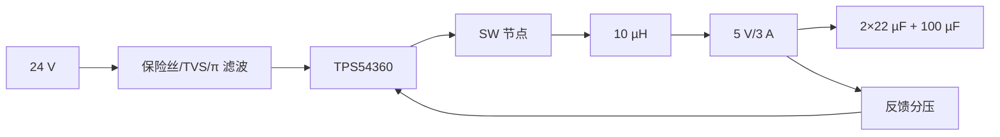

# 项目 4：低压 BUCK 降压电源（24 V→5 V/3 A）

> 文档编号：EHB-PROJ-04  
> 版本：v0.3.0  
> 状态：设计级（未打样、未实测）  
> 对应章节：第 08、10、11 章  
> 安全：24 V 输入、5 V/3 A 输出、≤20 W

---

## 1. 需求分析

| 项 | 指标 |
|---|---|
| 输入 | 18–30 V DC（标称 24 V） |
| 输出 | 5.0 V ±2% |
| 电流 | 0–3 A |
| 纹波 | ≤50 mV（20 MHz 带宽） |
| 效率 | ≥88% |
| 开关频率 | 500 kHz（TPS54360，按 RT 设置） |
| 保护 | 输入反接/浪涌、输出短路/过流、过热 |

---

## 2. 系统框图



---

## 3. 方案比较

| 方案 | 优点 | 缺点 |
|---|---|---|
| LDO | 简单、低噪声 | 24→5 V/3 A 功耗 57 W，不可行 |
| TPS54360 非同步 | 便宜、3 A、外围少 | 二极管损耗，效率略低 |
| 同步 BUCK | 效率高 | 成本/复杂度高 |

采用 TPS54360（60 V/3.5 A，非同步）。**注意**：TPS54331 的绝对最大输入仅 28 V，24 V 母线加浪涌/TVS 钳位后可能超限，不适合本项目；这是审查中修正的关键选型问题。

---

## 4. 参数计算

### 4.1 占空比与电感

$$
D=\frac{V_{out}}{V_{in}}=\frac{5}{24}=0.208
\tag{P4-1}
$$

取 $\Delta I_L=30\%\times3=0.9$ A：

$$
L=\frac{V_{out}(1-D)}{\Delta I_L f_{sw}}
=\frac{5\times0.792}{0.9\times500k}=8.8\ \mu\text{H}
\tag{P4-2}
$$

取 10 µH，饱和电流 ≥5 A，DCR ≤20 mΩ。

### 4.2 输出电容

$$
C_{out}\ge\frac{\Delta I_L}{8f_{sw}\Delta V}
=\frac{0.9}{8\times500k\times0.05}=4.5\ \mu\text{F}
\tag{P4-3}
$$

取 2×22 µF 陶瓷 + 100 µF 电解，覆盖 ESR/瞬态。

### 4.3 反馈分压

TPS54360 参考 0.8 V：

$$
V_{out}=0.8\left(1+\frac{R_1}{R_2}\right)
\Rightarrow
R_1/R_2=5.25
\tag{P4-4}
$$

取 R2=10 kΩ，R1=52.3 kΩ（1%）。

### 4.4 损耗估算

- 电感 DCR：$3^2\times0.02=0.18$ W。
- 二极管：$V_F\times I_{out}\times(1-D)\approx0.5\times3\times0.79=1.19$ W（非同步，主要损耗）。
- 开关/驱动：约 0.3 W。
- 总约 1.7 W，效率约 90%。

---

## 5. 原理图（设计级）

```text
24V ──[F1 3A]──[TVS 33V]──[π: 10µF/电感/10µF]── VIN
VIN ── C_in 10µF ── GND
SW ── L 10µH ── 5V ── C_out 2×22µF + 100µF ── GND
5V ── R1 52.3k ── FB ── R2 10k ── GND
SW ── D1 肖特基 40V/3A ── GND
```

布局：输入电容紧贴 VIN/GND；SW 节点短；电感靠近 SW；反馈从输出电容取，远离 SW；功率地/信号地单点。

**安全**：输入 10 µF 并联 1 kΩ 泄放电阻；首次上电限流 ≤100 mA，断电等待 ≥10 s；输出短路测试用限流电源。

---

## 6. BOM

[BOM/项目4_BOM.csv](BOM/项目4_BOM.csv)。

关键：TPS54360、10 µH/5 A、肖特基 40V/3A、22 µF/16V×2、100 µF/16V、52.3k/10k 1%、TVS、保险丝。

---

## 7. 仿真

[仿真/项目4_buck.cir](仿真/项目4_buck.cir)：理想开关 + 二极管 + L/C + 负载，观察纹波/电感电流。**未运行验证**。

---

## 8. 上电检查

- [ ] 输入/输出无短路；限流 100 mA 上电。
- [ ] 空载 5 V±2%；SW 波形正常。
- [ ] 加 1 A/3 A 负载，电压/纹波/温升。
- [ ] 短路保护/恢复。
- [ ] 效率曲线（0.5/1/2/3 A）。

---

## 9. 测试与验收

| 测试 | 目标 |
|---|---|
| 空载/满载电压 | 4.9–5.1 V |
| 纹波 | ≤50 mV（20 MHz BW，地弹簧） |
| 负载调整率 | ≤1% |
| 效率 | ≥88%（24 V→5 V/3 A） |
| 瞬态 | 50–100% 跳变，ΔV≤150 mV |
| 温升 | 电感/二极管/MOS ≤100 °C |
| 短路 | 保护并恢复 |

---

## 10. 故障排查

| 现象 | 原因 |
|---|---|
| 无输出 | EN/反馈/电感/焊接 |
| 输出电压高 | 反馈分压错/开环 |
| 纹波大 | 输入电容远/电感小/探头测法 |
| 发热 | 二极管损耗/电感 DCR/布局 |
| 一加载掉压 | 限流/电感饱和/输入不足 |

---

## 11. 改进方向

- 换同步 BUCK 提升效率。
- 加输入/输出共模滤波。
- 加 PGOOD/使能时序。
- 4 层板 + 完整地平面，做传导/辐射预测试。
