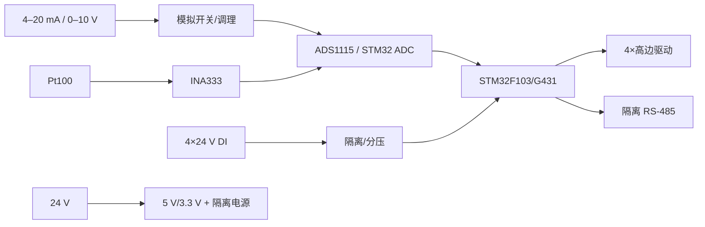

# 项目 5：多传感器采集与控制板

> 文档编号：EHB-PROJ-05  
> 版本：v0.3.0  
> 状态：设计级（未打样、未实测）  
> 对应章节：第 05、06、09、10 章  
> 安全：24 V、≤2 A

---

## 1. 需求分析

| 项 | 指标 |
|---|---|
| 模拟输入 | 4 路 4–20 mA、2 路 0–10 V、1 路三线 RTD |
| 数字输入 | 4 路 24 V DI（漏/源可配） |
| 数字输出 | 4 路 24 V DO（高边，≤0.5 A/路） |
| 通信 | 隔离 RS-485（Modbus RTU） |
| 供电 | 24 V±20%，板内 5 V/3.3 V |
| 隔离 | RS-485 1 kV；DI/DO 可选隔离 |
| 精度 | AI ≤±0.5% FS |

---

## 2. 系统框图

---

## 3. 关键设计

### 3.1 4–20 mA 输入

150 Ω 采样电阻：

$$
V=4\text{ mA}\times150=0.6\ \text{V}\ \text{到}\ 20\text{ mA}\times150=3.0\ \text{V}
$$

留 0.3 V 余量给串联保护/走线压降，避免 20 mA 时顶到 3.3 V 轨。若用 165 Ω，20 mA 正好 3.3 V，没有余量，不推荐。

### 3.2 0–10 V 输入

分压 10 kΩ/4.3 kΩ → 0–3.0 V；加 TVS/RC；输入阻抗足够高。

### 3.3 DI/DO

- DI：24 V 经 10 kΩ/4.7 kΩ 分压 + 钳位 + RC，光耦/数字隔离可选。
- DO：高边开关（如 BSP452/智能高边），带过流/过热；感性负载加续流。

### 3.4 隔离 RS-485

隔离收发器（ISO3082/ADM2582E，3.3 V）+ 隔离 DC-DC（B0505S）；终端 120 Ω、偏置、TVS。若用 5 V 的 ADM2483，必须处理 3.3 V MCU 侧的 RXD/TXD 电平。

---

## 4. BOM（摘要）

[BOM/项目5_BOM.csv](BOM/项目5_BOM.csv)。

关键：STM32F103/G431、ADS1115、INA333、150 Ω 0.1%、高边驱动、隔离 RS-485、B0505S、TVS、24 V 保险丝/反接保护。

---

## 5. PCB 设计要点（未提供工程文件）

- 4 层：模拟区/数字区/隔离区/电源区分区。
- 4–20 mA 输入走线远离 DC-DC/RS-485；采样电阻开尔文。
- 隔离带下方不得跨信号；隔离电源/信号隔离器分界清晰。
- DI/DO 连接器靠板边，TVS/保险丝靠入口。
- 24 V 功率地与信号地单点；机壳地/PE 处理。

---

## 6. 测试与验收

| 测试 | 目标 |
|---|---|
| 4–20 mA | 4/12/20 mA 对应 0/50/100%，误差 ≤±0.5% FS |
| 0–10 V | 0/5/10 V 误差 ≤±0.5% FS |
| RTD | 0/100/200 °C 误差 ≤±0.5 °C |
| DI/DO | 24 V 输入/输出，隔离耐压 |
| RS-485 | 100 m/115.2 kbps 误码 0 |
| EMC | ESD/EFT 后功能正常（预测试） |

---

## 7. 故障排查

| 现象 | 原因 |
|---|---|
| 4–20 mA 读数低 | 采样电阻/环路电压不足/接线 |
| 0–10 V 超量程 | 分压比/钳位 |
| RTD 跳变 | 地环路/屏蔽/激励 |
| DO 不动作 | 高边驱动/续流/负载短路 |
| RS-485 误码 | 终端/隔离/地环路 |

---

## 8. 改进方向

- 加隔离放大/隔离 ADC。
- 加 TVS/浪涌全保护。
- 加校准 EEPROM。
- 做 EMC 预测试与 72 h 烤机。
