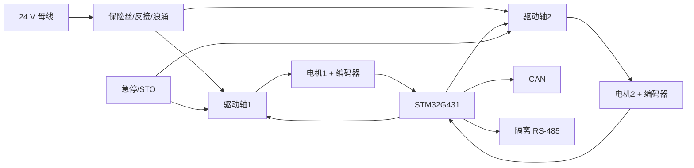

# 项目 6：智能装备综合控制板（两轴）

> 文档编号：EHB-PROJ-06  
> 版本：v1.1.0  
> 状态：设计级（未打样、未实测）  
> 对应章节：第 07、09、12 章  
> 安全：完整版 24 V、峰值 20 A、≤300 W（C，必须监护）；独立实操按 D；单轴 12 V/2 A 替代为 B

---

## 1. 需求分析

| 项 | 指标 |
|---|---|
| 控制对象 | 两轴运动平台（BLDC/PMSM + 编码器） |
| 主控 | STM32G431（或 F411） |
| 驱动 | 2× 三相栅极驱动 + 6×MOSFET/轴（或 2×DRV8323） |
| 反馈 | 2× 增量编码器（差分 ABZ）+ 霍尔 |
| 通信 | CAN 1 Mbps + 隔离 RS-485 |
| 安全 | 急停、STO/使能、限位、抱闸、过流/过温 |
| 电源 | 24 V 母线，板内 12 V/5 V/3.3 V |
| 环境 | 0–40 °C，粉尘/振动 |

---

## 2. 系统框图

---

## 3. 方案比较

| 方案 | 优点 | 缺点 |
|---|---|---|
| 分立栅极驱动 + 6 MOS/轴 | 灵活、学习全 | 保护/布局复杂 |
| DRV8323 集成 | 集成电流采样/保护 | 成本/功率受限 |
| 外购伺服驱动器 | 快、可靠 | 硬件学习少 |

教学采用“分立/集成各一轴”或两轴 DRV8323，按功率选。

### 3.1 初学者替代与限制

- **完整版（24 V、双轴、峰值 20 A）等级 C**：必须有监护、护罩、急停、限流；**不得独自上电**。
- **独立实操按 D 管理**：只做框图/选型/仿真/案例研究，不做整机实物。
- **单轴低功率替代（B）**：12 V/2 A、DRV8871、单编码器、急停/限位；只做一轴往返/定位，不做双轴联动。
- **机械安全**：护罩、限位、急停、断电抱闸；不得空载高速/带人运行。

### 3.2 单轴低功率替代（B）

| 项 | 方案 |
|---|---|
| 母线 | 12 V/2 A，保险丝 2 A，TVS 18 V |
| 驱动 | DRV8871（或 DRV8874），限流 1.5 A |
| 电机 | 12 V/10 W 有刷 + 增量编码器 |
| 安全 | 急停切断驱动电源/使能（继电器或 nSLEEP）；限位开关；可选抱闸 |
| 控制 | STM32 PWM + 编码器 AB；只做一轴往返/定位 |
| 储能 | 470 µF/25 V + 1 kΩ/2 W 泄放 |

调试顺序：急停/限位先接线 → 12 V 限流 0.5 A 上电 → 低速点动 → 编码器方向/计数 → 往返定位 → 急停/限位/断线故障注入。
验收：急停能切断驱动；限位能停机；编码器不丢脉冲；连续 10 min 温升正常。**不做双轴联动、不做 24 V/20 A。**

---

## 4. 关键设计

### 4.1 母线

24 V、两轴各 8 A 峰值 → 母线 20 A；电容 ≥2200 µF + 10 µF 陶瓷；制动/泄放；TVS。

### 4.2 电流采样

每相 5 mΩ 低边/在线采样，DRV8323 内置 CSA 或 INA240；采样窗口与 PWM 对齐。

### 4.3 编码器

差分 ABZ（RS-422），120 Ω 终端，RC 滤波，屏蔽；与电机线分开。

### 4.4 安全

急停硬件切断驱动器使能/STO；限位硬/软双保险；抱闸断电抱死；故障码上报。

**安全**：2200 µF 母线并联 1 kΩ/5 W 泄放电阻；首次上电预充电/限流；急停后等待 ≥10 s 再维护；电机固定、加防护。

---

## 5. BOM（摘要）

[BOM/项目6_BOM.csv](BOM/项目6_BOM.csv)。

关键：STM32G431、2×DRV8323（或栅极驱动+MOS）、编码器接口、CAN 收发器、隔离 RS-485、急停/继电器、TVS、母线电容、散热。

---

## 6. PCB 设计要点（未提供工程文件）

- 功率区/控制区/接口区分区；功率地/信号地单点。
- 母线电容紧贴桥臂；相线短、粗；采样开尔文。
- 编码器/通信靠板边，TVS 靠入口；隔离带无跨线。
- 散热铜皮/过孔/散热片；热敏电阻靠近热点。
- 测试点：母线、3.3 V、各相、编码器、CAN。

---

## 7. 上电与联调

1. 单板电源/时钟/复位/SWD。
2. 单轴空载、低速、编码器方向。
3. 单轴电流环/速度环（驱动器/固件）。
4. 双轴联动、限位/急停。
5. 故障注入：急停、限位、过流、编码器断线、通信超时。
6. 连续 8 h、温升/振动。

---

## 8. 测试与验收

| 测试 | 目标 |
|---|---|
| 定位重复性 | ≤±0.1 mm（按机械） |
| 双轴联动 | 轨迹/同步误差符合指标 |
| 急停/STO | 硬件切断，停机时间符合要求 |
| 过流/过温 | 保护动作，可恢复 |
| 编码器 | 丢脉冲 0（1 m 线、PWM 运行） |
| 通信 | CAN/RS-485 误码 0 |
| 连续运行 | 8 h 无故障 |
| 温升 | 功率器件 ≤100 °C |

---

## 9. 故障排查

| 现象 | 原因 |
|---|---|
| 一轴动另一轴丢脉冲 | 编码器干扰/地环路/线束 |
| 急停后仍使能 | 安全回路软件单点/接线错 |
| 通信超时 | 终端/隔离/地电位 |
| 随机复位 | 母线跌落/地弹/EMI |
| 过热 | 散热/损耗/连续堵转 |

---

## 10. 改进方向

- 功能安全（STO/安全 PLC）按 ISO 13849 评估。
- 加制动斩波/能量回馈。
- 4 层/6 层功率板、屏蔽、EMC 认证。
- 加诊断日志/远程维护。
