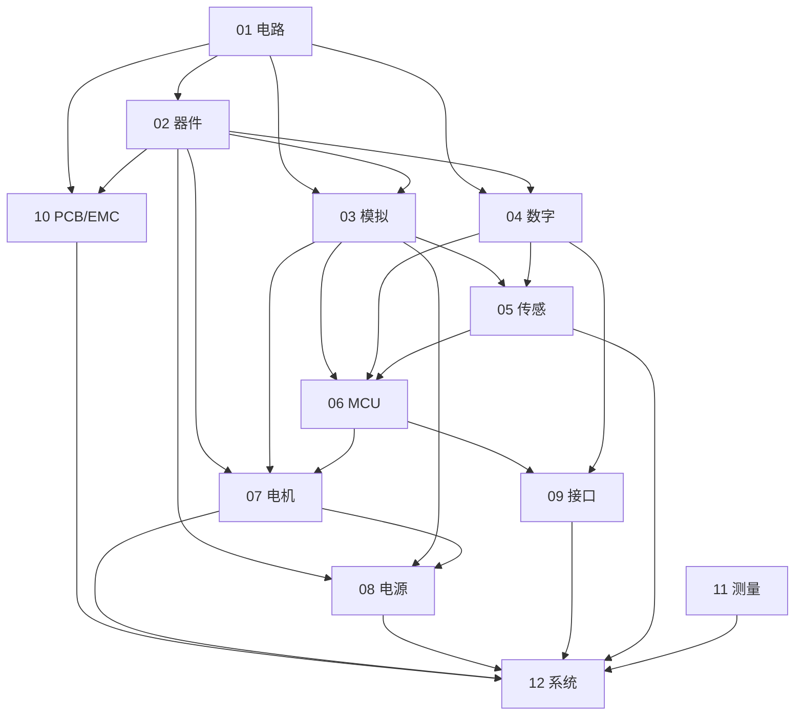

# 学习路线与能力地图

> 版本：v1.1.0  
> 用途：替代固定 78 周时间表；以“阶段目标 + 知识门槛 + 实践任务 + 能力验收”组织。  
> 说明：时间只是估算，可按学期/课程/个人进度调整；不要为了赶进度跳过安全与基础。

---

## 1. 先看终点：十项能力

| 编号 | 能力 | 可观察证据 |
|---|---|---|
| C1 | 理解元器件与参数 | 能从 Datasheet 提取 10 个关键参数并说明条件 |
| C2 | 分析模拟/数字电路 | 能算增益/带宽/阻抗/时序，指出风险 |
| C3 | 读原理图/参考设计 | 能拆成电源/时钟/复位/接口/保护五块 |
| C4 | 传感器接口与调理 | 能设计并实测一条从传感器到 ADC 的链 |
| C5 | MCU 外围与控制板 | 能完成一块 STM32 板并 bring-up |
| C6 | 电机/电源/功率 | 能解释半桥/三相/BUCK，算损耗与保护 |
| C7 | PCB/EDA | 能走完原理图→PCB→Gerber，DRC 清零 |
| C8 | 测量/调试/故障定位 | 能用仪器把故障定位到器件/网络 |
| C9 | 系统集成 | 能把传感/控制/驱动/通信/电源/安全集成 |
| C10 | 自主学习 | 能检索/评估/复现新器件/新方案 |

---

## 2. 知识地图：三链一保障

| 链 | 章节 | 回答 |
|---|---|---|
| 信号链 | 03、05 | 物理量如何变成可信数字 |
| 能量链 | 07、08 | 电能如何驱动执行器 |
| 信息链 | 04、06、09 | 数字信息如何传输/协同 |
| 保障链 | 10、11 | 板子如何在真实环境长期工作 |
| 地基 | 01、02 | 电路与器件 |
| 综合 | 12 | 多模块系统 |
| 索引 | 13 | 资料/术语 |

依赖关系：



---

## 3. 阶段路线（能力驱动）

> 每个阶段给出“必修 / 建议 / 进阶”。必修不过关，不进入下一阶段；建议/进阶可后补。
> 时间估算按每周 8–10 小时；课程繁忙时可按学期顺延。

### S0 起步：安全、工具、测量

| 项 | 内容 |
|---|---|
| 必修 | 安全规则、万用表/电源/示波器、焊接、记录 |
| 建议 | 读第 00 章、第 11 章 11.1–11.3 |
| 进阶 | 逻辑分析仪、电子负载（没有可后补） |
| 实践 | 限流点亮 LED、测 1 kHz 方波、焊 10 点 |
| 门槛 | 能正确设置限流、用 ×10 探头、解释电流档串联 |
| 估算 | 1–2 周（4–6 h/周） |

### S1 电路与器件

| 项 | 内容 |
|---|---|
| 必修 | 01 全章、02 全章；实验 1–5 |
| 建议 | LTspice 跑通 RC/二极管 |
| 进阶 | 二阶 RLC、噪声/公差（可先跳过推导） |
| 实践 | 分压/戴维南、RC、二极管、BJT 开关、MOSFET 开关 |
| 门槛 | 分压误差 ≤5%、τ 误差 ≤10%、能算 MOSFET 损耗 |
| 估算 | 6–10 周 |

### S2 模拟与数字

| 项 | 内容 |
|---|---|
| 必修 | 03 全章、04 全章；实验 6–10 |
| 建议 | 运放/滤波/ADC 的“算—仿—测”对照 |
| 进阶 | 噪声预算、稳定性、Sallen-Key Q（可先会用） |
| 实践 | 运放增益/带宽、二阶低通、比较器、逻辑/触发、ADC 采样 |
| 门槛 | 增益误差 ≤2%、fc 误差 ≤10%、能算 LSB/SNR/ENOB |
| 估算 | 8–12 周 |

### S3 传感与 MCU

| 项 | 内容 |
|---|---|
| 必修 | 05、06；项目 1、2 |
| 建议 | 电桥/RTD + INA + ADC 完整链；STM32 最小系统 |
| 进阶 | 24 位 Σ-Δ、低噪声布局（可后补） |
| 实践 | 传感器采集、STM32 板 bring-up、UART/SPI/I2C |
| 门槛 | 采集精度 ≤±1% FS；3.3 V 纹波 ≤20 mV；SWD/外设正常 |
| 估算 | 8–12 周 |

### S4 功率与电源

| 项 | 内容 |
|---|---|
| 必修 | 07、08；项目 3 低功率版、项目 4 |
| 建议 | 半桥/栅极驱动/电流采样；BUCK 效率/纹波 |
| 进阶 | 三相/FOC 硬件需求、环路补偿、磁性（可后补） |
| 实践 | 12 V/2 A 低功率电机驱动；24 V→5 V/3 A BUCK |
| 门槛 | 无直通、过流保护动作；BUCK 效率 ≥88%、纹波 ≤50 mV |
| 估算 | 8–12 周 |

### S5 接口、PCB、测量

| 项 | 内容 |
|---|---|
| 必修 | 09、10、11；项目 5 |
| 建议 | RS-485/CAN 长线、4 层板、EMC 预测试 |
| 进阶 | 隔离/浪涌/阻抗/眼图（可后补） |
| 实践 | 接口板、4 层控制板、故障注入 |
| 门槛 | 通信误码 0；DRC 清零；能定位一次电源/通信故障 |
| 估算 | 8–12 周 |

### S6 系统集成

| 项 | 内容 |
|---|---|
| 必修 | 12、13；项目 6（C 级，需监护） |
| 建议 | 双轴/多传感器系统、ICD、安全联锁 |
| 进阶 | 功能安全、可靠性/环境试验（可后补） |
| 实践 | 整机联调、故障注入、8 h 连续运行 |
| 门槛 | 5 类故障安全停机；文档包完整；能解释取舍 |
| 估算 | 8–12 周 |

---

## 4. 必修 / 建议 / 进阶怎么分

- **必修**：不懂就会做错/危险/无法继续（如 KCL、MOSFET 开关、ADC 采样、限流）。
- **建议**：能提高成功率，但可以边做边补（如 LTspice、Sallen-Key Q、EMC 预测试）。
- **进阶**：方向深入/高阶理论（FOC 整定、磁性设计、高速 SI、功能安全认证）。标注 C/D，不阻塞主线。

---

## 5. 与大学课程/C++/STM32 并行

| 并行项 | 建议 |
|---|---|
| 电路/模电/数电课程 | 课程学理论，手册做实验/仿真；不要重复刷题 |
| C/C++ | 第 06 章开始用 C 验证 GPIO/UART/ADC；不要求先学完 C |
| STM32 | 第 04 章后即可点灯/串口；硬件最小系统在第 06 章 |
| 英语 | 每章读 1 份英文 Datasheet/AN，积累术语 |
| 竞赛/项目 | 用项目 1/2 练手；不要一上来做项目 6 |

**避免同时高强度**：一个阶段最多 1 个主项目 + 1 个观察项目；课程考试周减半。

---

## 6. 方向分支（S4 后）

| 方向 | 加权重 | 可后补 |
|---|---|---|
| 运动控制/机器人 | 07、08、12 | FOC、编码器协议、关节热 |
| 电源 | 08、10 | 磁性、环路、PFC/LLC、安规 |
| 精密传感/测量 | 03、05、11 | 低噪声、24 位 ADC、标定 |
| 工业控制 | 09、12 | 隔离、功能安全、工业以太网 |
| 测试测量 | 11、03 | 仪器前端、校准、高速采集 |

所有方向都必须完成 01/02/03/04/06/10/11 的共同基础。

---

## 7. 学习进度记录模板（复制到自己的笔记）

```markdown
# 学习进度（更新日期：____）

## 当前阶段
S__：________

## 已学章节
- [ ] 01
- [ ] 02
...

## 已完成实验
- [ ] 实验 1 分压
...

## 已完成项目
- [ ] 项目 1 传感器采集（状态：设计/仿真/PCB/实测）
...

## 尚未掌握
1. ________（具体到节/公式/电路）
2. ________

## 下一步（本周/本月）
1. ________
2. ________

## 卡点/需要帮助
- ________
```

**建议频率**：每周 5 分钟；每阶段末复盘一次。

---

## 8. 能力验收（阶段门禁）

进入下一阶段前，至少满足：

- 能不看书画出该阶段的核心电路/框图；
- 能独立完成该阶段 1 个实验/项目，并有记录；
- 能解释 3 个“为什么”（为什么这样选、为什么这个值、坏了会怎样）；
- 无安全违规；
- 关键计算/测量有数据，不是“感觉对”。

---

## 9. 调整节奏

- **课程忙**：只保必修 + 1 个实验；建议/进阶顺延。
- **基础弱**：S1/S2 加长，先补数学/电路；不要跳。
- **有基础**：用项目验收代替重复阅读；仍要完成安全/测量。
- **方向明确**：S4 后加权，但共同基础不砍。

---

## 10. 章节/资源索引

- 章节入口：[README](README.md) 第 3 节。
- 实验：[基础实验手册](12_智能装备综合硬件系统/实验/00_基础实验手册.md)。
- 项目：[项目总览](12_智能装备综合硬件系统/项目/00_项目总览.md)。
- 安全：[安全与实践须知](安全与实践须知.md)。
- 维护：[维护记录](维护记录.md)。

---

## 11. 学完能做什么（如实说明）

| 阶段 | 能做 | 还不能 |
|---|---|---|
| 基础 01–04 | 电路分析、器件判断、运放/滤波/比较器/ADC 基础设计、读 Datasheet | 独立 PCB/系统、复杂 EMC/热 |
| 核心 05–11 | 传感器链、STM32 最小系统、半桥/三相、BUCK、RS-485/CAN、4 层板、测量与故障定位 | 量产级 EMC/安规/功能安全、高压/大功率/高速 |
| 6 个项目后 | 需求→框图→选型→计算→BOM→仿真→测试计划的设计级方案；测试/验收/故障文档 | PCB 实操、打样、实测、EMC/热/可靠性经验 |
| 方向深入 | 运动控制/电源/精密传感/工业控制/测试测量 | 需项目/工作积累，不能靠本书速成 |

**不承诺**：学完即上岗、达到资深工程师、薪资/就业结果。

